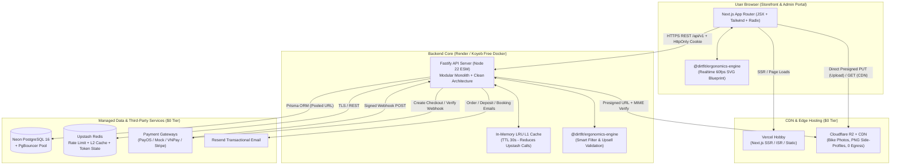
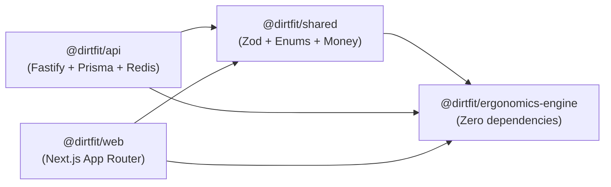

# 01. System Architecture & Monorepo Structure

> **Status:** Single Source of Truth (Master Plan)  
> **Language Mandate:** 100% Pure JavaScript (ES Modules / ESM — `"type": "module"`), JSDoc for editor type hints, Zod for runtime validation. **Zero TypeScript (`.ts`, `.tsx`, `tsconfig.json`).**  
> **Runtime & Tooling:** Node.js 22 LTS (`>=22.11.0 <23`) + `pnpm` 10.x (`10.28.2`) + Turborepo 2.x (`2.11.13`).

---

## 1. High-Level System Architecture

DirtFit Commerce follows a **Decoupled Web + Modular Monolith API** architecture inside a unified Monorepo:

- **`apps/web` (Next.js App Router — Pure JavaScript `.jsx`)**: Handles SSR/ISR for catalog SEO, 60fps browser-side rendering of the 2D Rider Fit Simulator (running `@dirtfit/ergonomics-engine` locally for 0ms slider latency), and the Admin Portal. **`apps/web` never connects directly to PostgreSQL** — all reads and writes go through the `/api/v1` REST API on `apps/api` to enforce RBAC, Zod validation, Idempotency, and Audit Logging at a single boundary.
- **`apps/api` (Fastify Modular Monolith — Pure JS ESM)**: Business core structured via Clean Architecture (Routes/Controller → UseCase/Service → Domain → Repository). Shares `@dirtfit/ergonomics-engine` for server-side *"Find bikes that fit me"* filtering, accessory upsell scoring, and saving rider fit snapshots on orders and test-ride bookings.
- **`packages/ergonomics-engine` (Zero-Dependency Pure JS ESM Engine)**: Contains all suspension sag, seat-width wrap, foot-contact physics, and 2D analytical inverse kinematics (Rider Triangle). Has zero DOM or Node-only dependencies — runs identically on Browser and Node.js.
- **`packages/shared` (Pure JS ESM + Zod)**: Contains shared Zod schemas (`.strict()`), enums, error code registry, VND money helpers (`toSafeVndNumber()` / `toVndBigInt()`), and JSDoc `@typedef` definitions.

### End-to-End System Flow



---

## 2. Pure JavaScript (ESM) Engineering Standards

To keep a **100% Pure JavaScript** codebase as disciplined, refactor-safe, and IDE-friendly as a statically typed repo without TypeScript compilation overhead, the following 6 standards are mandatory:

| Concern | Pure JS ESM Standard | Technical Rationale |
| :--- | :--- | :--- |
| **Module System** | `"type": "module"` in every `package.json`; relative Node imports **must include `.js` extensions** (`./sag.js`). | Native Node 22 ESM standard; eliminates CJS/ESM interop conflicts between Fastify and Next.js. |
| **Internal Packages (Zero-Build)** | `packages/ergonomics-engine` and `packages/shared` export raw `.js` files via `"exports"` in `package.json`; Next.js declares `transpilePackages`. | Zero intermediate build step (no Rollup/esbuild needed for packages) — edits to physics formulas take effect immediately in both API and Web. |
| **Type Hints & IDE IntelliSense** | Standard **JSDoc (`@typedef`, `@param`, `@returns`)** + `eslint-plugin-jsdoc` + `jsconfig.json` (IDE IntelliSense & path aliases only; **no `tsconfig.json`**, no `.ts`). | Preserves editor autocomplete and JSDoc tag/type validation while remaining 100% pure JavaScript. |
| **Validation & OpenAPI Sync** | **Zod `3.25.76`** + **`fastify-type-provider-zod@4.0.2`** + **`@fastify/swagger@9.9.5`**. | Pure runtime JS: a single `.strict()` Zod schema validates incoming payloads, strips/serializes responses, and auto-generates OpenAPI 3.0 specs. Pinning `zod@3.25.76` (v3 line with `./v3` export) ensures zero peer-dependency conflicts with `zod-to-json-schema`. |
| **Prisma ORM in Pure JS** | Centralized schema at `apps/api/prisma/schema.prisma`, generating JS `@prisma/client`; imported via `import { PrismaClient } from '@prisma/client'`. | Keeps Prisma native engines strictly out of `apps/web` (Vercel serverless); works natively in Node ESM. |
| **Currency (VND `BigInt` → Safe `Number`)** | PostgreSQL/Prisma stores VND columns as **`BIGINT` (`BigInt`)**. **Mandatory Repository/Mapper rule:** convert every `BigInt` field to a JS safe integer `Number` (safe up to `Number.MAX_SAFE_INTEGER` ≈ 9 quadrillion VND) via `toSafeVndNumber()` before returning to Service/DTO/JSON/Next.js Client Components; convert back via `toVndBigInt()` on DB writes. | Multi-bike Adventure orders easily exceed 32-bit `INT4` (~2.147B VND), requiring `BIGINT` in PostgreSQL. Converting `BigInt -> Number` at the Repository/Mapper boundary completely prevents `TypeError: Do not know how to serialize a BigInt` across JSON APIs and RSC boundaries. |

### Locked Compatible Stack Versions

| Layer / Package | Locked Version | Compatibility Rationale |
| :--- | :--- | :--- |
| **Runtime & Monorepo** | `node >=22.11.0 <23`, `pnpm@10.28.2`, `turbo@2.11.13` | Native ESM, workspace protocol, Turborepo v2 `tasks` |
| **Lint, Format & Test** | `eslint@9.39.5`, `@eslint/js@9.39.5`, `eslint-plugin-jsdoc@65.5.4`, `eslint-plugin-react@7.37.5`, `eslint-plugin-react-hooks@5.2.0`, `eslint-config-prettier@10.1.8`, `prettier@3.10.1`, `vitest@3.2.7` | Avoids `eslint-config-next` because it pulls `typescript` as a peer dependency |
| **Backend (`apps/api`)** | `fastify@5.12.8`, `zod@3.25.76`, `fastify-type-provider-zod@4.0.2`, `@fastify/swagger@9.9.5`, `@fastify/swagger-ui@6.1.5`, `@fastify/helmet@13.2.0`, `@fastify/cors@11.4.3`, `@fastify/cookie@11.1.5`, `@fastify/rate-limit@11.3.0`, `@fastify/jwt@10.2.9`, `prisma@6.19.3`, `@prisma/client@6.19.3`, `argon2@0.45.2`, `ioredis@6.1.0`, `lru-cache@11.5.3` | `zod@3.25.76` exports `./v3` required by `zod-to-json-schema`, pairing cleanly with `fastify-type-provider-zod@4.0.2` on Fastify 5 with zero peer warnings |
| **Shared (`packages/shared`)** | `zod@3.25.76` | Matches `apps/api` Zod version |
| **Engine (`packages/ergonomics-engine`)** | Zero external dependencies | Pure isomorphic math/kinematics for Browser & Node |
| **Frontend (`apps/web`)** | `next@15.5.29`, `react@19.2.9`, `react-dom@19.2.9`, `tailwindcss@3.4.19`, `postcss@8.5.33`, `autoprefixer@10.7.0` | Next.js 15 App Router Pure JSX (`output: 'standalone'`) |

---

## 3. Full Monorepo Directory Structure

```text
dirtfit-commerce/
├── .github/
│   └── workflows/
│       ├── pr-check.yml                 # Lint, Pure-JS check, Vitest, Prisma validate, Docker build, Trivy
│       ├── deploy-prod.yml              # Prisma migrate deploy + deploy API/Web
│       └── cron-sweeper.yml             # Secondary 15-min housekeeping sweeper
├── docs/
│   └── architecture/                    # Single Source of Truth (7 specs + README)
│       ├── README.md
│       ├── 01-system-architecture-monorepo.md
│       ├── 02-ergonomics-rider-fit-engine.md
│       ├── 03-database-design-prisma.md
│       ├── 04-backend-modules-api-security.md
│       ├── 05-frontend-ux-design-system.md
│       ├── 06-devops-docker-cicd-deploy.md
│       └── 07-implementation-roadmap.md
├── scripts/
│   └── check-pure-js.mjs                # CI/local guardrail banning .ts/.tsx/tsconfig/typescript
├── packages/
│   ├── ergonomics-engine/               # @dirtfit/ergonomics-engine (Pure JS ESM, 0 deps)
│   │   ├── package.json
│   │   ├── src/
│   │   │   ├── index.js                 # Public entry point + JSDoc exports
│   │   │   ├── constants.js             # Anthropometric ratios, footwear profiles, gravity
│   │   │   ├── anthropometry.js         # Inseam estimator & body segment calculator
│   │   │   ├── sag.js                   # Static/Rider sag & spring rate physics
│   │   │   ├── foot-contact.js          # Effective seat height, seat width wrap & foot reach
│   │   │   ├── kinematics.js            # 2D analytical IK (Seated & Standing Attack modes)
│   │   │   ├── calibration.js           # Image UV <-> Real-world mm coordinate projection
│   │   │   ├── scoring.js               # Fit score (0-100) & Smart Upsell simulator
│   │   │   └── comparator.js            # Ghost Overlay dual-bike alignment engine
│   │   └── tests/
│   │       ├── sag.test.js
│   │       ├── foot-contact.test.js
│   │       ├── kinematics.test.js
│   │       ├── calibration.test.js
│   │       └── real-world-bikes.test.js # Benchmarks: KTM 350 EXC-F, CRF300L, Tenere 700
│   │
│   └── shared/                          # @dirtfit/shared (Pure JS ESM + Zod)
│       ├── package.json
│       ├── src/
│       │   ├── index.js
│       │   ├── enums.js                 # Roles, BikeCategories, OrderStatuses, Showrooms...
│       │   ├── money.js                 # toSafeVndNumber(), toVndBigInt(), formatVnd(), deposit calc
│       │   ├── errors.js                # Machine-readable error codes & RFC 7807 builders
│       │   └── schemas/                 # Shared Zod schemas (.strict())
│       │       ├── auth.schema.js
│       │       ├── bike.schema.js
│       │       ├── accessory.schema.js
│       │       ├── ergonomics.schema.js
│       │       ├── cart.schema.js
│       │       ├── order.schema.js
│       │       ├── test-ride.schema.js
│       │       └── common.schema.js     # Pagination, UUID, sort, search params
│       └── tests/
│           └── schemas.test.js
│
├── apps/
│   ├── api/                             # @dirtfit/api (Fastify Clean Modular Monolith)
│   │   ├── package.json
│   │   ├── Dockerfile                   # Multi-stage production build (non-root)
│   │   ├── .env.example
│   │   ├── scripts/
│   │   │   └── verify-stack-compat.mjs  # Runtime smoke test for Fastify 5 + Zod + Swagger
│   │   ├── prisma/
│   │   │   ├── schema.prisma
│   │   │   ├── migrations/
│   │   │   └── seed.js                  # 3 showrooms + 8+ realistic bikes + compatible parts
│   │   ├── src/
│   │   │   ├── server.js                # Entry point (graceful shutdown SIGINT/SIGTERM)
│   │   │   ├── app.js                   # Fastify factory (buildApp() for test inject())
│   │   │   ├── config/
│   │   │   │   ├── env.js               # Strict Zod validation for process.env
│   │   │   │   └── constants.js
│   │   │   ├── plugins/                 # Global Fastify plugins
│   │   │   │   ├── prisma.plugin.js
│   │   │   │   ├── redis.plugin.js      # Upstash Redis + local L1 LRU cache wrapper
│   │   │   │   ├── security.plugin.js   # Helmet, strict CORS, Cookie, Rate Limit
│   │   │   │   ├── swagger.plugin.js    # OpenAPI 3.0 + Swagger UI
│   │   │   │   ├── error-handler.plugin.js # RFC 7807 Problem Details formatter
│   │   │   │   └── auth.plugin.js       # JWT verify, RBAC preHandler factories
│   │   │   ├── common/
│   │   │   │   ├── http/                # Response envelope helpers, pagination
│   │   │   │   ├── idempotency/         # Idempotency-Key preHandler & DB lock service
│   │   │   │   ├── storage/             # Cloudflare R2 S3Client + magic bytes verifier
│   │   │   │   ├── email/               # Resend transactional templates
│   │   │   │   └── jobs/                # Lightweight reservation-expiry sweeper
│   │   │   └── modules/                 # Domain-driven Feature Modules
│   │   │       ├── health/
│   │   │       ├── auth/
│   │   │       ├── users/               # Profile + UserBodyProfile CRUD
│   │   │       ├── catalog/             # Brands, Bikes, GeometrySpec, Media Calibration
│   │   │       ├── accessories/         # Accessories + BikeAccessoryCompatibility
│   │   │       ├── simulator/           # Fit calc, Compare 2 bikes, Smart Filter, Upsell
│   │   │       ├── cart/                # Guest/Auth cart + Bike/Accessory combos
│   │   │       ├── orders/              # Checkout, Lazy Expiration, Locking, State Machine
│   │   │       ├── payments/            # Strategy Pattern (PayOS, Mock, COD, VNPay, Stripe)
│   │   │       ├── test-rides/          # 3-Showroom Test Ride Booking & Slot Manager
│   │   │       ├── uploads/             # Presigned R2 upload & validation
│   │   │       └── audit/               # Immutable AuditLog service & Admin query
│   │   └── tests/
│   │       ├── setup/                   # Isolated test DB & Redis helpers
│   │       ├── unit/                    # Order state machine, pricing, locking logic
│   │       └── integration/             # Fastify app.inject() E2E API test suites
│   │
│   └── web/                             # @dirtfit/web (Next.js App Router - Pure JSX)
│       ├── package.json
│       ├── next.config.mjs
│       ├── Dockerfile                   # Multi-stage standalone output (non-root)
│       ├── .env.example
│       ├── jsconfig.json                # Path aliases (@/*) for IDE IntelliSense
│       ├── tailwind.config.mjs
│       ├── postcss.config.mjs
│       ├── public/
│       │   └── blueprints/              # Fallback SVG wireframe silhouettes
│       └── src/
│           ├── app/
│           │   ├── layout.jsx           # Fonts (Be Vietnam Pro, Plus Jakarta Sans, JetBrains Mono)
│           │   ├── globals.css          # Design tokens CSS variables
│           │   ├── (storefront)/        # Public & Customer Storefront route group
│           │   │   ├── layout.jsx
│           │   │   ├── page.jsx         # Editorial Homepage
│           │   │   ├── bikes/
│           │   │   │   ├── page.jsx     # Catalog + Dual Filter (Terrain & Rider Fit)
│           │   │   │   └── [slug]/page.jsx # Bike Detail + Embedded 2D Simulator
│           │   │   ├── compare/page.jsx # Ghost Overlay 2-Bike Comparison
│           │   │   ├── accessories/page.jsx
│           │   │   ├── cart/page.jsx
│           │   │   ├── checkout/page.jsx
│           │   │   ├── test-ride/page.jsx
│           │   │   └── account/
│           │   │       ├── profile/page.jsx   # Saved Rider Body Profiles
│           │   │       ├── orders/page.jsx    # Order & Deposit tracking
│           │   │       └── test-rides/page.jsx
│           │   ├── (auth)/
│           │   │   ├── login/page.jsx
│           │   │   └── register/page.jsx
│           │   └── admin/               # Protected Admin & Sales Portal
│           │       ├── layout.jsx
│           │       ├── page.jsx         # Operational KPI Dashboard
│           │       ├── bikes/
│           │       │   ├── page.jsx
│           │       │   └── [id]/calibrate/page.jsx # Side-Profile Calibration Tool
│           │       ├── accessories/page.jsx # Compatibility Matrix Manager
│           │       ├── orders/page.jsx
│           │       ├── test-rides/page.jsx
│           │       ├── users/page.jsx
│           │       └── audit-logs/page.jsx
│           ├── components/
│           │   ├── ui/                  # Radix UI primitives styled with Industrial tokens
│           │   ├── simulator/           # 2D SVG Blueprint, Rider Skeleton, Sliders, Ghost Overlay
│           │   ├── catalog/             # BikeCard, FitFilterBar, SpecDrawer
│           │   ├── checkout/            # DepositBreakdown, PaymentSelector
│           │   └── admin/               # CalibrationCanvas, CompatibilityMatrixTable
│           ├── lib/
│           │   ├── api-client.js        # Fetch wrapper, auto-refresh cookie, RFC 7807 parser
│           │   ├── i18n/                # Dictionaries (vi.js default, en.js ready)
│           │   └── formatters.js
│           └── stores/                  # Lightweight React Context / Store (RiderProfile, Cart)
│
├── docker-compose.yml                   # Local infrastructure stack (Postgres 16, Redis 7, Adminer)
├── pnpm-workspace.yaml
├── turbo.json
├── package.json                         # Root scripts, ESLint 9 Flat Config, Prettier
├── eslint.config.mjs
├── .prettierrc
├── .prettierignore
├── .gitignore
└── README.md
```

---

## 4. Internal Backend Module Architecture (Clean Architecture)

Every feature module in `apps/api/src/modules/<module-name>/` enforces a strict 4-layer inward dependency rule (outer layers call inner layers; domain/repository layers never depend on HTTP/Fastify):

```text
modules/orders/
├── orders.routes.js          # Delivery Layer: URL, RBAC preHandler, Zod schema (OpenAPI)
├── orders.controller.js      # Adapter Layer: Extract user/body/idempotencyKey, call Service, return envelope
├── orders.service.js         # UseCase Layer: Orchestrate TX, Lazy Expiration, Locking, Payment Adapter, AuditLog
├── orders.domain.js          # Domain Layer: Pure functions (Order State Machine, Deposit & COD rules)
└── orders.repository.js      # Persistence Layer: Prisma queries, SELECT ... FOR UPDATE, BigInt -> Number mapper
```

### Modular Monolith Boundary Rules

1. **No cross-module direct table queries:** For example, `orders.service.js` does not query `bike_accessory_compatibility` directly; it invokes exported interfaces from `catalog`/`accessories` repositories (passing the active `Prisma.TransactionClient tx` when participating in an ACID transaction).
2. **Synchronous in-transaction consistency for core state:** Inventory locking (`InventoryReservation`), `BigInt -> Number` mapping boundaries, and `AuditLog` writes run inside the **same DB transaction** as the business mutation so state can never drift.
3. **Post-commit external side-effects:** Sending transactional emails via Resend or invalidating Redis cache keys executes **after** the DB transaction commits successfully (wrapped in `try/catch` warning logs so transient email failures never roll back paid orders).

---

## 5. Monorepo Package Dependency Graph



- **`@dirtfit/ergonomics-engine` never imports `api`, `web`, or `prisma`** — keeping browser bundle overhead minimal (`< 12 KB` gzipped) and enabling 100% pure unit testing.
- **`@dirtfit/shared`** may import physical range constants from `ergonomics-engine` to keep min/max bounds (e.g. `heightCm: 135..220`, `weightKg: 35..160`) strictly synchronized across physics formulas, frontend forms, and API validators.
- **Turborepo Pipeline (`turbo.json`)**: `lint`, `test`, `test:coverage`, and `build` run in parallel with dependency-aware caching (`^test`, `^build`); `pnpm dev` runs `apps/api` (`node --watch`) and `apps/web` (Next.js Turbopack) concurrently.
