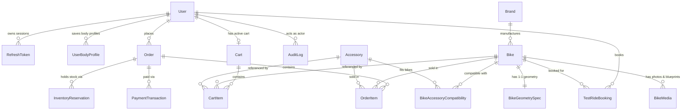

# 03. Database Design (ERD & Prisma Schema Draft)

> **RDBMS:** PostgreSQL 16 (Local Docker / Neon Free Tier with PgBouncer)  
> **ORM:** Prisma ORM (`prisma-client-js`, located at `apps/api/prisma/schema.prisma`)  
> **Core Design Principles:**
> 1. **PostgreSQL `BIGINT` → JS Safe `Number` Policy:** All VND currency columns are stored in PostgreSQL/Prisma as **`BigInt` (`BIGINT`)** to prevent 32-bit `INT4` overflow on multi-bike Adventure orders. **Mandatory JS/API rule:** every Repository/Mapper MUST convert all `BigInt` fields to JS safe integer `Number` (safe up to `Number.MAX_SAFE_INTEGER` ≈ 9 quadrillion VND) via `toSafeVndNumber()` before returning to Service, DTO, JSON responses, or Next.js Client Components (completely preventing `TypeError: Do not know how to serialize a BigInt`). Writes convert back via `toVndBigInt()`.
> 2. **Soft Delete (`deletedAt`)** on `User`, `Bike`, `Accessory`, and `Order` to preserve financial audit trails and order history.
> 3. **Dual Concurrency Control + Lazy Expiration:** Combines `SELECT ... FOR UPDATE` (Pessimistic Row Locking) + `InventoryReservation` (15-minute TTL holds) + `version` (Optimistic Locking) on `Bike` and `Accessory`, while **inline Lazy Expiration during stock availability checks and Checkout transactions** reclaims expired reservations (`expiresAt < NOW()`) immediately without waiting for 15-minute cron sweepers.
> 4. **Append-only `AuditLog`** storing `beforeState` / `afterState` snapshots for every admin price, stock, order status, calibration, and RBAC mutation.

---

## 1. Entity-Relationship Diagram (ERD)



---

## 2. Prisma Schema Draft (`apps/api/prisma/schema.prisma`)

```prisma
generator client {
  provider = "prisma-client-js"
}

datasource db {
  provider  = "postgresql"
  url       = env("DATABASE_URL")       // PgBouncer pooled URL (Neon)
  directUrl = env("DIRECT_URL")         // Direct non-pooled URL for prisma migrate deploy
}

// ============================================================================
// ENUMS
// ============================================================================

enum UserRole {
  CUSTOMER
  SALES_STAFF
  ADMIN
}

enum Gender {
  MALE
  FEMALE
  UNSPECIFIED
}

enum BodyProportion {
  SHORT_LEGS
  AVERAGE
  LONG_LEGS
}

enum FootwearType {
  SNEAKERS
  ADV_BOOTS
  MX_BOOTS
}

enum RidingExperience {
  BEGINNER
  INTERMEDIATE
  EXPERT
}

enum BikeCategory {
  MOTOCROSS
  ENDURO
  DUAL_SPORT
  ADVENTURE
  SUPERMOTO
}

enum RidingFocus {
  OFF_ROAD
  ON_OFF_MIXED
  ON_ROAD_ADV
}

enum SeatFoamFirmness {
  FIRM
  MEDIUM
  PLUSH
}

enum ProductStatus {
  DRAFT
  ACTIVE
  OUT_OF_STOCK
  DISCONTINUED
}

enum MediaType {
  HERO
  GALLERY
  SIDE_PROFILE_BLUEPRINT
  SPEC_SHEET
}

enum AccessoryCategory {
  LOWERING_LINK
  LOW_SEAT
  BAR_RISER
  FOOTPEG_LOWER
  SHOCK_SPRING
  PROTECTION
  APPAREL
  EXHAUST
  OTHER
}

enum ItemType {
  BIKE
  ACCESSORY
}

enum OrderType {
  BIKE_DEPOSIT       // Motorcycle deposit hold (+ optional accessories)
  FULL_PURCHASE      // 100% online payment (bikes + accessories)
  ACCESSORY_ONLY     // Accessories/gear only (eligible for COD within limit)
}

enum OrderStatus {
  PENDING_PAYMENT
  DEPOSIT_PAID
  PAID
  CONFIRMED
  PREPARING
  READY_FOR_HANDOVER
  SHIPPING
  COMPLETED
  CANCELLED
  EXPIRED
  REFUNDED
}

enum PaymentMethod {
  PAYOS
  MOCK // Local/Test/CI only (MockPaymentAdapter); strictly blocked in production
  VNPAY
  STRIPE
  COD
}

enum PaymentStatus {
  INITIATED
  PENDING
  SUCCEEDED
  FAILED
  REFUNDED
}

enum ReservationStatus {
  ACTIVE
  COMMITTED
  RELEASED
  EXPIRED
}

enum ShowroomCode {
  HN_LONG_BIEN
  DN_SON_TRA
  HCM_THU_DUC
}

enum TestRideStatus {
  PENDING
  CONFIRMED
  COMPLETED
  CANCELLED
  NO_SHOW
}

// ============================================================================
// 1. AUTHENTICATION, USERS & BODY PROFILES
// ============================================================================

model User {
  id                String            @id @default(uuid()) @db.Uuid
  email             String            @unique @db.VarChar(255)
  phone             String?           @db.VarChar(20)
  fullName          String            @map("full_name") @db.VarChar(120)
  passwordHash      String            @map("password_hash") @db.VarChar(255)
  role              UserRole          @default(CUSTOMER)
  isEmailVerified   Boolean           @default(false) @map("is_email_verified")
  isActive          Boolean           @default(true) @map("is_active")
  lastLoginAt       DateTime?         @map("last_login_at")
  createdAt         DateTime          @default(now()) @map("created_at")
  updatedAt         DateTime          @updatedAt @map("updated_at")
  deletedAt         DateTime?         @map("deleted_at")

  refreshTokens     RefreshToken[]
  bodyProfiles      UserBodyProfile[]
  cart              Cart?
  orders            Order[]
  testRideBookings  TestRideBooking[] @relation("CustomerTestRides")
  assignedTestRides TestRideBooking[] @relation("StaffTestRides")
  auditLogs         AuditLog[]

  @@index([role, isActive])
  @@index([deletedAt])
  @@map("users")
}

model RefreshToken {
  id                String    @id @default(uuid()) @db.Uuid
  userId            String    @map("user_id") @db.Uuid
  familyId          String    @map("family_id") @db.Uuid // Token family ID for reuse-attack revocation
  tokenHash         String    @unique @map("token_hash") @db.VarChar(64) // SHA-256 hex
  replacedByTokenId String?   @map("replaced_by_token_id") @db.Uuid
  revokedAt         DateTime? @map("revoked_at")
  expiresAt         DateTime  @map("expires_at")
  ipAddress         String?   @map("ip_address") @db.VarChar(45)
  userAgent         String?   @map("user_agent") @db.VarChar(512)
  createdAt         DateTime  @default(now()) @map("created_at")

  user              User      @relation(fields: [userId], references: [id], onDelete: Cascade)

  @@index([userId, familyId])
  @@index([expiresAt])
  @@map("refresh_tokens")
}

model UserBodyProfile {
  id               String           @id @default(uuid()) @db.Uuid
  userId           String           @map("user_id") @db.Uuid
  label            String           @default("Default Profile") @db.VarChar(80)
  heightCm         Float            @map("height_cm")
  weightKg         Float            @map("weight_kg")
  inseamCm         Float?           @map("inseam_cm") // Null = auto-estimated by ergonomics-engine
  gender           Gender           @default(UNSPECIFIED)
  bodyProportion   BodyProportion   @default(AVERAGE) @map("body_proportion")
  footwear         FootwearType     @default(ADV_BOOTS)
  gearWeightKg     Float            @default(7) @map("gear_weight_kg")
  ridingExperience RidingExperience @default(INTERMEDIATE) @map("riding_experience")
  isDefault        Boolean          @default(false) @map("is_default")
  createdAt        DateTime         @default(now()) @map("created_at")
  updatedAt        DateTime         @updatedAt @map("updated_at")

  user             User             @relation(fields: [userId], references: [id], onDelete: Cascade)

  @@index([userId, isDefault])
  @@map("user_body_profiles")
}

// ============================================================================
// 2. CATALOG: BRANDS, BIKES, GEOMETRY & MEDIA CALIBRATION
// ============================================================================

model Brand {
  id          String   @id @default(uuid()) @db.Uuid
  name        String   @unique @db.VarChar(80)
  slug        String   @unique @db.VarChar(100)
  country     String?  @db.VarChar(60)
  logoUrl     String?  @map("logo_url") @db.VarChar(512)
  createdAt   DateTime @default(now()) @map("created_at")
  updatedAt   DateTime @updatedAt @map("updated_at")

  bikes       Bike[]

  @@map("brands")
}

model Bike {
  id                String        @id @default(uuid()) @db.Uuid
  brandId           String        @map("brand_id") @db.Uuid
  sku               String        @unique @db.VarChar(64)
  name              String        @db.VarChar(160)
  slug              String        @unique @db.VarChar(180)
  modelYear         Int           @map("model_year")
  category          BikeCategory
  ridingFocus       RidingFocus   @map("riding_focus")
  engineCc          Int           @map("engine_cc")
  streetLegal       Boolean       @default(true) @map("street_legal")
  priceVnd          BigInt        @map("price_vnd")
  depositAmountVnd  BigInt        @map("deposit_amount_vnd")
  stockQty          Int           @default(0) @map("stock_qty")
  reservedQty       Int           @default(0) @map("reserved_qty")
  version           Int           @default(1) // Optimistic locking version
  status            ProductStatus @default(DRAFT)
  shortSummary      String?       @map("short_summary") @db.VarChar(500)
  descriptionMd     String?       @map("description_md") @db.Text
  createdAt         DateTime      @default(now()) @map("created_at")
  updatedAt         DateTime      @updatedAt @map("updated_at")
  deletedAt         DateTime?     @map("deleted_at")

  brand             Brand         @relation(fields: [brandId], references: [id], onDelete: Restrict)
  geometrySpec      BikeGeometrySpec?
  media             BikeMedia[]
  compatibilities   BikeAccessoryCompatibility[]
  cartItems         CartItem[]
  orderItems        OrderItem[]
  reservations      InventoryReservation[]
  testRideBookings  TestRideBooking[]

  @@index([status, deletedAt])
  @@index([category, ridingFocus, status])
  @@index([brandId, status])
  @@index([priceVnd])
  @@map("bikes")
}

model BikeGeometrySpec {
  id                      String           @id @default(uuid()) @db.Uuid
  bikeId                  String           @unique @map("bike_id") @db.Uuid

  // Core chassis dimensions (mm, kg, deg, inch)
  unladenSeatHeightMm     Int              @map("unladen_seat_height_mm")
  seatWidthMm             Int              @map("seat_width_mm")
  wheelbaseMm             Int              @map("wheelbase_mm")
  groundClearanceMm       Int              @map("ground_clearance_mm")
  frontWheelDiameterIn    Float            @map("front_wheel_diameter_in") // e.g., 21
  rearWheelDiameterIn     Float            @map("rear_wheel_diameter_in")  // e.g., 18 or 19
  frontTireOuterRadiusMm  Int              @map("front_tire_outer_radius_mm")
  rearTireOuterRadiusMm   Int              @map("rear_tire_outer_radius_mm")

  // Suspension & Sag parameters
  frontTravelMm           Int              @map("front_travel_mm")
  rearTravelMm            Int              @map("rear_travel_mm")
  staticSagRearMm         Int              @map("static_sag_rear_mm")
  staticSagFrontMm        Int              @map("static_sag_front_mm")
  targetRiderSagRatio     Float            @default(0.33) @map("target_rider_sag_ratio")
  referenceRiderWeightKg  Float            @default(83) @map("reference_rider_weight_kg")
  linkageProgressionAlpha Float            @default(0.85) @map("linkage_progression_alpha")
  seatFoamFirmness        SeatFoamFirmness @default(MEDIUM) @map("seat_foam_firmness")

  // 3 Rider Triangle Anchors (Origin at Rear Tire Ground Contact (0,0), in mm)
  seatPocketXMm           Int              @map("seat_pocket_x_mm")
  seatPocketYMm           Int              @map("seat_pocket_y_mm") // Matches unladenSeatHeightMm
  footpegXMm              Int              @map("footpeg_x_mm")
  footpegYMm              Int              @map("footpeg_y_mm")
  handlebarGripXMm        Int              @map("handlebar_grip_x_mm")
  handlebarGripYMm        Int              @map("handlebar_grip_y_mm")

  // Chassis & weight metrics
  rakeDeg                 Float?           @map("rake_deg")
  trailMm                 Float?           @map("trail_mm")
  wetWeightKg             Float            @map("wet_weight_kg")
  fuelCapacityL           Float?           @map("fuel_capacity_l")

  // Extended engine/brake specs (JSONB to keep primary columns lean)
  technicalSpecsJson      Json?            @map("technical_specs_json")

  updatedAt               DateTime         @updatedAt @map("updated_at")

  bike                    Bike             @relation(fields: [bikeId], references: [id], onDelete: Cascade)

  @@index([unladenSeatHeightMm, wetWeightKg])
  @@map("bike_geometry_specs")
}

model BikeMedia {
  id              String    @id @default(uuid()) @db.Uuid
  bikeId          String    @map("bike_id") @db.Uuid
  url             String    @db.VarChar(512)
  storageKey      String    @map("storage_key") @db.VarChar(255)
  mediaType       MediaType @default(GALLERY) @map("media_type")
  altText         String?   @map("alt_text") @db.VarChar(200)
  widthPx         Int?      @map("width_px")
  heightPx        Int?      @map("height_px")
  isPrimary       Boolean   @default(false) @map("is_primary")
  sortOrder       Int       @default(0) @map("sort_order")
  // SIDE_PROFILE_BLUEPRINT only: normalized UV anchors saved by Admin Calibration Tool
  calibrationData Json?     @map("calibration_data")
  createdAt       DateTime  @default(now()) @map("created_at")
  updatedAt       DateTime  @updatedAt @map("updated_at")
  deletedAt       DateTime? @map("deleted_at")

  bike            Bike      @relation(fields: [bikeId], references: [id], onDelete: Cascade)

  @@index([bikeId, mediaType, sortOrder])
  @@index([deletedAt])
  @@map("bike_media")
}

// ============================================================================
// 3. ACCESSORIES & COMPATIBILITY MATRIX
// ============================================================================

model Accessory {
  id              String            @id @default(uuid()) @db.Uuid
  sku             String            @unique @db.VarChar(64)
  name            String            @db.VarChar(160)
  slug            String            @unique @db.VarChar(180)
  category        AccessoryCategory
  brandName       String?           @map("brand_name") @db.VarChar(80)
  priceVnd        BigInt            @map("price_vnd")
  stockQty        Int               @default(0) @map("stock_qty")
  reservedQty     Int               @default(0) @map("reserved_qty")
  version         Int               @default(1)
  status          ProductStatus     @default(ACTIVE)
  imageUrl        String?           @map("image_url") @db.VarChar(512)
  descriptionMd   String?           @map("description_md") @db.Text
  // Default ergonomic impact: { loweringLinkMm, forkDropMm, lowSeatMm, seatWidthReductionMm, barRiserMm, pegLowerMm, springRateRatio }
  ergoImpactJson  Json?             @map("ergo_impact_json")
  createdAt       DateTime          @default(now()) @map("created_at")
  updatedAt       DateTime          @updatedAt @map("updated_at")
  deletedAt       DateTime?         @map("deleted_at")

  compatibilities BikeAccessoryCompatibility[]
  cartItems       CartItem[]
  orderItems      OrderItem[]
  reservations    InventoryReservation[]

  @@index([category, status, deletedAt])
  @@map("accessories")
}

model BikeAccessoryCompatibility {
  id                      String    @id @default(uuid()) @db.Uuid
  bikeId                  String    @map("bike_id") @db.Uuid
  accessoryId             String    @map("accessory_id") @db.Uuid
  // Per-bike fitment override (e.g., same link drops 30mm on KTM vs 25mm on Husqvarna)
  exactSeatDropMm         Int?      @map("exact_seat_drop_mm")
  exactForkDropMm         Int?      @map("exact_fork_drop_mm")
  requiresWorkshopInstall Boolean   @default(false) @map("requires_workshop_install")
  installLaborVnd         BigInt    @default(0) @map("install_labor_vnd")
  fitmentNotes            String?   @map("fitment_notes") @db.VarChar(300)
  createdAt               DateTime  @default(now()) @map("created_at")

  bike                    Bike      @relation(fields: [bikeId], references: [id], onDelete: Cascade)
  accessory               Accessory @relation(fields: [accessoryId], references: [id], onDelete: Cascade)

  @@unique([bikeId, accessoryId])
  @@index([accessoryId])
  @@map("bike_accessory_compatibilities")
}

// ============================================================================
// 4. CART, ORDERS, INVENTORY RESERVATION & PAYMENTS
// ============================================================================

model Cart {
  id            String     @id @default(uuid()) @db.Uuid
  userId        String?    @unique @map("user_id") @db.Uuid
  guestToken    String?    @unique @map("guest_token") @db.VarChar(64)
  expiresAt     DateTime?  @map("expires_at")
  createdAt     DateTime   @default(now()) @map("created_at")
  updatedAt     DateTime   @updatedAt @map("updated_at")

  user          User?      @relation(fields: [userId], references: [id], onDelete: Cascade)
  items         CartItem[]

  @@index([expiresAt])
  @@map("carts")
}

model CartItem {
  id            String     @id @default(uuid()) @db.Uuid
  cartId        String     @map("cart_id") @db.Uuid
  itemType      ItemType   @map("item_type")
  bikeId        String?    @map("bike_id") @db.Uuid
  accessoryId   String?    @map("accessory_id") @db.Uuid
  bundleGroupId String?    @map("bundle_group_id") @db.Uuid // Links Bike + Lowering/Ergo accessory bundle
  quantity      Int        @default(1)
  createdAt     DateTime   @default(now()) @map("created_at")
  updatedAt     DateTime   @updatedAt @map("updated_at")

  cart          Cart       @relation(fields: [cartId], references: [id], onDelete: Cascade)
  bike          Bike?      @relation(fields: [bikeId], references: [id], onDelete: Cascade)
  accessory     Accessory? @relation(fields: [accessoryId], references: [id], onDelete: Cascade)

  @@index([cartId])
  @@map("cart_items")
}

model Order {
  id                   String                 @id @default(uuid()) @db.Uuid
  orderNumber          String                 @unique @map("order_number") @db.VarChar(32) // e.g., DF-20261124-0042
  userId               String                 @map("user_id") @db.Uuid
  orderType            OrderType              @map("order_type")
  status               OrderStatus            @default(PENDING_PAYMENT)
  paymentMethod        PaymentMethod          @map("payment_method")

  subtotalVnd          BigInt                 @map("subtotal_vnd")
  installLaborTotalVnd BigInt                 @default(0) @map("install_labor_total_vnd")
  shippingFeeVnd       BigInt                 @default(0) @map("shipping_fee_vnd")
  discountVnd          BigInt                 @default(0) @map("discount_vnd")
  totalVnd             BigInt                 @map("total_vnd")
  payableNowVnd        BigInt                 @map("payable_now_vnd")      // = depositAmount for BIKE_DEPOSIT, = totalVnd for FULL_PURCHASE
  paidAmountVnd        BigInt                 @default(0) @map("paid_amount_vnd")
  remainingBalanceVnd  BigInt                 @map("remaining_balance_vnd")

  reservationExpiresAt DateTime?              @map("reservation_expires_at") // +15 mins from checkout creation
  shippingAddressJson  Json                   @map("shipping_address_json")
  riderFitSnapshotJson Json?                  @map("rider_fit_snapshot_json") // Captures simulator output so workshop sets sag to rider weight
  customerNote         String?                @map("customer_note") @db.VarChar(500)
  internalNote         String?                @map("internal_note") @db.Text

  createdAt            DateTime               @default(now()) @map("created_at")
  updatedAt            DateTime               @updatedAt @map("updated_at")
  deletedAt            DateTime?              @map("deleted_at")

  user                 User                   @relation(fields: [userId], references: [id], onDelete: Restrict)
  items                OrderItem[]
  reservations         InventoryReservation[]
  transactions         PaymentTransaction[]

  @@index([userId, createdAt(sort: Desc)])
  @@index([status, reservationExpiresAt])
  @@index([deletedAt])
  @@map("orders")
}

model OrderItem {
  id                  String     @id @default(uuid()) @db.Uuid
  orderId             String     @map("order_id") @db.Uuid
  itemType            ItemType   @map("item_type")
  bikeId              String?    @map("bike_id") @db.Uuid
  accessoryId         String?    @map("accessory_id") @db.Uuid
  productNameSnapshot String     @map("product_name_snapshot") @db.VarChar(180)
  skuSnapshot         String     @map("sku_snapshot") @db.VarChar(64)
  unitPriceVnd        BigInt     @map("unit_price_vnd")
  installLaborVnd     BigInt     @default(0) @map("install_labor_vnd")
  quantity            Int
  lineTotalVnd        BigInt     @map("line_total_vnd")
  metadataJson        Json?      @map("metadata_json") // e.g., pre-delivery workshop lowering kit install

  order               Order      @relation(fields: [orderId], references: [id], onDelete: Cascade)
  bike                Bike?      @relation(fields: [bikeId], references: [id], onDelete: SetNull)
  accessory           Accessory? @relation(fields: [accessoryId], references: [id], onDelete: SetNull)

  @@index([orderId])
  @@map("order_items")
}

model InventoryReservation {
  id          String            @id @default(uuid()) @db.Uuid
  orderId     String            @map("order_id") @db.Uuid
  itemType    ItemType          @map("item_type")
  bikeId      String?           @map("bike_id") @db.Uuid
  accessoryId String?           @map("accessory_id") @db.Uuid
  quantity    Int
  status      ReservationStatus @default(ACTIVE)
  expiresAt   DateTime          @map("expires_at")
  resolvedAt  DateTime?         @map("resolved_at")
  createdAt   DateTime          @default(now()) @map("created_at")

  order       Order             @relation(fields: [orderId], references: [id], onDelete: Cascade)
  bike        Bike?             @relation(fields: [bikeId], references: [id], onDelete: Restrict)
  accessory   Accessory?        @relation(fields: [accessoryId], references: [id], onDelete: Restrict)

  @@index([status, expiresAt])
  @@index([orderId])
  @@map("inventory_reservations")
}

model PaymentTransaction {
  id                String        @id @default(uuid()) @db.Uuid
  orderId           String        @map("order_id") @db.Uuid
  provider          PaymentMethod
  providerTxId      String?       @unique @map("provider_tx_id") @db.VarChar(128) // Prevents duplicate webhook replay
  checkoutUrl       String?       @map("checkout_url") @db.VarChar(1024)
  amountVnd         BigInt        @map("amount_vnd")
  currency          String        @default("VND") @db.VarChar(8)
  status            PaymentStatus @default(INITIATED)
  failureReason     String?       @map("failure_reason") @db.VarChar(300)
  rawWebhookPayload Json?         @map("raw_webhook_payload")
  verifiedAt        DateTime?     @map("verified_at")
  createdAt         DateTime      @default(now()) @map("created_at")
  updatedAt         DateTime      @updatedAt @map("updated_at")

  order             Order         @relation(fields: [orderId], references: [id], onDelete: Restrict)

  @@index([orderId, status])
  @@map("payment_transactions")
}

model IdempotencyKey {
  id             String   @id @default(uuid()) @db.Uuid
  scope          String   @db.VarChar(64)  // e.g., 'POST:/api/v1/orders'
  key            String   @db.VarChar(128) // Idempotency-Key header value
  userId         String   @map("user_id") @db.Uuid
  requestHash    String   @map("request_hash") @db.VarChar(64) // SHA-256 payload digest to detect payload mismatch
  responseStatus Int?     @map("response_status")
  responseBody   Json?    @map("response_body")
  isProcessing   Boolean  @default(true) @map("is_processing")
  expiresAt      DateTime @map("expires_at")
  createdAt      DateTime @default(now()) @map("created_at")

  @@unique([scope, key, userId])
  @@index([expiresAt])
  @@map("idempotency_keys")
}

// ============================================================================
// 5. TEST RIDE BOOKINGS & IMMUTABLE AUDIT LOG
// ============================================================================

model TestRideBooking {
  id                   String         @id @default(uuid()) @db.Uuid
  bookingCode          String         @unique @map("booking_code") @db.VarChar(24) // e.g., TR-20261124-01
  userId               String         @map("user_id") @db.Uuid
  bikeId               String         @map("bike_id") @db.Uuid
  assignedStaffId      String?        @map("assigned_staff_id") @db.Uuid
  showroomCode         ShowroomCode   @map("showroom_code") // 3 canonical showrooms: HN_LONG_BIEN (Hanoi), DN_SON_TRA (Da Nang), HCM_THU_DUC (HCMC)
  scheduledDate        DateTime       @map("scheduled_date") @db.Date
  timeSlot             String         @map("time_slot") @db.VarChar(16) // e.g., '09:00-10:30'
  licenseClass         String         @map("license_class") @db.VarChar(16) // A1 / A2
  riderProfileSnapshot Json?          @map("rider_profile_snapshot") // Lets showroom pre-adjust preload/low seat
  requestedModsJson    Json?          @map("requested_mods_json")
  status               TestRideStatus @default(PENDING)
  notes                String?        @db.VarChar(500)
  createdAt            DateTime       @default(now()) @map("created_at")
  updatedAt            DateTime       @updatedAt @map("updated_at")

  user                 User           @relation("CustomerTestRides", fields: [userId], references: [id], onDelete: Restrict)
  bike                 Bike           @relation(fields: [bikeId], references: [id], onDelete: Restrict)
  assignedStaff        User?          @relation("StaffTestRides", fields: [assignedStaffId], references: [id], onDelete: SetNull)

  @@index([bikeId, scheduledDate, timeSlot, status])
  @@index([userId, scheduledDate(sort: Desc)])
  @@map("test_ride_bookings")
}

model AuditLog {
  id          String    @id @default(uuid()) @db.Uuid
  actorId     String?   @map("actor_id") @db.Uuid
  actorRole   UserRole? @map("actor_role")
  action      String    @db.VarChar(80)  // e.g., 'BIKE_PRICE_UPDATED', 'ORDER_STATUS_CHANGED', 'STOCK_ADJUSTED'
  entityType  String    @map("entity_type") @db.VarChar(48)
  entityId    String    @map("entity_id") @db.VarChar(64)
  beforeState Json?     @map("before_state")
  afterState  Json?     @map("after_state")
  ipAddress   String?   @map("ip_address") @db.VarChar(45)
  userAgent   String?   @map("user_agent") @db.VarChar(512)
  requestId   String?   @map("request_id") @db.VarChar(64)
  createdAt   DateTime  @default(now()) @map("created_at")

  actor       User?     @relation(fields: [actorId], references: [id], onDelete: SetNull)

  @@index([entityType, entityId, createdAt(sort: Desc)])
  @@index([actorId, createdAt(sort: Desc)])
  @@index([action, createdAt(sort: Desc)])
  @@map("audit_logs")
}
```

---

## 3. PostgreSQL Engine-Level Integrity Constraints

Prisma schema syntax does not directly express `CHECK` constraints or Partial Unique Indexes. Therefore, the initial migration (`0001_init/migration.sql`) appends these PostgreSQL constraints as the final defense-in-depth layer:

```sql
-- 1. Never allow negative stock or reserved_qty exceeding stock_qty
ALTER TABLE bikes
  ADD CONSTRAINT chk_bikes_stock_non_negative CHECK (stock_qty >= 0),
  ADD CONSTRAINT chk_bikes_reserved_valid CHECK (reserved_qty >= 0 AND reserved_qty <= stock_qty),
  ADD CONSTRAINT chk_bikes_price_positive CHECK (price_vnd > 0 AND deposit_amount_vnd >= 0 AND deposit_amount_vnd <= price_vnd);

ALTER TABLE accessories
  ADD CONSTRAINT chk_accessories_stock_non_negative CHECK (stock_qty >= 0),
  ADD CONSTRAINT chk_accessories_reserved_valid CHECK (reserved_qty >= 0 AND reserved_qty <= stock_qty),
  ADD CONSTRAINT chk_accessories_price_positive CHECK (price_vnd > 0);

-- 2. Enforce strict polymorphic foreign keys on cart_items
ALTER TABLE cart_items
  ADD CONSTRAINT chk_cart_item_polymorphic CHECK (
    (item_type = 'BIKE' AND bike_id IS NOT NULL AND accessory_id IS NULL) OR
    (item_type = 'ACCESSORY' AND accessory_id IS NOT NULL AND bike_id IS NULL)
  ),
  ADD CONSTRAINT chk_cart_item_qty_positive CHECK (quantity > 0);

ALTER TABLE order_items
  ADD CONSTRAINT chk_order_item_qty_positive CHECK (quantity > 0),
  ADD CONSTRAINT chk_order_item_money_non_negative CHECK (unit_price_vnd >= 0 AND line_total_vnd >= 0);

-- 3. At most 1 active primary SIDE_PROFILE_BLUEPRINT per bike (excluding soft-deleted rows)
CREATE UNIQUE INDEX uq_bike_single_primary_blueprint
  ON bike_media (bike_id)
  WHERE media_type = 'SIDE_PROFILE_BLUEPRINT' AND is_primary = true AND deleted_at IS NULL;

-- 4. Prevent double-booking the same bike, showroom, date, and slot while PENDING/CONFIRMED
CREATE UNIQUE INDEX uq_test_ride_slot_active
  ON test_ride_bookings (bike_id, showroom_code, scheduled_date, time_slot)
  WHERE status IN ('PENDING', 'CONFIRMED');

-- 5. At most 1 default UserBodyProfile per user
CREATE UNIQUE INDEX uq_user_single_default_body_profile
  ON user_body_profiles (user_id)
  WHERE is_default = true;
```

---

## 4. Query Optimization & Smart Rider-Fit Filtering

Challenge: *"Find all bikes fitting a 168 cm, 65 kg rider wearing MX Boots for Dual-Sport"* requires running Sag + Seat Width math across the active catalog.

**Two-Tier Optimization Strategy (Fast Pre-Filter + Cached In-Memory Geometry Projection):**
1. **Realistic Catalog Cardinality:** A specialized off-road dealer carries `30 – 250` active motorcycle models.
2. **Tier 1 (DB Index + L1/L2 Cache):** Fetch lightweight `ActiveBikeGeometrySummary` projections (`bikes` JOIN `bike_geometry_specs` + compatible `LOWERING_LINK`/`LOW_SEAT` parts), cached in **Fastify In-Memory LRU (30s)** + **Upstash Redis (300s)**, invalidated immediately on any Admin catalog/accessory mutation.
3. **Tier 2 (Engine Projection < 2ms):** Execute `@dirtfit/ergonomics-engine` across the cached projection list (200 bikes take `< 1.5 ms` in V8) to compute `fitScore`, `contactStatus`, `effectiveSeatHeightMm`, and `canFitWithLoweringKit`, then filter, sort by `fitScore DESC`, and paginate.
4. **Result:** Smart Fit API latency `< 15 ms` with near-zero load on Neon PostgreSQL.

---

## 5. Lazy Expiration Policy for `InventoryReservation`

Free-tier GitHub Actions cron schedules can be delayed by 5–15 minutes. Therefore, inventory availability must **never** remain artificially locked waiting for a cron sweep:

1. **Availability Reads (Catalog / Bike Detail / Cart):** Effective available stock excludes expired holds (`stockQty - SUM(ACTIVE reservations WHERE expiresAt > NOW())`).
2. **Inside Checkout Transaction (`SELECT ... FOR UPDATE`):** Immediately after locking target `bikes` / `accessories` rows, the transaction queries all `ACTIVE` rows in `inventory_reservations` for those items where `expires_at < NOW()`, transitions them to `EXPIRED`, decrements `reserved_qty`, marks unpaid parent orders `EXPIRED`, and **only then** evaluates `available >= reqQty`.
3. **GitHub Actions Cron Sweeper (15-min interval):** Acts solely as periodic background housekeeping for untouched expired holds.

---

## 6. Seed Data Standard (Phase 2)

`apps/api/prisma/seed.js` must be idempotent and seed at minimum:
- **Sample Accounts:** `ADMIN`, `SALES_STAFF`, `CUSTOMER` (dev Argon2id hashes, plus a default `UserBodyProfile`).
- **3 Canonical Showrooms for Test Rides:**
  - `HN_LONG_BIEN`: DirtFit Hanoi — Long Bien
  - `DN_SON_TRA`: DirtFit Da Nang — Son Tra
  - `HCM_THU_DUC`: DirtFit Ho Chi Minh City — Thu Duc
- **Minimum 8 Real-World Motorcycles (with realistic `BikeGeometrySpec`):**
  1. **Honda CRF150L** (Dual-Sport, 149cc, 869 mm seat, ~225/207 mm travel, 122 kg)
  2. **Honda CRF300L** (Dual-Sport, 286cc, 880 mm seat, 260/260 mm travel, 142 kg)
  3. **Yamaha WR155R** (Dual-Sport, 155cc, 880 mm seat, 215/185 mm travel, 134 kg)
  4. **Kawasaki KLX230** (Dual-Sport, 233cc, 885 mm seat, 240/250 mm travel, 134 kg)
  5. **KTM 350 EXC-F** (Enduro, 349cc, 963 mm seat, 300/310 mm travel, 111 kg wet)
  6. **Husqvarna FE 350** (Enduro, 349cc, 952 mm seat, 300/300 mm travel, 112 kg wet)
  7. **Yamaha Ténéré 700** (Adventure, 689cc, 875 mm seat, 220 mm seat width, 210/200 mm travel, 204 kg)
  8. **Honda CRF250R** (Motocross, 249cc, 960 mm seat, 310/313 mm travel, 102 kg wet)
- **Compatible Accessories (`BikeAccessoryCompatibility`):** Lowering links (-25mm / -30mm), Low seats (-20mm / -25mm), Bar risers (+30mm), and MX Boots (`APPAREL` — COD-eligible).

---

## 7. v2.0 Schema Expansion Delta (17 → 20 Models, Expand-and-Contract)

Các migration mở rộng ở Phase 10 và Phase 11 bổ sung hoàn toàn tương thích ngược với 17 bảng `v1.0.0`:
- **Phase 10 — Google OAuth 2.0 ([08-google-oauth-architecture.md](./08-google-oauth-architecture.md)):**
  - Cập nhật `User`: `passwordHash String?` (nullable cho tài khoản thuần OAuth) và `avatarUrl String?`.
  - Thêm enum `AuthProvider { GOOGLE }` và bảng `OAuthAccount` (`oauth_accounts`) với `@@unique([provider, providerAccountId])`, `@@unique([userId, provider])` cùng SQL `CHECK` không cho phép chuỗi rỗng.
- **Phase 11 — AI Support Chatbot ([09-ai-chatbot-knowledge-prompts.md](./09-ai-chatbot-knowledge-prompts.md)):**
  - Thêm enums `ChatMessageRole`, `ChatFeedback`, `ChatIntent`.
  - Thêm 2 bảng `ChatSession` (`chat_sessions`, hỗ trợ `userId` hoặc `guestTokenHash` kèm SQL `CHECK (user_id IS NOT NULL OR guest_token_hash IS NOT NULL)`) và `ChatMessage` (`chat_messages`, lưu `intent`, `citationsJson`, `recommendedBikesJson`, `provider`, `latencyMs`, `feedback`).
  - Sweeper cron 15 phút được mở rộng dọn định kỳ các `chat_sessions` ẩn danh đã hết hạn (`user_id IS NULL AND expires_at <= NOW()`).
