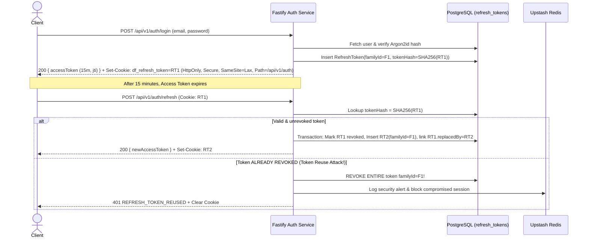
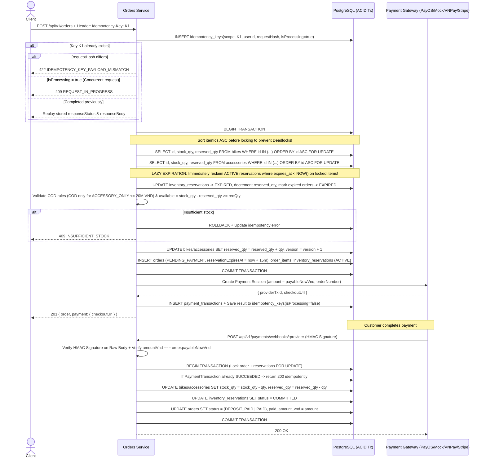

# 04. Backend Modules, API Specification & Security Architecture

> **Framework:** Fastify 5.x (`5.12.8`, Node.js 22 LTS, Pure JS ESM)  
> **Validation & OpenAPI:** Zod `3.25.76` (`.strict()`) + `fastify-type-provider-zod@4.0.2` + `@fastify/swagger@9.9.5` + `@fastify/swagger-ui@6.1.5` (UI enabled in `development`/`staging` or gated by Admin auth in `production`)  
> **Error Contract:** RFC 7807 (`application/problem+json`)  
> **Logging:** Pino Structured JSON Logging propagating `requestId` across all logs and DB audit entries.

---

## 1. Fastify Plugin Registration Order & Request Lifecycle

Plugin registration order in `apps/api/src/app.js` is strictly fixed to prevent security ordering gaps:

1. **`genReqId` + Pino Logger**: Generates UUIDv7 / `x-request-id` (sanitizing client headers) and redacts sensitive fields (`req.headers.authorization`, `req.headers.cookie`, `body.password`, `body.passwordHash`).
2. **`@fastify/helmet`**: Enforces CSP, HSTS, `X-Frame-Options: DENY`, `X-Content-Type-Options: nosniff`, `Referrer-Policy: no-referrer`.
3. **`@fastify/cors`**: Strict origin whitelist loaded from `CORS_ALLOWED_ORIGINS` (never `*` when `credentials: true`).
4. **`@fastify/cookie`**: Parses & signs cookies for `HttpOnly` Refresh Tokens and Guest Cart tokens.
5. **`@fastify/rate-limit` (Upstash Redis store)**: IP + `userId` rate limiting with dedicated thresholds for sensitive routes.
6. **`fastify-type-provider-zod`**: Attaches global `validatorCompiler` and `serializerCompiler` — rejects undeclared input fields (`.strict()`) and strips sensitive fields from responses.
7. **Core Infra Plugins**: `prisma.plugin.js`, `redis.plugin.js` (L1 LRU + L2 Upstash), `auth.plugin.js` (`authenticate`, `requireRole(...)`, `optionalAuth`).
8. **Global RFC 7807 Error Handler**: Normalizes `ZodError`, `PrismaClientKnownRequestError` (`P2002`, `P2025`), domain `AppError`, and unhandled 500s (suppressing stack traces in production).
9. **Route Registration**: `/api/v1` prefix for all business modules; `/health/live` and `/health/ready` unprefixed at root.

---

## 2. Response Envelope, RFC 7807 & `BigInt` Policy

### 2.1. Success Response Envelope
```json
{
  "data": { "...": "..." },
  "meta": {
    "requestId": "req_01JDF9X8...",
    "timestamp": "2026-11-24T14:30:00.000Z",
    "pagination": {
      "page": 1,
      "limit": 12,
      "totalItems": 48,
      "totalPages": 4
    }
  }
}
```

### 2.2. RFC 7807 Error Response (`Content-Type: application/problem+json`)
```json
{
  "type": "https://api.dirtfit.vn/errors/INSUFFICIENT_STOCK",
  "title": "Insufficient inventory to reserve order",
  "status": 409,
  "code": "INSUFFICIENT_STOCK",
  "detail": "KTM 350 EXC-F 2026 only has 1 unit available, cannot satisfy requested quantity (2).",
  "instance": "/api/v1/orders",
  "requestId": "req_01JDF9X8...",
  "errors": [
    {
      "field": "items[0].quantity",
      "code": "STOCK_EXCEEDED",
      "message": "Available stock is 1"
    }
  ]
}
```

### 2.3. Mandatory `BigInt` (VND) Serialization Policy
- PostgreSQL/Prisma stores all VND currency columns as `BIGINT` (`BigInt` in JS).
- **Non-negotiable boundary rule:** Every **Repository / Mapper** MUST convert all `BigInt` fields to JS safe integer `Number` (safe up to `Number.MAX_SAFE_INTEGER` ≈ 9 quadrillion VND) via `toSafeVndNumber()` before returning data to Service, DTO, Fastify JSON serializer, or Next.js Client Components. Raw `BigInt` values must never escape the Repository layer, eliminating `TypeError: Do not know how to serialize a BigInt`.

---

## 3. Complete REST API Specification (`/api/v1`)

> **Role Legend:** `PUBLIC`, `AUTH` (any authenticated user), `CUSTOMER`, `SALES_STAFF`, `ADMIN`.  
> **Rate Limit Tiers:** `RL-STRICT` (5–10 req/min/IP), `RL-WRITE` (30 req/min), `RL-READ` (120 req/min).

### 3.1. Health & Observability
| Method | Endpoint | Role | Description |
| :--- | :--- | :--- | :--- |
| `GET` | `/health/live` | `PUBLIC` | Instant liveness probe (`< 2ms`, no DB/Redis I/O). |
| `GET` | `/health/ready` | `PUBLIC` | Readiness probe checking PostgreSQL (`SELECT 1`) & Redis (`PING`). |

### 3.2. Auth Module (`modules/auth`)
| Method | Endpoint | Role | Rate Limit | Summary |
| :--- | :--- | :--- | :--- | :--- |
| `POST` | `/api/v1/auth/register` | `PUBLIC` | `RL-STRICT` | `{ email, password, fullName, phone? }` → Argon2id hash, create user + send verification email → `201 { user, accessToken }` + Set `HttpOnly` Refresh Cookie. |
| `POST` | `/api/v1/auth/login` | `PUBLIC` | `RL-STRICT` | `{ email, password }` → Verify Argon2id, merge Guest Cart if present → `200 { user, accessToken }` + Set Refresh Cookie. |
| `POST` | `/api/v1/auth/refresh` | `PUBLIC` (Cookie) | `RL-WRITE` | Reads `df_refresh_token` cookie → Reuse detection check → Rotate token + revoke old token → `200 { accessToken }` + Set new Cookie. |
| `POST` | `/api/v1/auth/logout` | `AUTH` | `RL-WRITE` | Revokes current token family in DB + blacklists Access Token `jti` in Redis → Clear cookie → `204`. |
| `POST` | `/api/v1/auth/logout-all` | `AUTH` | `RL-STRICT` | Revokes all `RefreshToken` rows for the user across all devices → `204`. |
| `POST` | `/api/v1/auth/forgot-password` | `PUBLIC` | `RL-STRICT` | Sends 15-min reset token via Resend; always returns `202` (prevents email enumeration). |
| `POST` | `/api/v1/auth/reset-password` | `PUBLIC` | `RL-STRICT` | Resets password via token and revokes all prior sessions. |

### 3.3. Users & Rider Body Profiles (`modules/users`)
| Method | Endpoint | Role | Summary |
| :--- | :--- | :--- | :--- |
| `GET` | `/api/v1/users/me` | `AUTH` | Returns account details & saved `bodyProfiles`. |
| `PATCH` | `/api/v1/users/me` | `AUTH` | Updates `fullName`, `phone`. |
| `GET` | `/api/v1/users/me/body-profiles` | `AUTH` | Lists saved rider body profiles. |
| `POST` | `/api/v1/users/me/body-profiles` | `AUTH` | Creates body profile (max 5/user); auto-estimates `inseamCm` when omitted. |
| `PATCH` | `/api/v1/users/me/body-profiles/:id` | `AUTH` | Updates measurements or sets `isDefault`. |
| `DELETE` | `/api/v1/users/me/body-profiles/:id` | `AUTH` | Deletes owned body profile. |
| `GET` | `/api/v1/admin/users` | `ADMIN` | Lists users with role/status/search filters. |
| `PATCH` | `/api/v1/admin/users/:id/role` | `ADMIN` | Updates role (`CUSTOMER`/`SALES_STAFF`/`ADMIN`) or `isActive` + writes `AuditLog`. |

### 3.4. Catalog: Brands, Bikes, Geometry & Media (`modules/catalog`)
| Method | Endpoint | Role | Summary |
| :--- | :--- | :--- | :--- |
| `GET` | `/api/v1/brands` | `PUBLIC` | Lists brands (cached). |
| `GET` | `/api/v1/bikes` | `PUBLIC` | Dual Catalog Filter: `category`, `ridingFocus`, `brandSlug`, `minPrice`, `maxPrice`, `streetLegal`, `search`, **plus Rider Fit params** (`riderHeightCm`, `riderWeightKg`, `riderInseamCm`, `footwear`, `minFitStatus`, `includeModdable`) → returns bikes enriched with `fitPreview`. |
| `GET` | `/api/v1/bikes/:slug` | `PUBLIC` | Full bike detail: `geometrySpec`, `media` (including `calibrationData`), `compatibleAccessories`. |
| `POST` | `/api/v1/admin/bikes` | `ADMIN` | Creates bike + `BikeGeometrySpec` in 1 transaction + writes `AuditLog` + invalidates catalog cache. |
| `PATCH` | `/api/v1/admin/bikes/:id` | `ADMIN` | Updates bike info/price/stock (with `version`/lock check) + writes `AuditLog`. |
| `DELETE` | `/api/v1/admin/bikes/:id` | `ADMIN` | Soft delete (`deletedAt = now()`) + writes `AuditLog`. |
| `POST` | `/api/v1/admin/bikes/:id/media` | `ADMIN` | Attaches uploaded R2 media asset to a bike. |
| `PATCH` | `/api/v1/admin/bikes/:id/media/:mediaId/calibration` | `ADMIN` | Saves UV coordinates from **Admin Calibration Tool** (strict `[0..1]` Zod validation) + computes `pxPerMm` + writes `AuditLog`. |

### 3.5. Accessories & Compatibility Matrix (`modules/accessories`)
| Method | Endpoint | Role | Summary |
| :--- | :--- | :--- | :--- |
| `GET` | `/api/v1/accessories` | `PUBLIC` | Filter by `category`, `bikeId` (compatible with bike), `inStock`, `search`. |
| `GET` | `/api/v1/accessories/:slug` | `PUBLIC` | Accessory details + compatible motorcycles. |
| `POST` | `/api/v1/admin/accessories` | `ADMIN` | Creates accessory with `ergoImpactJson` + writes `AuditLog`. |
| `PATCH` | `/api/v1/admin/accessories/:id` | `ADMIN` | Updates price/stock/specs + writes `AuditLog`. |
| `PUT` | `/api/v1/admin/bikes/:bikeId/compatibilities` | `ADMIN` | Replaces/upserts bike compatibility matrix (`accessoryId`, `exactSeatDropMm`, `installLaborVnd`) + writes `AuditLog`. |

### 3.6. Rider Fit Simulator & Comparison (`modules/simulator`)
| Method | Endpoint | Role | Summary |
| :--- | :--- | :--- | :--- |
| `POST` | `/api/v1/simulator/evaluate` | `PUBLIC` | `{ bikeId, riderProfile, accessoryIds[] }` → executes `@dirtfit/ergonomics-engine` server-side → returns Sag, Foot Contact, Rider Triangle, Fit Score + **Smart Upsell Suggestions** with live stock & pricing. |
| `POST` | `/api/v1/simulator/compare` | `PUBLIC` | `{ bikeIds: [idA, idB], riderProfile, modificationsByBike? }` → returns side-by-side comparison + Ghost Overlay alignment data. |

### 3.7. Cart & Combo Bundles (`modules/cart`)
| Method | Endpoint | Role | Summary |
| :--- | :--- | :--- | :--- |
| `GET` | `/api/v1/cart` | `PUBLIC` / `AUTH` | Returns active cart (`userId` or `df_guest_cart` cookie) with live pricing, available stock (after Lazy Expiration), and deposit breakdown. |
| `POST` | `/api/v1/cart/items` | `PUBLIC` / `AUTH` | Adds 1 motorcycle or 1 accessory. |
| `POST` | `/api/v1/cart/bundles` | `PUBLIC` / `AUTH` | Adds **Bike + Lowering/Ergo Accessories Bundle** (validates compatibility via `BikeAccessoryCompatibility`, tags shared `bundleGroupId`). |
| `PATCH` | `/api/v1/cart/items/:itemId` | `PUBLIC` / `AUTH` | Updates quantity (capped at available stock). |
| `DELETE` | `/api/v1/cart/items/:itemId` | `PUBLIC` / `AUTH` | Removes cart item. |

### 3.8. Orders & Payments (`modules/orders`, `modules/payments`)
| Method | Endpoint | Role | Headers / Rate Limit | Summary |
| :--- | :--- | :--- | :--- | :--- |
| `POST` | `/api/v1/orders` | `AUTH` | **`Idempotency-Key` required** / `RL-WRITE` | Creates order from cart (`orderType`, `paymentMethod`, `shippingAddress`, `riderFitSnapshot?`). Locks stock (`SELECT ... FOR UPDATE`), executes Lazy Expiration, creates 15-min `InventoryReservation`, invokes Payment Adapter (`checkoutUrl` or immediate `CONFIRMED` for valid `COD`). |
| `GET` | `/api/v1/orders/me` | `AUTH` | `RL-READ` | Lists customer's orders & deposit balances. |
| `GET` | `/api/v1/orders/:id` | `AUTH` | `RL-READ` | Order detail (IDOR check: owner or `SALES_STAFF`/`ADMIN` only). |
| `POST` | `/api/v1/orders/:id/cancel` | `AUTH` | `RL-WRITE` | Customer cancels `PENDING_PAYMENT` order → immediately releases `InventoryReservation`. |
| `GET` | `/api/v1/admin/orders` | `SALES_STAFF`, `ADMIN` | `RL-READ` | Admin order management filtered by status, `orderType`, `orderNumber`. |
| `PATCH` | `/api/v1/admin/orders/:id/status` | `SALES_STAFF`, `ADMIN` | `RL-WRITE` | Transitions order via **Order State Machine** + writes `AuditLog` + triggers Resend email. |
| `POST` | `/api/v1/payments/webhooks/:provider` | `PUBLIC` (Signed) | `RL-WRITE` | Receives webhooks from `payos` / `mock` / `vnpay` / `stripe`. **Verifies HMAC/signature on raw body**, enforces idempotency on `providerTxId`, commits stock (`stockQty -= qty, reservedQty -= qty`), marks `DEPOSIT_PAID`/`PAID`. |
| `POST` | `/api/v1/payments/mock/simulate-webhook` | `PUBLIC` (Non-Prod Only) | `RL-WRITE` | **Mounted ONLY when `NODE_ENV !== 'production'` and `ENABLE_MOCK_PAYMENT=true`.** Simulates payment success/failure locally and in CI to test full deposit & stock-commit flows without live gateway credentials. |

### 3.9. Test Ride Bookings, Media Uploads & Audit Logs
| Method | Endpoint | Role | Summary |
| :--- | :--- | :--- | :--- |
| `GET` | `/api/v1/test-rides/availability` | `PUBLIC` | Query `{ bikeId, showroomCode, date }` (`showroomCode` ∈ `HN_LONG_BIEN`, `DN_SON_TRA`, `HCM_THU_DUC`) → returns available `timeSlot` values. |
| `POST` | `/api/v1/test-rides` | `AUTH` | Books test ride with `riderProfileSnapshot` and requested mods (slot uniqueness enforced via partial unique index). |
| `GET` | `/api/v1/test-rides/me` | `AUTH` | Lists customer's test ride bookings. |
| `PATCH` | `/api/v1/admin/test-rides/:id` | `SALES_STAFF`, `ADMIN` | Confirms booking, assigns staff, marks completed/cancelled + writes `AuditLog`. |
| `POST` | `/api/v1/admin/uploads/presign` | `ADMIN` | Generates Presigned PUT URL for Cloudflare R2 (restricted to `image/webp|png|jpeg`, max 8MB). |
| `POST` | `/api/v1/admin/uploads/verify` | `ADMIN` | Downloads first 4KB (HTTP Range Request) from R2 to verify **MIME Magic Bytes** (`file-type`); deletes spoofed executables/SVGs immediately and returns `422`. |
| `GET` | `/api/v1/admin/audit-logs` | `ADMIN` | Queries immutable audit logs by `entityType`, `entityId`, `actorId`, `action`, and date range. |

---

## 4. Critical Security & Integrity Flows

### 4.1. Authentication: JWT + Refresh Token Rotation & Reuse Detection



### 4.2. Order Checkout, Idempotency, Lazy Expiration & Inventory Locking



#### Reservation Expiry Mechanism (Lazy Expiration Primary + Sweeper Secondary)
- **Lazy Expiration (Primary Authoritative Mechanism):** Never relies on 15-minute cron jobs (which can lag on free tiers). Every availability read (`GET /bikes`, `GET /cart`) ignores expired holds (`expires_at < NOW()`), and every Checkout transaction **immediately reclaims** expired `ACTIVE` holds on locked items before checking stock. If a late webhook arrives right after lazy expiration, the system records `PAYMENT_RECEIVED_AFTER_EXPIRY` and logs an `AuditLog` alert for refund/manual resolution without driving stock negative.
- **Background Sweeper (Secondary Housekeeping):** Runs every 60s in-process while the API is awake, plus a GitHub Actions HMAC-signed cron calling `POST /internal/cron/expire-reservations` every 15 minutes (`SELECT ... FOR UPDATE SKIP LOCKED` on expired reservations).

### 4.3. Payment Adapter Strategy Pattern (`modules/payments/adapters/`)
Every gateway implements a shared JSDoc interface (`PaymentAdapter`):
- `createPaymentIntent({ order, returnUrl, cancelUrl })` → `{ providerTxId, checkoutUrl, qrCodeData? }`
- `verifyAndParseWebhook({ rawBody, headers })` → `{ isValid, providerTxId, orderNumber, amountVnd, status, rawPayload }`
- `refund({ providerTxId, amountVnd, reason })`

Registered Adapters:
1. **`PayOSAdapter` (Production Default Online Gateway):** Primary Vietnam gateway generating instant VietQR transfers with real-time signed webhooks for bike deposits and full online orders.
2. **`MockPaymentAdapter` (Local / Test / CI Default):** Active when `NODE_ENV !== 'production'` (`PAYMENT_DEFAULT_PROVIDER=MOCK`), paired with `POST /api/v1/payments/mock/simulate-webhook` to test full deposit + webhook + stock-commit flows without external accounts. Strictly disabled in production.
3. **`CodAdapter`:** Restricted to `orderType === 'ACCESSORY_ONLY'` and `totalVnd <= 20_000_000` (20M VND); immediately transitions order to `CONFIRMED` and deducts stock at checkout.
4. **`VNPayAdapter` & `StripeAdapter` (Optional Secondary Adapters):** Vietnam domestic ATM/QR (`HMAC-SHA512`) and international cards (`stripe-signature` on `rawBody`).

---

## 5. Security Hardening Checklist (OWASP Top 10 Production-Ready)

| OWASP Threat | Concrete Defense in DirtFit API |
| :--- | :--- |
| **A01: Broken Access Control (IDOR / Privilege Escalation)** | Protected routes enforce `authenticate` + `requireRole(...)`. Personal resources (`orders/:id`, `body-profiles/:id`, `test-rides/:id`) filter by `WHERE id = :id AND userId = :reqUserId` unless role is `ADMIN`/`SALES_STAFF`. |
| **A02: Cryptographic Failures** | Passwords hashed with **Argon2id** (`memoryCost: 65536`, `timeCost: 3`, `parallelism: 1`). Refresh tokens stored as **SHA-256 hashes** only. Cookies set `HttpOnly`, `Secure` (prod), `SameSite=Lax`. JWT TTL 15 minutes with >=64-byte secret. |
| **A03: Injection (SQLi / XSS / Mass Assignment)** | 100% Prisma parameterized queries (`Prisma.sql` tagged templates for any raw SQL). All Zod schemas enforce `.strict()` to block Mass Assignment (`role: 'ADMIN'`, `priceVnd: 0`). Markdown descriptions sanitized via `DOMPurify` / `rehype-sanitize`. |
| **A04: Insecure Design (Price Tampering / Overselling)** | Server never trusts client-supplied prices; always reads prices/labor fees from DB inside checkout. `Idempotency-Key` + sorted `SELECT ... FOR UPDATE` + Lazy Expiration prevent duplicate orders and overselling. |
| **A05: Security Misconfiguration** | Strict `@fastify/helmet`, explicit CORS whitelist, `X-Powered-By` hidden, fail-fast Zod validation on `process.env` at startup (`config/env.js`). |
| **A07: Auth Failures & Brute Force** | Strict rate limits on `/auth/login`, `/auth/register`, `/auth/forgot-password` (5 req/min/IP + soft account cooldown). Constant-time verification & uniform `202` forgot-password response prevent enumeration. |
| **A08: Software & Data Integrity (Webhook Forgery)** | Preserves `rawBody` (`fastify-raw-body` scoped to `/payments/webhooks/*`) for `crypto.timingSafeEqual` HMAC verification and exact `amountVnd` matching. |
| **A09: Logging & Monitoring** | Pino JSON logs with `requestId`, `userId`, `durationMs` and automatic redaction of credentials/cookies. Immutable `AuditLog` tracks all admin changes. |
| **A10: SSRF & Unrestricted File Upload** | Direct R2 Presigned PUT uploads; `image/svg+xml` explicitly banned (Stored XSS prevention); server verifies real **MIME Magic Bytes** (`file-type`, `jpg/png/webp` only, <= 8MB) and assigns UUID object keys. |

---

## 6. Testing & Observability Strategy

1. **Unit Tests (Vitest):**
   - `@dirtfit/ergonomics-engine`: Coverage >= 95% across Sag, Foot Contact, 2D IK, Edge Cases, and Golden Benchmarks.
   - `@dirtfit/shared`: Verifies `.strict()` rejection on all Zod schemas and `BigInt <-> Number` VND money helpers.
   - `apps/api` Domain layer: Tests Order State Machine transitions, Deposit rules, and COD limits.
2. **Integration & E2E API Tests (Vitest + Fastify `app.inject()`):**
   - Fast in-process execution against test PostgreSQL & Redis without binding TCP ports.
   - Mandatory automated suites:
     - Refresh Token Reuse Attack → verifies entire token family revocation.
     - **Concurrency Race Condition Test:** 10 parallel `POST /api/v1/orders` requests (`Promise.all`) competing for the last unit (`stockQty = 1`) → exactly **1 succeeds (`201`)**, **9 receive `409 INSUFFICIENT_STOCK`**, zero negative stock.
     - **Lazy Expiration Test:** Expired reservation (`expiresAt < NOW()`) is reclaimed inline by a new checkout without waiting for cron.
     - Idempotency Replay (`201` cached) & Payload Mismatch (`422`) tests.
     - RBAC & IDOR tests (`403` across users/roles) + Webhook signature forgery (`401`) & replay idempotency tests.

---

## 7. v2.0 API, Security & Testing Expansion Delta

- **Google OAuth 2.0 & Account Linking ([08-google-oauth-architecture.md](./08-google-oauth-architecture.md)):** Bổ sung `/api/v1/auth/google/start`, `/api/v1/auth/google/callback`, `/api/v1/auth/google/mock-authorize` (chỉ mount ở non-prod khi `ENABLE_MOCK_OAUTH=true`, trả `404` ở production), `/api/v1/auth/oauth/exchange` (One-Time Ticket `60s` + merge `df_guest_cart` & `df_chat_guest`), `/api/v1/auth/set-password`, `/api/v1/auth/providers`. Mở rộng Pino `redact.paths` che `idToken`, `codeVerifier`, `clientSecret`, `oauthCode`, `ticket`.
- **AI Support Chatbot ([09-ai-chatbot-knowledge-prompts.md](./09-ai-chatbot-knowledge-prompts.md)):** Bổ sung `/api/v1/chat/session` (`GET`/`DELETE`), `/api/v1/chat/messages` (`POST`, rate limit `15/min`), `/api/v1/chat/messages/:id/feedback` (`POST`, anti-IDOR), và `/api/v1/admin/chat/metrics` (`GET`, ẩn danh zero-PII). Áp dụng đầy đủ phòng thủ **OWASP LLM Top 10**.
- **Nâng cấp Kiểm thử 3 Tầng ([10-testing-pyramid-unit-integration-system.md](./10-testing-pyramid-unit-integration-system.md)):** Nâng cấp toàn bộ integration test của `apps/api` từ `app.inject()` sang HTTP thực qua **Supertest** (`app.listen({ port: 0, host: '127.0.0.1' })`, chạy tuần tự `fileParallelism: false`), tách riêng `tests/unit/` và bổ sung tầng 3 **Playwright System E2E**.

---

## 8. v2.1 API, Media Lifecycle & Rich Cart/Order Expansion Delta

Chi tiết đặc tả tại [12-real-product-media-and-rich-cart.md](./12-real-product-media-and-rich-cart.md) (triển khai ở Phase 13A):
- **Bike Real Photo Management (`/api/v1/admin/bikes/:id/media/*`, `ADMIN` only, giữ nguyên alias cũ `/admin/media/{presign,confirm}`):**
  - Bổ sung `POST .../presign`, `POST .../confirm` (tự động phân vùng key `bikes/<bikeId>/(photos|blueprint|specs)/<uuid>.<ext>`, 4KB Magic Bytes check, transactional `isPrimary` theo đúng miền media), `PATCH .../:mediaId/primary`, `PATCH .../reorder`, `DELETE .../:mediaId` (soft-delete + auto-promote cover kế tiếp + best-effort R2 delete), và chặn `PATCH .../calibration` trên media khác `SIDE_PROFILE_BLUEPRINT`.
- **Accessory R2 Media Management (`/api/v1/admin/accessories/:id/media/*`, `ADMIN` only):**
  - Bổ sung `POST .../presign` (key `accessories/<accessoryId>/<uuid>.<ext>`, `<= 5MB`), `POST .../confirm` (4KB Magic Bytes + dọn object cũ best-effort + `AuditLog` + `invalidateCatalogCache`), và `DELETE .../media`.
- **Non-Prod Local Media Preview (`GET /api/v1/media/local/*`):** Chỉ mount khi `STORAGE_DRIVER === 'local' && NODE_ENV !== 'production'` (validate regex key chống path traversal, header `X-Content-Type-Options: nosniff`); trả **`404`** tuyệt đối ở production.
- **Catalog, Cart, Order & Chatbot Contract Enrichment:**
  - `GET /api/v1/bikes` & `GET /api/v1/bikes/:slug` bổ sung `coverImageUrl`, `coverImageKind`, `primaryPhoto`, `galleryImages[]`, `blueprintImageUrl`, `primaryBlueprint` (dùng chung `resolveBikeMedia()` từ `@dirtfit/shared`, giữ nguyên `media[]`).
  - `GET /api/v1/cart` (bỏ `take: 2` trên `bike.media`), `GET /api/v1/orders*`, và Chatbot `recommendedBikes[]` trả đồng bộ `productUrl` (`/bikes/[slug]` | `/accessories?sku=...`), `imageUrl`, `imageKind`.
