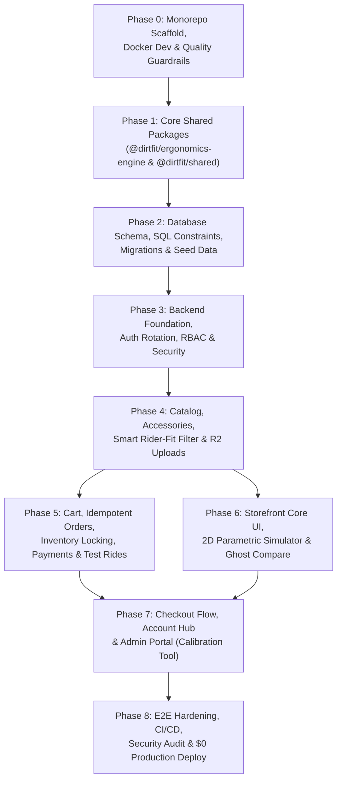

# 07. Phased Implementation Roadmap

> **Execution Rule:** Execute strictly phase-by-phase following the dependency graph. **Do not advance to the next Phase until 100% of the current Phase's Definition of Done (DoD) is verified.**  
> **Mandatory Discipline Across All Phases:** 100% Pure JavaScript ESM (`"type": "module"`, zero `.ts`/`.tsx`/`tsconfig.json`), complete JSDoc, Zod `.strict()`, all code/identifiers/comments/commits in English, and storefront UI supporting Vietnamese (i18n-ready).

---

## Phase Dependency Graph

---

## Phase 0: Monorepo Scaffold, Local Infrastructure & Pure-JS Guardrails

- **Goal:** Establish a clean `pnpm` + Turborepo Pure JS ESM monorepo, local PostgreSQL 16 + Redis 7 via Docker Compose, ESLint/Prettier/JSDoc rules, and automated anti-TypeScript + stack-compatibility guardrails.
- **Dependencies:** Approved Master Plan (`/docs/architecture/*`).
- **Key Deliverables:**
  - Root `package.json`, `pnpm-workspace.yaml`, `turbo.json`, `eslint.config.mjs` (with `eslint-plugin-jsdoc`, avoiding `eslint-config-next` which pulls `typescript`), `.prettierrc`, `.gitignore`.
  - Locked compatible Pure JS ESM stack: `pnpm@10.28.2`, `fastify@5.12.8`, `zod@3.25.76`, `fastify-type-provider-zod@4.0.2`, `@fastify/swagger@9.9.5`, `prisma@6.19.3`, `next@15.5.29`, `react@19.2.9`.
  - ESM package skeletons (`"type": "module"`) for `packages/ergonomics-engine`, `packages/shared`, `apps/api`, and `apps/web` (`jsconfig.json` path aliases).
  - `docker-compose.yml` (Postgres 16, Redis 7, `tools` profile Adminer) and `.env.example` templates for API & Web.
  - `scripts/check-pure-js.mjs` (fails on `.ts`, `.tsx`, `tsconfig.json`, or `typescript` dependency) and `apps/api/scripts/verify-stack-compat.mjs` (verifies Fastify 5 + Zod 3.25.76 + Swagger OpenAPI 3.0).
- **Definition of Done (DoD):**
  - [x] `pnpm install` completes with zero workspace or peer dependency errors.
  - [x] `docker compose up -d --wait postgres redis` brings up both containers in `healthy` state.
  - [x] `pnpm check:pure-js`, `pnpm lint`, `pnpm format:check`, `pnpm verify:compat`, and `pnpm test` all exit `0` with zero warnings.

---

## Phase 1: Core Shared Packages (`@dirtfit/ergonomics-engine` & `@dirtfit/shared`)

- **Goal:** Implement the complete physics/kinematics simulation core and shared `.strict()` Zod contracts + `BigInt <-> Number` VND money helpers.
- **Dependencies:** Phase 0.
- **Key Deliverables:**
  - `packages/ergonomics-engine/src/`: `constants.js`, `anthropometry.js`, `sag.js`, `foot-contact.js`, `kinematics.js`, `calibration.js`, `scoring.js`, `comparator.js`, `index.js` with full JSDoc.
  - `packages/shared/src/`: `enums.js`, `money.js` (`toSafeVndNumber()`, `toVndBigInt()`, `formatVnd()`), `errors.js` (RFC 7807 error registry), and all `.strict()` Zod schemas in `schemas/*.schema.js`.
  - Comprehensive Vitest suites including **Golden Benchmarks** (KTM 350 EXC-F, Honda CRF300L, Yamaha Ténéré 700) and all Edge Cases (40 kg, 140 kg, 145 cm, 205 cm, `NaN` guards).
- **Definition of Done (DoD):**
  - [x] `pnpm --filter @dirtfit/ergonomics-engine test:coverage` achieves **>= 95% coverage** with 100% pass rate.
  - [x] Golden benchmark effective seat heights remain within `±8mm` of reference values.
  - [x] `pnpm --filter @dirtfit/shared test` confirms `.strict()` rejects unknown fields and `toSafeVndNumber()` safely converts `BigInt`.
  - [x] Zero external dependencies in `@dirtfit/ergonomics-engine`.

---

## Phase 2: Database Layer, SQL Constraints & Realistic Seed Data

- **Goal:** Implement the PostgreSQL schema via Prisma, engine-level `CHECK` / Partial Unique constraints, and an idempotent realistic seed script.
- **Dependencies:** Phase 1.
- **Key Deliverables:**
  - `apps/api/prisma/schema.prisma` containing all 17 models per `03-database-design-prisma.md`.
  - Initial SQL migration appending all `CHECK` constraints (`stock_qty >= 0`, `reserved_qty <= stock_qty`, polymorphic `cart_items`) and Partial Unique Indexes (`uq_bike_single_primary_blueprint`, `uq_test_ride_slot_active`, `uq_user_single_default_body_profile`).
  - `apps/api/prisma/seed.js`: Seeds Admin, Sales Staff, Customer, **3 canonical showrooms (`HN_LONG_BIEN`, `DN_SON_TRA`, `HCM_THU_DUC`)**, at least **8 real-world motorcycles** (`Honda CRF150L`, `Honda CRF300L`, `Yamaha WR155R`, `Kawasaki KLX230`, `KTM 350 EXC-F`, `Husqvarna FE 350`, `Yamaha Ténéré 700`, `Honda CRF250R`) with realistic `BikeGeometrySpec`, plus compatible accessories (lowering links, low seats, bar risers, MX boots).
- **Definition of Done (DoD):**
  - [x] `prisma validate` and `prisma migrate dev` pass cleanly.
  - [x] `prisma db seed` is idempotent (re-running succeeds without duplicates).
  - [x] Direct SQL verification confirms PostgreSQL rejects `UPDATE bikes SET reserved_qty = stock_qty + 1`.

---

## Phase 3: Backend Foundation, Auth Rotation, RBAC & Security Hardening

- **Goal:** Build the Fastify Clean Architecture core, security plugins, OpenAPI 3.0 Swagger, Refresh Token Rotation + Reuse Detection, and User Body Profile management.
- **Dependencies:** Phase 2.
- **Key Deliverables:**
  - `apps/api/src/config/env.js` (fail-fast Zod env parser), `app.js` (`buildApp()`), `server.js` (graceful shutdown).
  - Core plugins: `prisma`, `redis` (L1 LRU + L2 Redis), `security` (Helmet, strict CORS, Cookie, Rate Limit), `swagger`, `error-handler` (RFC 7807), `auth` (`authenticate`, `requireRole`).
  - Modules: `health` (`/health/live`, `/health/ready`), `auth` (Argon2id register/login, refresh rotation + family revoke, logout, logout-all, password reset), `users` (Profile + `UserBodyProfile` CRUD + Admin Users), `audit` (`AuditLog` service).
- **Definition of Done (DoD):**
  - [x] `/docs` Swagger UI renders full Zod-derived OpenAPI 3.0 specs.
  - [x] Integration tests (`app.inject()`) pass 100%: Argon2id login, Refresh Token Rotation, **Token Reuse Detection revoking full family**, RBAC `403`, IDOR checks, and RFC 7807 errors.
  - [x] Pino logs redact `password`, `cookie`, and `authorization`.

---

## Phase 4: Catalog, Accessories, Smart Rider-Fit API & R2 Media Uploads

- **Goal:** Complete catalog management, geometry specs, compatibility matrix, secure Cloudflare R2 uploads, Admin Calibration API, and server-side Smart Rider-Fit filtering.
- **Dependencies:** Phase 3.
- **Key Deliverables:**
  - Modules: `catalog` (Brands, Bikes, GeometrySpec, Media + Calibration UV save, L1+L2 caching + invalidation), `accessories` (Accessories + `BikeAccessoryCompatibility`), `simulator` (`/evaluate` + Smart Upsell + `/compare`), `uploads` (R2 Presigned PUT + `file-type` 4KB Magic Bytes check blocking spoofed files/SVGs).
  - Smart Rider-Fit Filter integrated into `GET /api/v1/bikes`.
  - Automatic in-transaction `AuditLog` + `BigInt -> Number` Repository mapping across all endpoints.
- **Definition of Done (DoD):**
  - [x] `GET /api/v1/bikes?riderHeightCm=168&riderWeightKg=65&footwear=MX_BOOTS&includeModdable=true` returns accurate `fitPreview` results in `< 30ms` locally.
  - [x] Integration tests verify disguised uploads (e.g., `.exe` renamed `.png` or `.svg`) are rejected (`422`) and deleted from storage.
  - [x] Admin price/stock mutations record `AuditLog` entries with `beforeState` and `afterState`.

---

## Phase 5: Cart, Idempotent Orders, Inventory Locking, Payments & Test Rides

- **Goal:** Complete the high-concurrency e-commerce transaction core: Cart (with Lowering Bundles), Idempotent Checkout, `SELECT ... FOR UPDATE` + Lazy Expiration, Payment Adapters (`PayOS`, `MockPaymentAdapter`, `COD`), and 3-Showroom Test Ride Bookings.
- **Dependencies:** Phase 4.
- **Key Deliverables:**
  - Modules: `cart` (Guest cookie + login merge + `/bundles`), `orders` (Idempotency middleware, sorted `SELECT ... FOR UPDATE`, **Lazy Expiration** for expired reservations inside checkout & availability checks, Order State Machine, Deposit & COD rules), `payments` (**`PayOSAdapter` production default**, **`MockPaymentAdapter` local/test/CI default** + `POST /api/v1/payments/mock/simulate-webhook`, `CodAdapter`, optional `VNPayAdapter`/`StripeAdapter`), `test-rides` (3 showrooms + slot uniqueness), `common/email` (Resend), `common/jobs` (secondary sweeper + `/internal/cron/expire-reservations`).
- **Definition of Done (DoD):**
  - [x] **Concurrency Race Condition Test:** 10 parallel `POST /api/v1/orders` calls for 1 remaining bike → exactly 1 `201`, 9 `409 INSUFFICIENT_STOCK`, zero negative inventory.
  - [x] **Lazy Expiration Test:** An expired reservation (`expiresAt < NOW()`) is reclaimed inline by a new checkout without running cron.
  - [x] Idempotency Replay & Payload Mismatch (`422`) tests pass 100%.
  - [x] `MockPaymentAdapter` + `simulate-webhook`, signature forgery (`401`), and `providerTxId` replay tests pass 100%.
  - [x] COD is strictly rejected when cart includes `BIKE` or accessory total exceeds 20,000,000 VND.

---

## Phase 6: Storefront Core UI, 2D Parametric Simulator & Ghost Overlay

- **Goal:** Build the Storefront UI following the *Industrial Motorsport / Technical Editorial* design system, 60fps 2D Simulator, and Ghost Overlay comparison page.
- **Dependencies:** Phase 4 (can overlap partially with Phase 5).
- **Key Deliverables:**
  - `apps/web` foundation: Design Tokens (`globals.css`), Vietnamese-ready Google Fonts (`Plus Jakarta Sans`, `Be Vietnam Pro`, `JetBrains Mono` `tabular-nums`), Radix UI primitives, `api-client.js` (Single-Flight Refresh + RFC 7807 + Cold-Start Banner), i18n dictionary (`vi.js`, `en.js`).
  - Storefront pages: `/` (Editorial Hero + Quick Fit Bar), `/bikes` (Dual Terrain + Rider Fit Filter), `/bikes/[slug]` (3-tier Progressive Disclosure + Spec Drawer), `/accessories`.
  - `RiderFitSimulator` (5-layer SVG Blueprint + Parametric Wireframe Fallback + 1-click Mod Switcher + Smart Upsell Card) & `/compare` (**Ghost Overlay**).
- **Definition of Done (DoD):**
  - [x] Zero purple-blue gradients, zero glassmorphism, zero cluttered spec dumps; Lighthouse Accessibility >= 90.
  - [x] Slider interactions run at 60fps with zero horizontal number jitter (`tabular-nums`).
  - [x] Ghost Overlay scales both motorcycles accurately by real `wheelbaseMm`.
  - [x] Clean responsive layouts on Desktop (1440px) and Mobile (390px).

---

## Phase 7: Checkout Flow, Account Hub & Admin Portal (Calibration Tool)

- **Goal:** Wire end-to-end customer checkout & account management alongside the full Admin & Sales Portal including the interactive Calibration Tool.
- **Dependencies:** Phase 5 & Phase 6.
- **Key Deliverables:**
  - **Customer Flows:** `/login`, `/register`, `/cart`, `/checkout` (Idempotency-Key, PayOS/Mock/COD selector, result page), `/test-ride` (3 showrooms), `/account/*` (Body Profiles, Orders/Deposits, Test Rides).
  - **Admin Portal (`/admin/*`):** KPI Dashboard, Bike & GeometrySpec CRUD, **Admin Calibration Tool** (`/admin/bikes/[id]/calibrate` with 2.5x loupe & 175cm test rider overlay), Compatibility Matrix Manager, Order State Machine controls, Test Ride scheduler, User RBAC, and Audit Log viewer.
- **Definition of Done (DoD):**
  - [ ] Full E2E journey verified: enter height → filter fitting bikes → toggle -30mm lowering link in Simulator → add bundle to cart → pay deposit via Mock/Sandbox webhook → verify updated order & stock in Admin Portal.
  - [ ] Admin calibrates a new side-profile photo in `< 60 seconds` and sees millimeter-accurate alignment on the Storefront Simulator.
  - [ ] `/admin/*` strictly blocks `CUSTOMER` role at both UI/middleware and API layers.

---

## Phase 8: Production Dockerfiles, CI/CD, Security Audit & \$0 Deployment

- **Goal:** Finalize production containers, automated CI/CD gates, security scanning, and live \$0/month deployment.
- **Dependencies:** Phase 7.
- **Key Deliverables:**
  - Multi-stage non-root `apps/api/Dockerfile` and `apps/web/Dockerfile` per `06-devops-docker-cicd-deploy.md`.
  - GitHub Actions: `pr-check.yml`, `deploy-prod.yml`, `cron-sweeper.yml`.
  - Live \$0 deployment across Neon PostgreSQL (PgBouncer + Direct URL), Upstash Redis, Cloudflare R2, Resend, Render/Koyeb Free (API), and Vercel Hobby (Web).
  - Operational Runbook (`docs/architecture/RUNBOOK.md`) covering safe migration rollback and secret rotation.
- **Definition of Done (DoD):**
  - [ ] Both production Docker images build cleanly, run as non-root (`id -u !== 0`), and report `healthy`.
  - [ ] GitHub Actions `pr-check.yml` passes 100% (Pure-JS guard + Lint + Unit/Integration tests + Prisma Validate + Docker Build + Trivy Scan).
  - [ ] Production environment passes live smoke tests (`/health/ready` `200`, HTTPS/TLS, Cookie Auth, R2 CDN assets, sandbox payment webhook).
