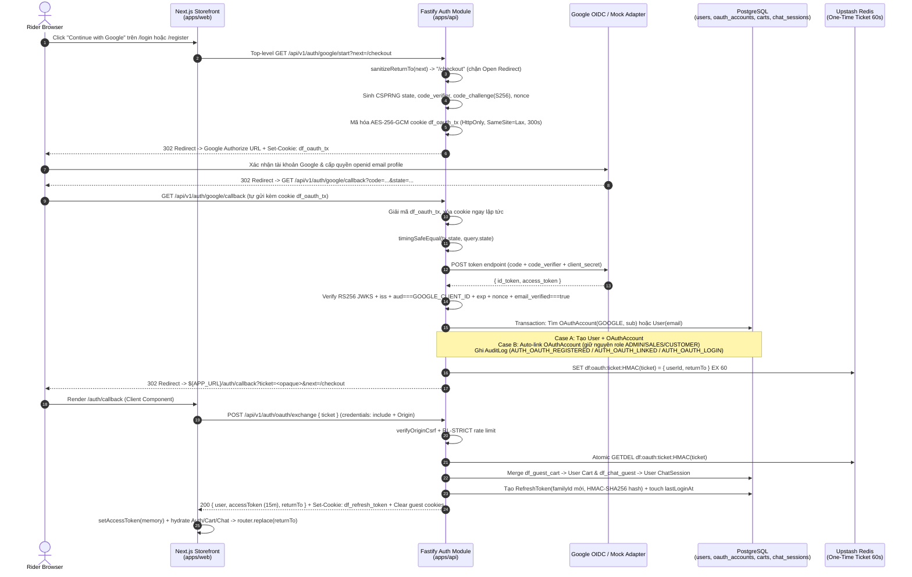

# 08. Kiến trúc Đăng nhập Google OAuth 2.0, OIDC & Account Linking (v2.0)

> **Phiên bản mục tiêu:** DirtFit Commerce `v2.0` (Phase 10)  
> **Chuẩn bảo mật áp dụng:** OAuth 2.0 Security Best Current Practice (**RFC 9700**), **PKCE (`S256`)**, OpenID Connect Core 1.0 (**OIDC `nonce` + JWKS RS256**), **RFC 7807** Problem Details  
> **Ràng buộc nền tảng:** 100% Pure JavaScript ESM (`"type": "module"`, zero `.ts`/`.tsx`), tương thích hoàn toàn với `apps/api` (Fastify 5 + Prisma 6.19.3 + Upstash Redis + Render Free) và `apps/web` (Next.js 15 App Router + Vercel Hobby, song ngữ **EN / VI**, mặc định **EN**).

---

## 1. Mục tiêu & Quyết định Kiến trúc Cốt lõi (ADRs)

Hệ thống đăng nhập bằng Google của DirtFit Commerce phải mở rộng mượt mà trên nền tảng `modules/auth` hiện có của `v1.0.0` (Argon2id + JWT Access Token 15m lưu memory + `df_refresh_token` HttpOnly Rotation + Reuse Detection + `df_guest_cart` merge) mà **không phá vỡ** bất kỳ bảo đảm bảo mật hay giới hạn **$0/tháng Free Tier** nào:

1. **Authorization Code Flow + PKCE (`S256`) + CSRF `state` + OIDC `nonce`:**
   - Tuyệt đối không dùng Implicit Flow hay truyền token qua URL fragment/query.
   - Mọi giao dịch OAuth đều sinh 3 giá trị CSPRNG 256-bit độc lập (`state`, `code_verifier`, `nonce`).
2. **Lưu OAuth Transaction State trong Cookie Mã hóa Ngắn hạn (`df_oauth_tx`) thay vì Redis:**
   - **Phân tích đánh đổi trên Upstash Free Tier (500k lệnh/tháng):**
     - *Phương án Redis:* Mỗi lần khách bấm "Continue with Google" (kể cả khi khách đóng tab/hủy giữa chừng hoặc bot crawl) đều tiêu tốn lệnh `SET` + `GETDEL` và dễ trở thành điểm cạn quota Upstash.
     - *Phương án được chọn (**Encrypted HttpOnly Cookie `df_oauth_tx`**):* Lưu payload `{ state, codeVerifier, nonce, returnTo, mode, iat }` đã mã hóa **AES-256-GCM** (khóa 32-byte dẫn xuất từ `COOKIE_SECRET` bằng `crypto.hkdfSync('sha256', ...)`) vào cookie `df_oauth_tx` (`HttpOnly`, `Secure` theo `env.COOKIE_SECURE`, `SameSite=Lax`, `Path=/api/v1/auth/google`, `Max-Age=300`).
     - **Ưu điểm kỹ thuật:** **0 lệnh Upstash Redis** ở bước khởi tạo OAuth; chịu tải tốt khi bot gọi `/auth/google/start`; vì redirect từ Google về `GET /api/v1/auth/google/callback` là **top-level GET navigation**, thuộc tính `SameSite=Lax` luôn gửi kèm `df_oauth_tx` hợp lệ ngay cả khi khác origin; cookie bị xóa ngay khi callback thực thi (chống replay).
3. **Cơ chế Handoff Cross-Origin An toàn cho Vercel (`*.vercel.app`) ↔ Render (`*.onrender.com`) bằng One-Time Ticket (`60s`):**
   - **Vấn đề thực tế của Free Tier Deploy:** Khi Frontend chạy tại `https://dirtfit.vercel.app` và Backend chạy tại `https://dirtfit-api.onrender.com`, trình duyệt hiện đại (Safari ITP, Chrome Tracking Protection) có thể hạn chế cookie cross-site nếu không gắn cùng root domain. Đồng thời, **cấm tuyệt đối** đính kèm `accessToken` hay `refreshToken` lên URL redirect vì sẽ rò rỉ vào Browser History, `Referer` header, proxy logs và analytics.
   - **Giải pháp chuẩn (One-Time Authorization Ticket Exchange):**
     1. Sau khi `GET /api/v1/auth/google/callback` xác thực xong với Google và liên kết/tạo `User`, API tạo một **opaque single-use ticket** (`32 bytes` CSPRNG `base64url`), chỉ lưu **HMAC-SHA256 hash** của ticket trong Redis tại key `df:oauth:ticket:<hmacHash>` với **TTL = 60 giây** (chỉ tốn đúng 2 lệnh Redis: `SET EX 60` và `GETDEL` atomic cho các lượt đăng nhập **thành công thật sự**).
     2. API redirect `302` trình duyệt về `${APP_URL}/auth/callback?ticket=<opaque_ticket>&next=<safeReturnTo>`.
     3. Trang `/auth/callback` trên `apps/web` lập tức gọi `POST /api/v1/auth/oauth/exchange` với body `{ ticket }` và `credentials: 'include'` (được bảo vệ bởi `app.verifyOriginCsrf` + rate limit `RL-STRICT`).
     4. API thực thi **`GETDEL` atomic** (ticket dùng đúng 1 lần duy nhất, gọi lại lần 2 lập tức trả `401 OAUTH_TICKET_INVALID`), tự động **merge `df_guest_cart` → User `Cart`** và **merge `df_chat_guest` → User `ChatSession`**, rồi phát hành cặp **JWT Access Token (15m)** + **HttpOnly Refresh Cookie (`df_refresh_token` với `familyId` mới)** chuẩn hệt luồng đăng nhập local.
   - **Khuyến nghị Production:**
     - **Tối ưu nhất:** Gắn cùng root domain (`dirtfit.vn` → Vercel, `api.dirtfit.vn` → Render) với `COOKIE_SAME_SITE=lax; COOKIE_SECURE=true`.
     - **Khi dùng tạm domain miễn phí tách biệt (`*.vercel.app` ↔ `*.onrender.com`):** Đặt `COOKIE_SAME_SITE=none; COOKIE_SECURE=true` (đã có sẵn trong `render.yaml`) kết hợp `verifyOriginCsrf` nghiêm ngặt và luồng One-Time Ticket ở trên. Không proxy toàn bộ `/api/v1/*` qua Vercel Rewrites làm đường chính vì Vercel Hobby có giới hạn `10s` function timeout, dễ cắt ngang yêu cầu khi Render Free Tier đang cold start (`30–50s`).
4. **Xác thực `id_token` chuẩn OIDC bằng `jose` (ESM thuần, zero dependencies):**
   - Cài đặt `jose` (phiên bản ổn định ESM thuần, không kéo bất kỳ transitive dependency nào) trong `apps/api` để xác thực chữ ký RS256 của Google `id_token` trực tiếp qua Google JWKS (`https://www.googleapis.com/oauth2/v3/certs`, có cache nội bộ trong RAM), kiểm tra đủ 5 claim bắt buộc: `iss`, `aud`, `exp`, `nonce`, và **`email_verified === true`**.

---

## 2. Sơ đồ Luồng Xác thực End-to-End (Sequence Diagram)



---

## 3. Thiết kế Database Delta (`apps/api/prisma/schema.prisma`)

Mở rộng theo nguyên tắc **Expand-and-Contract** (tương thích ngược 100% với 17 bảng `v1.0.0`, không làm hỏng dữ liệu hiện có):

### 3.1. Prisma Models & Enum mới

```prisma
enum AuthProvider {
  GOOGLE
}

// Cập nhật trên model User hiện có:
model User {
  id                String            @id @default(uuid()) @db.Uuid
  email             String            @unique @db.VarChar(255)
  phone             String?           @db.VarChar(20)
  fullName          String            @map("full_name") @db.VarChar(120)
  passwordHash      String?           @map("password_hash") @db.VarChar(255) // Nullable cho tài khoản thuần OAuth
  avatarUrl         String?           @map("avatar_url") @db.VarChar(512)    // Avatar HTTPS từ Google/upload
  role              UserRole          @default(CUSTOMER)
  isEmailVerified   Boolean           @default(false) @map("is_email_verified")
  isActive          Boolean           @default(true) @map("is_active")
  lastLoginAt       DateTime?         @map("last_login_at")
  createdAt         DateTime          @default(now()) @map("created_at")
  updatedAt         DateTime          @updatedAt @map("updated_at")
  deletedAt         DateTime?         @map("deleted_at")

  oauthAccounts     OAuthAccount[]    // NEW (v2.0)
  chatSessions      ChatSession[]     // NEW (v2.0 - xem 09-ai-chatbot-knowledge-prompts.md)
  // ... giữ nguyên toàn bộ relations v1.0.0
}

model OAuthAccount {
  id                String       @id @default(uuid()) @db.Uuid
  userId            String       @map("user_id") @db.Uuid
  provider          AuthProvider
  providerAccountId String       @map("provider_account_id") @db.VarChar(128) // Google OIDC `sub` bất biến
  providerEmail     String       @map("provider_email") @db.VarChar(255)
  emailVerified     Boolean      @default(true) @map("email_verified")
  avatarUrl         String?      @map("avatar_url") @db.VarChar(512)
  linkedAt          DateTime     @default(now()) @map("linked_at")
  lastUsedAt        DateTime?    @map("last_used_at")
  createdAt         DateTime     @default(now()) @map("created_at")
  updatedAt         DateTime     @updatedAt @map("updated_at")

  user              User         @relation(fields: [userId], references: [id], onDelete: Cascade)

  @@unique([provider, providerAccountId])
  @@unique([userId, provider])
  @@index([userId])
  @@map("oauth_accounts")
}
```

### 3.2. SQL Constraints bổ sung trong Migration (`0002_oauth_accounts`)

```sql
-- Bảo đảm provider_account_id và provider_email không rỗng ở tầng engine PostgreSQL
ALTER TABLE oauth_accounts
  ADD CONSTRAINT chk_oauth_provider_account_id_non_empty CHECK (length(trim(provider_account_id)) > 0),
  ADD CONSTRAINT chk_oauth_provider_email_non_empty CHECK (length(trim(provider_email)) > 0);
```

> **Lưu ý thiết kế khóa định danh:** Luôn đối chiếu theo `(provider, providerAccountId)` (Google `sub`) trước khi fallback sang `User.email`. Theo chuẩn OIDC, Google `sub` là định danh bất biến ngay cả khi người dùng đổi địa chỉ email Google Workspace sau này.

---

## 4. Ma trận Account Linking & Xử lý Toàn diện Edge Cases

| Case | Trạng thái DB & Input từ Google | Hành vi hệ thống bắt buộc | `AuditLog` / Error Code |
| :---: | :--- | :--- | :--- |
| **A** | Chưa có `OAuthAccount` và chưa có `User` theo email (`email_verified === true`) | Tạo `User` mới (`role: CUSTOMER`, `passwordHash: null`, `isEmailVerified: true`, `avatarUrl` từ Google nếu hợp lệ HTTPS) + tạo `OAuthAccount` trong 1 transaction. | `AUTH_OAUTH_REGISTERED` |
| **B** | Chưa có `OAuthAccount`, nhưng đã có `User` local cùng email (`deletedAt: null`, `isActive: true`) và Google xác nhận `email_verified === true` | **Auto-link an toàn:** Tạo `OAuthAccount` nối vào `User` hiện có, đặt `isEmailVerified = true`, chỉ điền `avatarUrl` nếu đang `null`. **Tuyệt đối giữ nguyên `role`** (`ADMIN`/`SALES_STAFF`/`CUSTOMER` không bị hạ hay nâng quyền). | `AUTH_OAUTH_LINKED` |
| **B2** | Đã có `OAuthAccount(GOOGLE, sub)` và `User` đang `isActive: true`, `deletedAt: null` | Cập nhật `lastUsedAt`, `providerEmail` nếu thay đổi, tiến hành cấp One-Time Ticket bình thường. | `AUTH_OAUTH_LOGIN` |
| **C** | `User` tạo từ Google (`passwordHash === null`) cố đăng nhập bằng form `POST /api/v1/auth/login` (email + password) | **Vẫn chạy `await verifyDummyPassword(input.password)`** để triệt tiêu timing side-channel, không bao giờ gọi `argon2.verify(null, ...)`. Trả lỗi RFC 7807 `401` hướng dẫn đăng nhập bằng Google hoặc thiết lập mật khẩu local sau khi đăng nhập. | `AUTH_OAUTH_ONLY_ACCOUNT` (`401`) |
| **D** | `User` đăng nhập Google muốn đặt mật khẩu local để đăng nhập đa phương thức | Gọi `POST /api/v1/auth/set-password` (`requireAuth` + `RL-STRICT`, chỉ cho phép khi `passwordHash === null`). Hash mật khẩu mới bằng Argon2id, cập nhật `User.passwordHash`, trả về `{ user }` với `hasPassword: true`. Nếu đã có mật khẩu → trả `409 PASSWORD_ALREADY_SET`. | `AUTH_LOCAL_PASSWORD_SET` |
| **D2** | `User` xem phương thức liên kết hoặc muốn hủy liên kết Google trong `/account` | `GET /api/v1/auth/me` trả thêm `hasPassword: Boolean(user.passwordHash)` và `linkedProviders: [{ provider, providerEmail, linkedAt }]`. Nếu sau này cho phép unlink (`DELETE /api/v1/auth/oauth/google`), **chặn `409 AUTH_LAST_LOGIN_METHOD`** khi `passwordHash === null` để tránh khóa tài khoản vĩnh viễn. | `AUTH_OAUTH_UNLINKED` / `AUTH_LAST_LOGIN_METHOD` |
| **E** | Google trả `email_verified !== true`, hoặc `id_token` sai chữ ký JWKS / `iss` / `aud` / `exp` / `nonce` | Hủy giao dịch ngay lập tức, xóa cookie `df_oauth_tx`, không tạo hoặc liên kết DB, redirect về `${APP_URL}/login?oauthError=OAUTH_EMAIL_UNVERIFIED` (hoặc `OAUTH_ID_TOKEN_INVALID`). | `AUTH_OAUTH_FAILED` |
| **F** | `User` tìm thấy bị vô hiệu hóa (`isActive === false`) hoặc đã soft-delete (`deletedAt !== null`) | Từ chối đăng nhập, không cấp ticket, redirect về `${APP_URL}/login?oauthError=ACCOUNT_DISABLED`. | `AUTH_OAUTH_BLOCKED_INACTIVE` |
| **G** | User bấm **Cancel** trên màn hình Google (`?error=access_denied`) hoặc cookie `df_oauth_tx` hết hạn/sai `state` | Xóa `df_oauth_tx`, redirect êm về `${APP_URL}/login?oauthError=OAUTH_ACCESS_DENIED` hoặc `OAUTH_STATE_INVALID`. | Log `warn` (không rò stack trace) |
| **H** | Kẻ tấn công gửi `next=https://evil.com`, `next=//evil.com`, `next=/\evil.com` | Hàm thuần `sanitizeReturnTo(rawNext)` lọc nghiêm ngặt: chỉ nhận chuỗi khớp `/^\/(?!\/|\\)[^\r\n]*$/` (không vượt quá 256 ký tự); mọi giá trị khác ép về `/account`. | Chống Open Redirect 100% |

---

## 5. Adapter Strategy & Cơ chế Mock OAuth (Local / CI / Playwright)

Để bộ Integration Test (`Supertest`) và System E2E (`Playwright`) chạy xanh 100% trên GitHub Actions **không cần Google Client Secret thật**, `modules/auth/oauth/` triển khai Strategy Pattern tương đồng với `modules/payments/adapters/`:

```text
apps/api/src/modules/auth/
├── auth.controller.js
├── auth.crypto.js           # Mở rộng: PKCE (S256), AES-256-GCM oauth tx cookie, HMAC ticket hash, sanitizeReturnTo()
├── auth.repository.js       # Mở rộng: findOAuthAccount, upsertGoogleUserTransaction, setLocalPassword
├── auth.routes.js           # Đăng ký thêm /auth/google/*, /auth/oauth/exchange, /auth/set-password
├── auth.service.js          # Mở rộng: Case C dummy Argon2 guard, sanitizeUser() trả hasPassword + linkedProviders
└── oauth/
    ├── oauth.adapter.js     # Factory chọn GoogleOAuthAdapter hoặc MockGoogleOAuthAdapter
    ├── google.adapter.js    # Real Google OIDC (authorization URL + token exchange + `jose` JWKS verify)
    ├── mock-google.adapter.js # Non-production deterministic adapter cho local/test/CI
    └── oauth.service.js     # Orchestrate start -> callback -> account linking -> ticket -> exchange + cart/chat merge
```

### Quy tắc Fail-Fast & Production Gating (Bắt buộc)

1. **Trong `apps/api/src/config/env.js` (Zod `.superRefine`):**
   - `GOOGLE_OAUTH_ENABLED` (`BooleanStringSchema`, mặc định `false`).
   - `ENABLE_MOCK_OAUTH` (`BooleanStringSchema`, mặc định `false`).
   - `GOOGLE_CLIENT_ID`, `GOOGLE_CLIENT_SECRET`, `GOOGLE_CALLBACK_URL` (optional khi chưa bật Google thật).
   - **Rule 1 (Cấm tuyệt đối Mock OAuth ở Production):** Nếu `NODE_ENV === 'production' && ENABLE_MOCK_OAUTH === true` → **fail-fast ngay lúc khởi động server**.
   - **Rule 2 (Bắt buộc đủ credentials khi bật Google thật):** Nếu `GOOGLE_OAUTH_ENABLED === true && !ENABLE_MOCK_OAUTH`, bắt buộc `GOOGLE_CLIENT_ID`, `GOOGLE_CLIENT_SECRET`, `GOOGLE_CALLBACK_URL` khác rỗng và `GOOGLE_CALLBACK_URL` là URL hợp lệ.
2. **Route Mounting Guard:**
   - Route `GET /api/v1/auth/google/mock-authorize` **CHỈ được đăng ký** khi `app.env.NODE_ENV !== 'production' && app.env.ENABLE_MOCK_OAUTH === true`. Ở production, gọi đường dẫn này trả về **`404 Not Found`**.
   - `MockGoogleOAuthAdapter` hỗ trợ các persona test rõ ràng qua query/header kiểm thử (`?persona=new_rider`, `existing_local`, `admin_link`, `unverified_email`, `access_denied`) nhằm kiểm chứng tự động toàn bộ Cases A–G.
3. **Pino Logger Redaction (`apps/api/src/app.js`):**
   - Bổ sung vào `redact.paths`: `'*.idToken'`, `'*.codeVerifier'`, `'*.clientSecret'`, `'*.oauthCode'`, `'*.ticket'`, `'*.rawTicket'`.

---

## 6. Đặc tả REST API mới (`modules/auth`)

| Method | Endpoint | Auth / Guard | Rate Limit | Mô tả & Contract |
| :--- | :--- | :--- | :--- | :--- |
| `GET` | `/api/v1/auth/google/start` | `PUBLIC` | `RL-AUTH` | Query `?next=/account` (optional). Sinh PKCE/State/Nonce, đặt cookie mã hóa `df_oauth_tx` (300s), trả `302` sang Google Authorize URL (hoặc `/api/v1/auth/google/mock-authorize` khi bật mock ở non-prod). |
| `GET` | `/api/v1/auth/google/callback` | `PUBLIC` (Cookie `df_oauth_tx`) | `RL-AUTH` | Nhận `?code=...&state=...` hoặc `?error=...`. Kiểm tra `df_oauth_tx`, xóa cookie, đổi `code` + verify OIDC `id_token`, thực hiện Account Linking, lưu One-Time Ticket (60s) vào Redis, trả `302` về `${APP_URL}/auth/callback?ticket=...&next=...` (hoặc `/login?oauthError=...`). |
| `GET` | `/api/v1/auth/google/mock-authorize` | **Non-Prod Only (`ENABLE_MOCK_OAUTH=true`)** | `RL-AUTH` | Không mount ở production (`404`). Mô phỏng màn hình Google redirect lại `/api/v1/auth/google/callback` với `code` ký giả lập cho local/CI/Playwright. |
| `POST` | `/api/v1/auth/oauth/exchange` | `PUBLIC` + `verifyOriginCsrf` | `RL-STRICT` | Body `{ ticket: string }` (Zod `.strict()`). Đọc & xóa atomic (`GETDEL`) ticket từ Redis, **merge `df_guest_cart` và `df_chat_guest`**, phát hành JWT Access Token + `df_refresh_token` HttpOnly cookie, trả `200 { data: { user, accessToken, returnTo } }`. |
| `POST` | `/api/v1/auth/set-password` | `requireAuth` + `verifyOriginCsrf` | `RL-STRICT` | Body `{ newPassword: string }` (Zod `.strict()`, tối thiểu 8 ký tự, chữ hoa/thường/số). Cho phép user thuần Google bổ sung mật khẩu local; ghi `AuditLog`. |
| `GET` | `/api/v1/auth/providers` | `PUBLIC` | `RL-READ` | Trả về khả năng đăng nhập đang bật của server `{ googleEnabled: boolean, mockOAuthEnabled: boolean }` để Frontend ẩn/hiện nút Google gọn gàng theo cấu hình môi trường. |

### Mã lỗi bổ sung trong `@dirtfit/shared` (`packages/shared/src/errors.js`)

- `OAUTH_DISABLED`, `OAUTH_STATE_INVALID`, `OAUTH_ACCESS_DENIED`, `OAUTH_ID_TOKEN_INVALID`, `OAUTH_EMAIL_UNVERIFIED`, `OAUTH_TICKET_INVALID`, `AUTH_OAUTH_ONLY_ACCOUNT`, `PASSWORD_ALREADY_SET`, `AUTH_LAST_LOGIN_METHOD`.

---

## 7. Thiết kế Frontend UX (`apps/web`, Song ngữ EN / VI)

Tuân thủ tuyệt đối phong cách **Industrial Motorsport / Technical Editorial** (`#F7F7F5`, `#FFFFFF`, `#111214`, `#E84C1E`, `rounded-sm`, viền `1px solid`, không hiệu ứng cầu vồng/glassmorphism):

1. **Nút Google trên `/login` và `/register` (`components/auth/GoogleAuthButton.jsx`):**
   - Đặt phía trên hoặc ngay dưới đường kẻ phân tách `OR / HOẶC` mảnh `1px solid #E3E3DC`.
   - Giao diện: nền `#FFFFFF`, viền `1px solid #1C1E21`, hover nền `#EFEFE9`, icon chữ `G` tiêu chuẩn SVG sạch, nhãn **`Continue with Google`** (`en`) / **`Tiếp tục với Google`** (`vi`).
   - Khi click: điều hướng top-level `window.location.assign(`${getPublicApiBaseUrl()}/api/v1/auth/google/start?next=${encodeURIComponent(safeNext)}`)` (không dùng `fetch` XHR vì Google chặn CORS trên authorize endpoint).
   - Tự đọc `?oauthError=...` trên `/login` để hiển thị banner lỗi màu `--fit-unsafe` (`#B91C1C`) đã bản địa hóa đầy đủ EN/VI (`OAUTH_ACCESS_DENIED`, `OAUTH_EMAIL_UNVERIFIED`, `OAUTH_STATE_INVALID`, `ACCOUNT_DISABLED`, `OAUTH_TICKET_INVALID`).
2. **Trang Handoff `apps/web/src/app/auth/callback/page.jsx`:**
   - Client Component bọc `Suspense`, đọc `ticket` và `next` từ `useSearchParams()`.
   - Gọi hàm `completeOAuthLogin(ticket)` mới trong `AppProviders.jsx` (dùng `useRef` guard chống gọi đúp dưới React 19 StrictMode!).
   - Xóa `ticket` khỏi thanh địa chỉ trình duyệt ngay bằng `router.replace(safeNext)` sau khi `setAccessToken()`, `refreshUser()`, `refreshCart()` và phát event đồng bộ `ChatSession` hoàn tất.
   - Nếu thất bại → `router.replace('/login?oauthError=OAUTH_TICKET_INVALID')`.
3. **Khu vực Bảo mật & Liên kết tài khoản trong `apps/web/src/app/account/page.jsx`:**
   - Bổ sung thẻ **Sign-in Methods / Phương thức đăng nhập** trong tab Profile:
     - Hiển thị trạng thái **Google Account**: badge xanh `--fit-flat` (`Connected / Đã liên kết` + `providerEmail`) hoặc `Not linked / Chưa liên kết`.
     - Hiển thị trạng thái **Local Password**: nếu `user.hasPassword === false`, cung cấp form gọn để thiết lập mật khẩu (`POST /api/v1/auth/set-password`) kèm validation Zod phía client.
4. **Cải thiện bổ sung khi đồng bộ Guest Cart:**
   - Cập nhật luôn `registerHandler` trong `auth.controller.js` để cả 3 con đường (`login`, `register`, `oauth/exchange`) đều thống nhất merge `df_guest_cart` và `df_chat_guest`.
