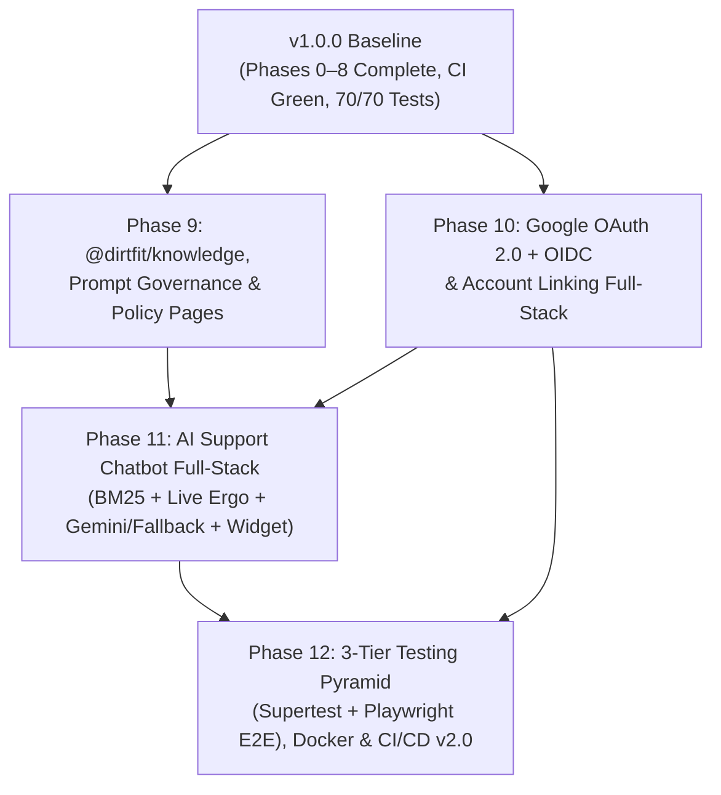

# 11. Lộ trình Triển khai Mở rộng v2.0 (Phase 9 → Phase 12) & Vận hành \$0

> **Nền tảng khởi đầu:** `v1.0.0` hoàn chỉnh 100% (Phase 0 → Phase 8 verified, 4/4 CI jobs xanh, 70/70 tests passed, 100% Pure JavaScript ESM, EN/VI i18n mặc định EN).  
> **Nguyên tắc thực thi:** Thực hiện tuần tự từng Phase theo đồ thị phụ thuộc, dừng nghiệm thu toàn bộ **Definition of Done (DoD)** bằng lệnh tự động trước khi chuyển sang Phase kế tiếp. **100% source code, tên biến, API, comment, test case và commit message viết bằng Tiếng Anh; toàn bộ UI, Policy Docs & Chatbot hỗ trợ đầy đủ song ngữ EN / VI (mặc định EN).**

---

## 1. Đồ thị Phụ thuộc & Lộ trình Mở rộng (Phase 9 → Phase 12)

> **Lý do sắp xếp thứ tự Phase 9 → 10 → 11 → 12:**
> - **Phase 9 đi trước** tạo nền tảng `@dirtfit/knowledge` + 3 trang `/policies/*` + bộ file `prompts/*.md` mà Chatbot (Phase 11) cần trích dẫn trực tiếp.
> - **Phase 10 trước Phase 11** hoàn thiện luồng `OAuthAccount`, `df_oauth_tx`, `POST /api/v1/auth/oauth/exchange` và hợp nhất hook merge guest session để Phase 11 gắn ngay `mergeGuestChatSessionToUser()` vào đúng 1 điểm thống nhất (Local Login + Register + Google OAuth Exchange).
> - **Phase 12 chốt cuối** nâng cấp toàn bộ Integration tests sang `Supertest`, dựng trọn bộ 6 kịch bản `Playwright` phủ cả OAuth + Chatbot + Storefront + Admin, xác minh Docker standalone + CI 5/5 jobs xanh và cập nhật tài liệu deploy `$0`.

---

## 2. Chi tiết Kế hoạch Từng Phase & Definition of Done (DoD)

### Phase 9: Knowledge Base Package (`@dirtfit/knowledge`), Prompt Governance & Storefront Policy Pages

- **Mục tiêu:** Thiết lập Single Source of Truth cho toàn bộ tài liệu chính sách/FAQ song ngữ EN/VI đóng gói an toàn trên cả Docker lẫn Vercel, hoàn thiện hệ thống quản trị Prompt có version, và xuất bản 3 trang chính sách công khai trên Storefront.
- **Phụ thuộc:** `v1.0.0`.
- **Deliverables chính:**
  1. Tạo package **`packages/knowledge`** (`@dirtfit/knowledge`, `"type": "module"`, 0 external dependencies):
     - 8 file Markdown chuẩn trong `content/{en,vi}/`: `ordering-and-deposit-guide.md`, `terms-and-conditions.md`, `warranty-and-returns.md`, `rider-fit-faq.md`.
     - `src/manifest.js` dùng `new URL('../content/.../*.md', import.meta.url)` tĩnh để `@vercel/nft` trace 100%, `src/parser.js` cắt chunk theo H2 section, `src/index.js`.
     - `tests/knowledge.test.js` kiểm tra EN/VI parity, anchor uniqueness, và nội dung không rỗng.
  2. Tạo hệ thống quản trị Prompt tại `apps/api/src/modules/chatbot/prompts/`:
     - `README.md`, `system.prompt.md`, `guardrails.prompt.md`, `intent-and-grounding.md`.
  3. Khai báo `"@dirtfit/knowledge": "workspace:*"` trong `apps/api/package.json` & `apps/web/package.json`; cập nhật `apps/web/next.config.mjs` (`transpilePackages` + `outputFileTracingIncludes` cho `/policies/**`).
  4. Tạo 3 trang Server Component trên `apps/web`: `/policies/ordering`, `/policies/terms`, `/policies/warranty` + component dùng chung `PolicyDocumentView.jsx` (Sticky TOC, render Markdown an toàn không dùng `dangerouslySetInnerHTML`, đọc cookie `dirtfit_locale`).
  5. Cập nhật `SiteFooter.jsx` & từ điển `en.js`/`vi.js` gắn liên kết tới 3 trang chính sách.
- **Definition of Done (DoD):**
  - [x] `pnpm check:pure-js && pnpm lint && pnpm format:check` thoát mã `0`.
  - [x] `pnpm --filter @dirtfit/knowledge test` đạt 100% pass (xác nhận parity EN/VI và đủ 4 tài liệu).
  - [x] `pnpm --filter @dirtfit/web build` (chế độ standalone) thành công và xác nhận thư mục standalone chứa đủ file `.md` chính sách.
  - [x] Cả 3 đường dẫn `/policies/ordering`, `/policies/terms`, `/policies/warranty` trả HTTP `200` đúng ngôn ngữ cho cả cookie `dirtfit_locale=en` và `dirtfit_locale=vi`.

---

### Phase 10: Google OAuth 2.0 + OIDC + Account Linking Full-Stack

- **Mục tiêu:** Triển khai hoàn chỉnh đăng nhập bằng Google chuẩn RFC 9700 (PKCE `S256` + `state` + OIDC `nonce` + JWKS RS256), Account Linking an toàn cho mọi edge case A–G, One-Time Ticket cross-origin handoff, Mock OAuth Adapter cho local/CI, và giao diện `/login`, `/register`, `/auth/callback`, `/account`.
- **Phụ thuộc:** `v1.0.0` (độc lập với Phase 9, triển khai sau Phase 9 để giữ nhịp tuần tự).
- **Deliverables chính:**
  1. **Database & Migration:** Cập nhật `apps/api/prisma/schema.prisma` (`AuthProvider`, `OAuthAccount`, `User.passwordHash` nullable, `User.avatarUrl`) + migration Expand-and-Contract + SQL `CHECK` constraints.
  2. **Shared Contracts & Config:**
     - Thêm mã lỗi OAuth vào `packages/shared/src/errors.js` + Zod schemas (`OAuthExchangeSchema`, `SetPasswordSchema`) vào `packages/shared/src/schemas/auth.schema.js`.
     - Cập nhật `apps/api/src/config/env.js` (biến Google OAuth + fail-fast cấm `ENABLE_MOCK_OAUTH=true` khi `NODE_ENV=production`), `turbo.json`, `.env.example`, `render.yaml`, `docker-compose.prod.yml`, Pino redaction trong `apps/api/src/app.js`.
  3. **Backend OAuth (`apps/api/src/modules/auth/`):**
     - Cài `jose` (ESM thuần, 0 deps) trong `apps/api`.
     - Mở rộng `auth.crypto.js`: PKCE `S256`, AES-256-GCM cho cookie `df_oauth_tx` (300s), HMAC hash cho One-Time Ticket (60s), `sanitizeReturnTo()` chống Open Redirect.
     - Triển khai `oauth/google.adapter.js`, `oauth/mock-google.adapter.js` (chỉ mount khi non-prod + `ENABLE_MOCK_OAUTH=true`), `oauth/oauth.service.js`.
     - Cập nhật `loginUser` xử lý Case C (chạy `verifyDummyPassword` khi `passwordHash === null` → trả `401 AUTH_OAUTH_ONLY_ACCOUNT`), cập nhật `sanitizeUser` trả `hasPassword` & `linkedProviders`, bổ sung `POST /api/v1/auth/set-password`, `GET /api/v1/auth/providers`, `POST /api/v1/auth/oauth/exchange` (merge `df_guest_cart`), và hợp nhất merge guest cart cho cả `registerHandler`.
  4. **Frontend (`apps/web`):**
     - `components/auth/GoogleAuthButton.jsx` gắn trên `/login` & `/register` + hiển thị banner lỗi `?oauthError=...` song ngữ EN/VI.
     - Trang `apps/web/src/app/auth/callback/page.jsx` + hàm `completeOAuthLogin(ticket)` trong `AppProviders.jsx` (có `useRef` guard chống double-call dưới React StrictMode).
     - Khu vực **Sign-in Methods & Set Local Password** trên `apps/web/src/app/account/page.jsx`.
  5. **Tests:** `apps/api/tests/unit/oauth-crypto.test.js` và `apps/api/tests/integration/oauth-google.test.js` phủ toàn bộ Cases A–G + Production `404` gating.
- **Definition of Done (DoD):**
  - [x] `pnpm --filter @dirtfit/api run db:validate && pnpm --filter @dirtfit/api run db:generate` sạch lỗi.
  - [x] `pnpm audit --prod --audit-level=high` thoát mã `0` (không có cảnh báo high/critical mới sau khi thêm `jose`).
  - [x] Unit test `oauth-crypto.test.js` và Integration test `oauth-google.test.js` pass 100% (bao gồm Case B giữ nguyên role `ADMIN`, Case C dummy Argon2, Open Redirect block, Ticket replay `401`, Production mock `404`).
  - [x] `pnpm check:pure-js && pnpm lint && pnpm format:check && pnpm test` thoát mã `0`.

---

### Phase 11: AI Support Chatbot Full-Stack (`modules/chatbot` + `SupportChatWidget.jsx`)

- **Mục tiêu:** Triển khai hoàn chỉnh AI Support Chatbot grounding 100% vào `@dirtfit/knowledge`, `CatalogCache` và `@dirtfit/ergonomics-engine`, hỗ trợ cả `GeminiChatAdapter` (Free Tier) lẫn `GroundedFallbackAdapter` (zero-key / 429 fallback), persistence DB + guest merge + Sweeper cleanup, và `SupportChatWidget.jsx` thẩm mỹ Anti-AI-Slop.
- **Phụ thuộc:** Phase 9 & Phase 10.
- **Deliverables chính:**
  1. **Database & Migration:** Thêm `ChatMessageRole`, `ChatFeedback`, `ChatIntent`, `ChatSession`, `ChatMessage` + SQL constraint `chk_chat_session_owner` vào `schema.prisma` và migration mới.
  2. **Backend (`apps/api/src/modules/chatbot/`):**
     - `chatbot.prompts.js` (nạp và kiểm chứng `prompts/*.md` lúc startup).
     - `chatbot.guardrails.js` (Prompt-Injection / Abuse pre-filter + output sanitizer).
     - `chatbot.intent.js` (Intent Router 8 nhóm + EN/VI Body/Bike Entity Extractor).
     - `chatbot.retriever.js` (Local BM25 / TF-IDF hỗ trợ tiếng Việt có dấu & không dấu, `< 2MB` RAM).
     - `chatbot.grounding.js` (đọc `CatalogCache`, chạy `evaluateBikeFit()` từ `@dirtfit/ergonomics-engine`, tra đơn scoped theo `authUser.id`).
     - `adapters/gemini.adapter.js` (native `fetch`, header `x-goog-api-key`, timeout `12s`, 1 retry, fallback tự động sang `GroundedFallbackAdapter`) và `adapters/fallback.adapter.js`.
     - `chatbot.repository.js`, `chatbot.service.js`, `chatbot.routes.js` (`/api/v1/chat/session`, `/api/v1/chat/messages`, `/api/v1/chat/messages/:id/feedback`, `/api/v1/admin/chat/metrics`).
     - Gắn `mergeGuestChatSessionToUser()` vào `loginHandler`, `registerHandler`, và `oauthExchangeHandler`.
     - Mở rộng `apps/api/src/modules/sweeper/sweeper.service.js` dọn guest `ChatSession` hết hạn (`user_id IS NULL AND expires_at <= NOW()`).
  3. **Frontend (`apps/web`):**
     - `components/chat/SupportChatWidget.jsx` + `components/chat/SafeChatMessage.jsx` (whitelist renderer, zero `dangerouslySetInnerHTML`) + `components/chat/MiniFitCard.jsx`.
     - Mount trong `StorefrontShell.jsx` (tự động ẩn trên `/admin/*`), hỗ trợ Quick Prompts EN/VI, Citation Chips, Mini Fit Card, Copy, Feedback `👍👎`, Reset phiên chat, đồng bộ khi đăng nhập/đăng xuất.
  4. **Tests:** `apps/api/tests/unit/chatbot-engine.test.js`, `apps/web/tests/chat-renderer.test.js`, và `apps/api/tests/integration/chatbot-grounded.test.js`.
- **Definition of Done (DoD):**
  - [x] Mọi câu hỏi về chính sách trả về `citations[]` thật trỏ tới `/policies/*` khớp `locale` hiện tại.
  - [x] Câu hỏi tư vấn vóc dáng trả về `recommendedBikes[]` có `effectiveSeatHeightMm` và `contactStatus` khớp 100% kết quả của `@dirtfit/ergonomics-engine`.
  - [x] Prompt Injection, XSS payload, IDOR cross-user feedback/session đều bị chặn có kiểm chứng test tự động; Rate Limit `429` hoạt động trên Redis.
  - [x] Khi không có `GEMINI_API_KEY` (hoặc mô phỏng Gemini trả `429`/timeout), hệ thống tự chuyển mượt sang `GroundedFallbackAdapter` và vẫn trả kết quả đầy đủ citations.
  - [x] `pnpm check:pure-js && pnpm lint && pnpm format:check && pnpm test` thoát mã `0`.

---

### Phase 12: 3-Tier Testing Pyramid (`Supertest` + `Playwright`), Docker, CI/CD & `$0` Deployment Guide v2.0

- **Mục tiêu:** Chuẩn hóa toàn bộ hệ thống kiểm thử 3 tầng theo `10-testing-pyramid-unit-integration-system.md`, hoàn thiện đóng gói Production Docker + CI/CD 5 jobs xanh 100% và hướng dẫn deploy `$0` cho cả Google OAuth + Gemini API.
- **Phụ thuộc:** Phase 10 & Phase 11.
- **Deliverables chính:**
  1. **Tầng 1 & Tầng 2 Upgrade:**
     - Cài `supertest` (`devDependencies` của `apps/api`), tạo `apps/api/tests/helpers/http-server.js` (`startTestServer()` trên `port: 0`).
     - Chuyển toàn bộ 6 suite trong `apps/api/tests/integration/*.test.js` sang gọi HTTP thực qua **Supertest** (kèm kiểm tra Helmet/CORS/Cookie flags).
     - Tách `apps/api/vitest.unit.config.mjs` (song song, 0 DB/Redis) và `apps/api/vitest.config.mjs` (tuần tự `fileParallelism: false`).
  2. **Tầng 3 System E2E (`Playwright` Pure JS ESM):**
     - Cài `@playwright/test` ở root `devDependencies`, tạo `playwright.config.mjs` và đủ 6 file spec `tests/system/01..06*.spec.js` phủ toàn bộ hành trình Storefront, OAuth, Chatbot, Checkout, Test Ride và Admin Calibration.
     - Chuẩn hóa root scripts (`test:unit`, `test:integration`, `test:system`, `test`) và `turbo.json` (`test:unit`, `globalPassThroughEnv` bổ sung đầy đủ biến v2.0).
     - Bổ sung `playwright-report/`, `test-results/` vào `.gitignore`, `.prettierignore`, `.dockerignore` và `scripts/check-pure-js.mjs`.
  3. **CI/CD, Docker & Deployment Docs:**
     - Cập nhật `.github/workflows/ci.yml`: tách rõ chạy `test:unit` + `test:integration` và bổ sung job `system-e2e` (Playwright Chromium cache + artifact upload khi fail).
     - Build và smoke-test lại cả 2 production image `apps/api/Dockerfile` & `apps/web/Dockerfile` qua `docker-compose.prod.yml` + `scripts/smoke-stack.mjs` (mở rộng smoke check kiểm tra thêm `/policies/ordering`, `/policies/terms`, `/api/v1/auth/providers`, `/api/v1/chat/session`, và xác nhận `mock-authorize` trả `404` ở production).
     - Cập nhật `docs/DEPLOYMENT_FREE_TIER.md` hướng dẫn từng bước tạo **Google Cloud Console OAuth 2.0 Client ID** và **Google AI Studio Gemini API Key Free Tier** + đồng bộ `render.yaml` và `apps/api/.env.example`.
- **Definition of Done (DoD):**
  - [ ] `pnpm check:pure-js && pnpm lint && pnpm format:check && pnpm audit --prod --audit-level=high` thoát mã `0`.
  - [ ] `pnpm test:unit` pass 100% trong `< 5s` (không cần Docker Postgres/Redis).
  - [ ] `pnpm test:integration` (Supertest) pass 100% liên tiếp 2 lần không flaky.
  - [ ] `pnpm test:system` (Playwright Chromium, 6/6 E2E specs) pass 100%.
  - [ ] `docker compose -f docker-compose.prod.yml up --build -d` đạt trạng thái `healthy` cả API & Web, `pnpm smoke` pass 100% bao gồm kiểm tra OAuth/Chatbot/Policies.
  - [ ] Toàn bộ 5/5 jobs trên GitHub Actions (`ci.yml`) xanh 100%.

---

## 3. Bảng Đồng bộ Biến Môi trường mới của `v2.0`

Tất cả các biến sau sẽ được đồng bộ trên 6 điểm: `apps/api/src/config/env.js`, `turbo.json` (`globalPassThroughEnv`), `apps/api/.env.example`, `render.yaml`, `docker-compose.prod.yml`, và `.github/workflows/ci.yml`:

| Biến môi trường | Mặc định (`env.js`) | Bắt buộc ở Production? | Mô tả & Quy tắc Fail-Fast |
| :--- | :--- | :---: | :--- |
| `GOOGLE_OAUTH_ENABLED` | `false` | Tùy chọn (`true` khi gắn Google) | Bật/tắt nút & luồng Google OAuth 2.0. |
| `ENABLE_MOCK_OAUTH` | `false` | **Bắt buộc `false`** | Chỉ dùng cho local/test/CI. **`env.js` fail-fast nếu `true` khi `NODE_ENV=production`**. |
| `GOOGLE_CLIENT_ID` | *(optional)* | Bắt buộc nếu `GOOGLE_OAUTH_ENABLED=true` | OAuth 2.0 Client ID từ Google Cloud Console. |
| `GOOGLE_CLIENT_SECRET` | *(optional)* | Bắt buộc nếu `GOOGLE_OAUTH_ENABLED=true` | OAuth 2.0 Client Secret (redacted trong Pino logs). |
| `GOOGLE_CALLBACK_URL` | *(optional)* | Bắt buộc nếu `GOOGLE_OAUTH_ENABLED=true` | URL callback tuyệt đối, ví dụ `https://api.dirtfit.vn/api/v1/auth/google/callback` (local: `http://localhost:4000/api/v1/auth/google/callback`). |
| `CHAT_PROVIDER` | `auto` (`auto` \| `gemini` \| `fallback`) | `auto` (hoặc `fallback`) | `auto`: dùng Gemini khi có `GEMINI_API_KEY`, tự fallback sang `GroundedFallbackAdapter` nếu không có key hoặc gặp `429`/timeout. |
| `GEMINI_API_KEY` | *(optional)* | Tùy chọn (khuyến nghị gắn ở prod) | API key miễn phí từ Google AI Studio (gửi qua header `x-goog-api-key`, redacted trong logs). |
| `GEMINI_MODEL` | `gemini-2.5-flash` | Có default | Model nhẹ tối ưu Free Tier; dễ đổi qua env mà không cần sửa code. |
| `CHAT_RATE_LIMIT_MAX` | `15` | Có default (`15` req/min) | Giới hạn số tin nhắn/phút theo `userId`/IP trên Upstash Redis. |
| `CHAT_GUEST_TTL_DAYS` | `7` | Có default (`7` ngày) | Thời gian sống của `ChatSession` khách ẩn danh trước khi Sweeper dọn sạch. |

---

## 4. Hướng dẫn Cấu hình Dịch vụ Miễn phí mới (\$0/tháng) *(sẽ đồng bộ vào `docs/DEPLOYMENT_FREE_TIER.md` ở Phase 12)*

### 4.1. Google Cloud Console — OAuth 2.0 Credentials (\$0)
1. Truy cập [Google Cloud Console](https://console.cloud.google.com/) → Tạo Project mới (ví dụ `dirtfit-commerce`) — **không cần bật Billing**.
2. Vào **Google Auth Platform / OAuth consent screen**:
   - Chọn **External**, điền tên ứng dụng (`DirtFit Commerce`), email hỗ trợ, logo và đường dẫn công khai `/policies/terms`.
   - Thêm Scopes tối thiểu (Non-sensitive, không cần Google App Verification tốn phí): `openid`, `email`, `profile`.
   - Nếu ở trạng thái Testing, thêm test users; khi lên production public, chuyển sang **In Production**.
3. Vào **Clients → Create OAuth client ID → Web application**:
   - **Authorized JavaScript origins:** `http://localhost:3000` (dev) và `https://dirtfit.vn` (prod).
   - **Authorized redirect URIs:**
     - Local: `http://localhost:4000/api/v1/auth/google/callback`
     - Production: `https://api.dirtfit.vn/api/v1/auth/google/callback` (hoặc `https://<your-render-service>.onrender.com/api/v1/auth/google/callback`).
4. Lưu `Client ID` → `GOOGLE_CLIENT_ID`, `Client Secret` → `GOOGLE_CLIENT_SECRET`, đặt `GOOGLE_OAUTH_ENABLED=true`, `ENABLE_MOCK_OAUTH=false` trên Render.

### 4.2. Google AI Studio — Gemini API Key Free Tier (\$0)
1. Truy cập [Google AI Studio](https://aistudio.google.com/apikey) → tạo API key trong project Free Tier (không cần thẻ tín dụng).
2. Nạp `GEMINI_API_KEY` vào Render Environment Variables (giữ `CHAT_PROVIDER=auto`, `GEMINI_MODEL=gemini-2.5-flash`).
3. **Bảo vệ hạn mức Free Tier:**
   - Intent Router + BM25 Retriever chạy 100% local (0 lượt gọi LLM cho phân loại hay tìm tài liệu).
   - Prompt Injection pre-filter chặn sớm trước khi gọi Gemini.
   - Rate Limit `15 req/min/user` bảo vệ quota RPM/RPD.
   - Khi chạm `429` hoặc quá `12s`, hệ thống tự chuyển tức thì sang `GroundedFallbackAdapter` — dịch vụ Chatbot không bao giờ trả lỗi `500` cho khách hàng.

---

## 5. Sổ Quản trị Rủi ro Kỹ thuật v2.0 (Risk Register)

| Rủi ro | Mức độ | Biện pháp giảm thiểu đã nhúng vào kiến trúc |
| :--- | :---: | :--- |
| **Render Free 512MB RAM bị OOM** khi thêm Chatbot + Knowledge Base | Trung bình | Không dùng Vector DB hay embedding model cục bộ; Local BM25 index cho 8 file `.md` tốn `< 2 MB` RAM; không cài SDK LLM nặng (dùng native Node 22 `fetch()`). |
| **Cạn quota Upstash Redis (500k lệnh/tháng)** do OAuth & Chat | Cao | `df_oauth_tx` dùng encrypted cookie (**0 lệnh Redis**); One-Time Ticket chỉ tốn 2 lệnh (`SET` + `GETDEL`) khi login thành công; Catalog grounding tái sử dụng L1 In-Memory LRU 30s; Sweeper dọn `ChatSession` dùng PostgreSQL trực tiếp qua cron 15 phút. |
| **Safari ITP / Cross-Origin Cookie** giữa `*.vercel.app` và `*.onrender.com` | Cao | Dùng One-Time Ticket Exchange (`POST /api/v1/auth/oauth/exchange` với `credentials: 'include'`), khuyến nghị custom subdomain cùng root domain (`dirtfit.vn` + `api.dirtfit.vn`), giữ fallback `SameSite=None; Secure` + `verifyOriginCsrf`. |
| **Thiếu file `.md` khi đóng gói Next.js Standalone / Vercel** | Cao | Đóng gói trong workspace package `@dirtfit/knowledge` + khai báo tĩnh `new URL('../content/.../*.md', import.meta.url)` + `outputFileTracingIncludes` trong `next.config.mjs` + kiểm chứng trực tiếp bằng `next build` ở Phase 9 & Docker build ở Phase 12. |
| **Playwright E2E bị flaky trên GitHub Actions** | Trung bình | Chạy tuần tự (`workers: 1`), `webServer` đợi `/health/ready` và `/` sẵn sàng trước khi test, bật `retries: 1` trên CI, dùng `runId` cô lập và upload `playwright-report/` + trace khi fail. |
| **Biến động lỗ hổng `pnpm audit --prod --audit-level=high`** | Thấp | `supertest` và `@playwright/test` là `devDependencies`; production chỉ thêm `jose` (zero transitive dependencies). |
