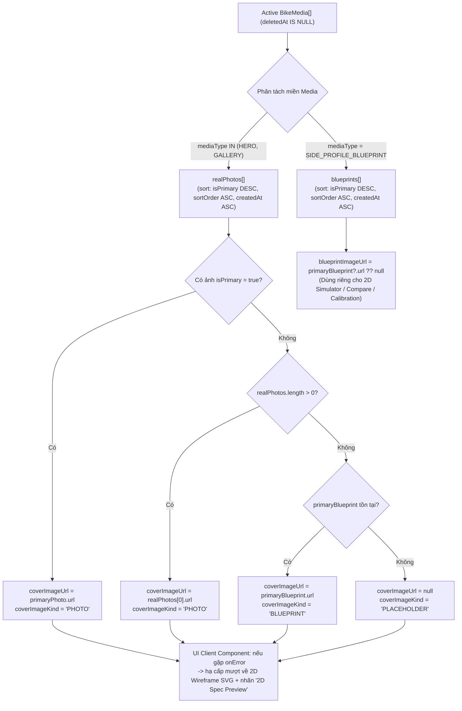
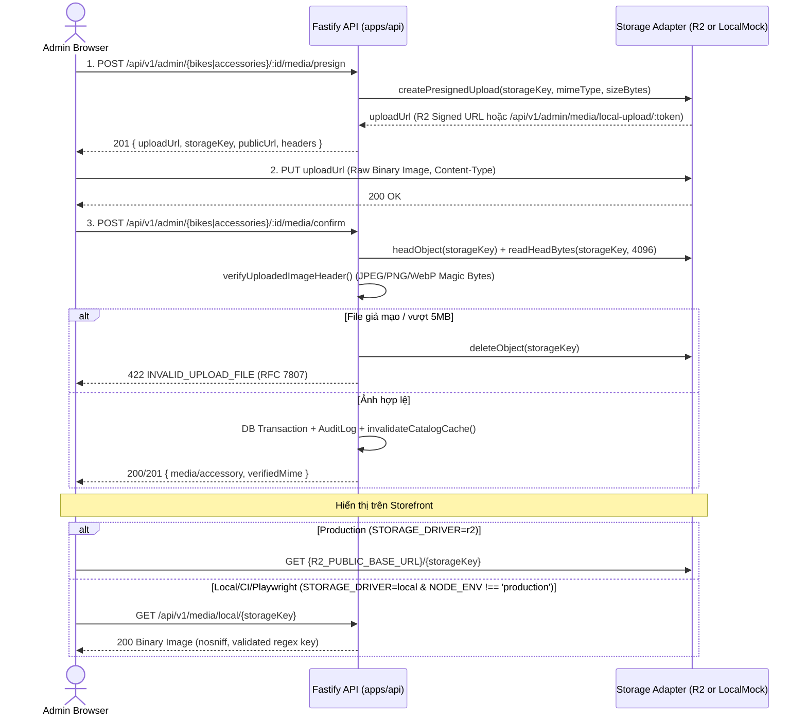

# 12. Kiến trúc Hệ thống Ảnh thật Sản phẩm (Xe máy & Phụ kiện) & Trải nghiệm Giỏ hàng Giàu thông tin (Expansion v2.1)

> **Phiên bản mục tiêu:** `v2.1.0` (mở rộng tương thích ngược 100% trên nền `v2.0.0` đang chạy production trên **Neon PostgreSQL + Upstash Redis + Cloudflare R2 + Render API + Vercel Web**)  
> **Ràng buộc kỹ thuật bắt buộc:** **100% Pure JavaScript ESM (`"type": "module"`)**, zero TypeScript (`.ts`/`.tsx`/`tsconfig.json`), Zod `.strict()`, RFC 7807, **\$0/tháng** (Cloudflare R2 Free 10 GB / 0 egress), song ngữ **EN / VI (mặc định EN)**, giữ nguyên 100% **107 bài test hiện có** và không làm gián đoạn dữ liệu Neon production.

---

## 1. Bối cảnh Thực trạng `v2.0` & Vấn đề cần giải quyết

Qua rà soát toàn bộ codebase `v2.0`, hệ thống hiện tồn tại 4 khoảng trống thực tế khi vận hành thương mại:

1. **Chưa tách bạch Ảnh thật bán hàng và Ảnh 2D Blueprint trên Xe máy:**
   - Trong `apps/api/prisma/schema.prisma`, bảng `bike_media` đã có enum `MediaType { HERO, GALLERY, SIDE_PROFILE_BLUEPRINT, SPEC_SHEET }`, nhưng mới chỉ có 1 Partial Unique Index `uq_bike_single_primary_blueprint` cho `SIDE_PROFILE_BLUEPRINT`. Chưa có ràng buộc đảm bảo **duy nhất 1 ảnh bìa thật (`HERO`/`GALLERY`) đang active** mỗi xe, và chưa có API đổi ảnh bìa (`PATCH .../primary`), sắp xếp thứ tự (`PATCH .../reorder`) hay xóa mềm + dọn R2 (`DELETE .../:mediaId`).
   - Trên Storefront, `BikeCard.jsx` chỉ render 2D Wireframe SVG còn `BikeDetailClient.jsx` không hiển thị gallery ảnh chụp thực tế của xe.
   - Trong `apps/api/prisma/seed.js`, 8 xe mẫu đang seed sẵn URL placeholder `https://cdn.dirtfit.vn/bikes/<slug>/hero.webp` không trỏ tới ảnh thật — nếu giao diện gắn thẳng `` mà không có cơ chế chống vỡ ảnh (`onError` fallback), toàn bộ 8 xe mẫu sẽ hiện icon broken image.
2. **Phụ kiện (`Accessory`) chưa có pipeline upload ảnh lên Cloudflare R2:**
   - Bảng `accessories` đã có cột `image_url VARCHAR(512)` nhưng chưa có `image_storage_key` để quản lý vòng đời xóa/thay thế object trên R2, chưa có endpoint `presign -> PUT -> confirm (4KB Magic Bytes) -> delete`, và Admin `/admin/accessories` chưa có công cụ chọn/tải ảnh lên R2.
3. **Giỏ hàng (`/cart`), Checkout (`/checkout`) & Lịch sử đơn hàng (`/account`) thiếu trực quan và thiếu Deep-Link:**
   - `cart.repository.js` hiện query `bike.media` với `take: 2` không phân biệt `mediaType` nên có nguy cơ lấy nhầm URL của `SIDE_PROFILE_BLUEPRINT` thay vì ảnh bìa thật; `CartPage` và `CheckoutPage` chưa hiển thị ảnh thumbnail và chưa gắn `<Link>` điều hướng về `/bikes/[slug]` hay `/accessories?sku=...`.
4. **Hạn chế xem trước ảnh khi chạy `STORAGE_DRIVER=local` (Dev / CI / Playwright):**
   - `LocalMockStorageAdapter` lưu buffer vào RAM nhưng trả `publicUrl = https://cdn.dirtfit.vn/...`, khiến trình duyệt local/Playwright không thể tải ngược ảnh vừa upload để kiểm chứng hiển thị end-to-end trên Storefront.

---

## 2. Trụ cột 1 — Kiến trúc Media Xe máy: Tách bạch Ảnh thật Bán hàng vs. 2D Side Blueprint

### 2.1. Phân tách Domain Media trên `BikeMedia`

Giữ nguyên 100% bảng `bike_media` và enum `MediaType { HERO, GALLERY, SIDE_PROFILE_BLUEPRINT, SPEC_SHEET }` (không đổi tên cột, không phá vỡ dữ liệu đang chạy trên Neon), phân nhóm nghiệp vụ rõ ràng thành **2 miền độc lập**:

| Miền Media | Giá trị `mediaType` | Mục đích sử dụng | Quy tắc `isPrimary` | Dữ liệu `calibrationData` |
| :--- | :--- | :--- | :--- | :--- |
| **Miền Thương mại (Real Product Photos)** | `HERO`, `GALLERY` | Ảnh bìa trên `/`, `/bikes`, `/cart`, `/checkout`, `MiniFitCard`, và bộ sưu tập ảnh góc chụp trên `/bikes/[slug]`. | Tối đa **1 ảnh active** (`isPrimary = true`, `deletedAt IS NULL`) cho mỗi `bikeId` (bảo vệ bởi Partial Unique Index mới `uq_bike_single_primary_photo`). | Luôn `null` (chặn ghi calibration lên ảnh gallery). |
| **Miền Kỹ thuật 2D (Technical Blueprint)** | `SIDE_PROFILE_BLUEPRINT` | Dùng riêng cho **2D Rider Fit Simulator**, **Ghost Overlay Compare** và **Admin 6-Point UV Calibration Tool**. | Giữ nguyên tối đa **1 blueprint active** (`isPrimary = true`, `deletedAt IS NULL`) bảo vệ bởi index hiện hữu `uq_bike_single_primary_blueprint`. | Lưu JSON 6 điểm neo UV chuẩn hóa `[0..1]`. |
| **Tài liệu phụ (Optional)** | `SPEC_SHEET` | Bản vẽ / bảng thông số mở rộng (nếu có). | Không cạnh tranh `isPrimary` với 2 miền trên. | `null`. |

> **Nguyên tắc bất biến (Isolation Invariant):** Mọi thao tác upload, đặt ảnh bìa (`Set as Cover`), sắp xếp (`Reorder`), hay xóa (`Delete`) thuộc Miền Thương mại (`HERO`/`GALLERY`) **tuyệt đối không chạm tới** bản ghi `SIDE_PROFILE_BLUEPRINT` và ngược lại.

### 2.2. Thiết kế Database & Zero-Downtime Migration trên Neon Production

Migration additive `apps/api/prisma/migrations/20261126000000_v21_product_media/migration.sql` (chạy tự động trước khi khởi động API mới trong `.github/workflows/cd.yml` qua `DIRECT_URL`):

```sql
-- ============================================================================
-- Migration v2.1: Real Product Media (Bike Cover Photo + Accessory Storage Key)
-- Zero-downtime, 100% additive & safe for live Neon production data.
-- ============================================================================

-- 1. Defensive deduplication BEFORE creating partial unique index:
--    In v2.0, an Admin could upload a GALLERY image with is_primary = true while
--    seed.js also created a HERO row with is_primary = true.
--    Keep the highest-priority active real photo (uploaded UUID photo first,
--    then HERO before GALLERY, then lowest sort_order / newest created_at).
WITH ranked_primary_photos AS (
  SELECT
    "id",
    ROW_NUMBER() OVER (
      PARTITION BY "bike_id"
      ORDER BY
        CASE WHEN "url" NOT LIKE 'https://cdn.dirtfit.vn/bikes/%/hero.webp' THEN 0 ELSE 1 END,
        CASE WHEN "media_type" = 'HERO' THEN 0 ELSE 1 END,
        "sort_order" ASC,
        "created_at" DESC
    ) AS rn
  FROM "bike_media"
  WHERE "media_type" IN ('HERO', 'GALLERY')
    AND "is_primary" = true
    AND "deleted_at" IS NULL
)
UPDATE "bike_media"
SET "is_primary" = false,
    "updated_at" = NOW()
WHERE "id" IN (
  SELECT "id" FROM ranked_primary_photos WHERE rn > 1
);

-- 2. Partial Unique Index: at most 1 active primary commercial photo (HERO/GALLERY) per bike.
--    Completely orthogonal to existing uq_bike_single_primary_blueprint!
CREATE UNIQUE INDEX "uq_bike_single_primary_photo"
  ON "bike_media" ("bike_id")
  WHERE "media_type" IN ('HERO', 'GALLERY')
    AND "is_primary" = true
    AND "deleted_at" IS NULL;

-- 3. Additive nullable column on accessories to track R2 storage key for safe cleanup/replacement.
ALTER TABLE "accessories"
  ADD COLUMN "image_storage_key" VARCHAR(255);
```

- **Kiểm chứng Zero-Downtime:**
  - Code `v2.0` đang chạy trong lúc `prisma migrate deploy` thực thi vẫn đọc/ghi bình thường vì cột `image_storage_key` cho phép `NULL` và không xóa/đổi kiểu bất kỳ cột cũ nào.
  - Bước CTE chống trùng `ranked_primary_photos` đảm bảo `CREATE UNIQUE INDEX` **không bao giờ fail với `SQLSTATE 23505`** dù trên Neon production đã có dữ liệu upload thử nghiệm từ trước.
  - Index cũ `uq_bike_single_primary_blueprint` giữ nguyên 100%, không ảnh hưởng bài test ràng buộc Phase 2 (`database.constraints.test.js`).

### 2.3. Quy tắc Fallback Hierarchy Thống nhất (`@dirtfit/shared`)

Đặt hàm pure ESM `resolveBikeMedia(mediaList)` và `resolveAccessoryMedia(accessory)` ngay trong `packages/shared/src/media.js` (0 external dependencies, export qua `@dirtfit/shared`) để **Backend API Mappers** (`catalog.mapper.js`, `cart.service.js`, `orders.mapper.js`, `chatbot/context-builder.js`) và **Frontend** dùng chung 1 nguồn chân lý duy nhất:



- **Quy tắc hiển thị Thương mại** (`/`, `/bikes`, `/bikes/[slug]` Gallery, `/cart`, `/checkout`, `MiniFitCard`):
  1. Ưu tiên ảnh thật có `isPrimary = true` (`HERO` hoặc `GALLERY`).
  2. Nếu chưa gắn `isPrimary`, lấy ảnh `HERO`/`GALLERY` đầu tiên theo `sortOrder ASC, createdAt ASC`.
  3. Nếu chưa có ảnh thật nào, lấy `blueprintImageUrl` (`imageKind = 'BLUEPRINT'`).
  4. Nếu chưa có hoặc `` tải lỗi (`onError`, bao gồm các URL placeholder `cdn.dirtfit.vn` từ `seed.js`), tự động fallback về **2D Parametric Wireframe SVG** dựng từ `BikeGeometrySpec` kèm nhãn kỹ thuật nhỏ `2D Spec Preview` — **cam kết 0 broken image trên toàn hệ thống**.
- **Quy tắc hiển thị Kỹ thuật** (`RiderFitSimulator`, `/compare` Ghost Overlay, `BlueprintCalibrationTool`):
  - **Chỉ** đọc `primaryBlueprint` (`mediaType === 'SIDE_PROFILE_BLUEPRINT'`). Không bao giờ dùng ảnh góc nghiêng/ngoài trời trong `galleryImages[]` làm nền cho 2D Simulator.

### 2.4. Thiết kế Backend API Quản trị Media Xe máy & Catalog JSON Contract

#### A. Quy ước R2 Storage Key (Path-Traversal Proof & Tương thích ngược)

Mở rộng `apps/api/src/common/storage/magic-bytes.js` (bỏ qua hoàn toàn tên file gốc client gửi lên):

| Loại tài sản | Quy ước Storage Key mới (`v2.1`) | Tương thích Regex cũ |
| :--- | :--- | :--- |
| Ảnh thật xe (`HERO`, `GALLERY`) | `bikes/<bikeId>/photos/<uuid>.<ext>` | Khớp `startsWith("bikes/<bikeId>/")` |
| Ảnh 2D Blueprint (`SIDE_PROFILE_BLUEPRINT`) | `bikes/<bikeId>/blueprint/<uuid>.<ext>` | Khớp `startsWith("bikes/<bikeId>/")` |
| Tài liệu kỹ thuật (`SPEC_SHEET`) | `bikes/<bikeId>/specs/<uuid>.<ext>` | Khớp `startsWith("bikes/<bikeId>/")` |
| Ảnh phụ kiện (`Accessory`) | `accessories/<accessoryId>/<uuid>.<ext>` | Namespace tách biệt hoàn toàn |

- `validateSafeBikeStorageKey(key, bikeId)` chấp nhận cả định dạng mới `^bikes/<uuid>/(photos|blueprint|specs)/<uuid>\.(jpg|png|webp)$` lẫn định dạng cũ `^bikes/<uuid>/<uuid>\.(jpg|png|webp)$` để mọi bản ghi/test cũ hoạt động 100% không gãy.

#### B. Endpoints Quản trị Ảnh Xe máy (`/api/v1/admin/...`)

> **Tương thích ngược:** Giữ nguyên 2 route hiện hữu `POST /api/v1/admin/media/presign` và `POST /api/v1/admin/media/confirm` (đang được `catalog-ergonomics-media.test.js` gọi trực tiếp), đồng thời bổ sung bộ route chuẩn REST theo tài nguyên xe dưới `/api/v1/admin/bikes/:id/media/*` dùng chung tầng `uploads.service.js`:

| Method | Endpoint | RBAC | Zod Body / Params (`.strict()`) | Hành vi & Bảo toàn Tính toàn vẹn |
| :--- | :--- | :--- | :--- | :--- |
| `POST` | `/api/v1/admin/bikes/:id/media/presign` *(+ alias cũ `/admin/media/presign`)* | `ADMIN` | `{ mediaType, mimeType, sizeBytes <= 5MB, originalFileName? }` | Xác nhận bike active; sinh key `bikes/<id>/(photos\|blueprint\|specs)/<uuid>.<ext>`; trả `201 { uploadUrl, uploadPath?, storageKey, publicUrl, method: 'PUT', headers: { 'content-type' }, expiresInSeconds: 300 }`. |
| `POST` | `/api/v1/admin/bikes/:id/media/confirm` *(+ alias cũ `/admin/media/confirm`)* | `ADMIN` | `{ storageKey, declaredMimeType, mediaType, altText?, widthPx?, heightPx?, isPrimary?, sortOrder? }` | 1. Validate key + `headObject` (`<= 5MB`) + đọc **4KB đầu** kiểm tra Magic Bytes (JPEG/PNG/WebP, chặn SVG/HTML XSS; sai → xóa object + `MEDIA_UPLOAD_REJECTED` AuditLog + `422 INVALID_UPLOAD_FILE`).<br>2. Trong Prisma `$transaction`:<br>&nbsp;&nbsp;- Nếu `mediaType === 'SIDE_PROFILE_BLUEPRINT'` và `isPrimary === true`: hạ `isPrimary = false` chỉ trên `SIDE_PROFILE_BLUEPRINT` cũ.<br>&nbsp;&nbsp;- Nếu `mediaType IN ('HERO', 'GALLERY')`: nếu `isPrimary === true` **hoặc** xe chưa có ảnh thật `isPrimary = true` nào (hoặc chỉ còn ảnh seed placeholder `cdn.dirtfit.vn/bikes/%/hero.webp`), hạ `isPrimary = false` các ảnh `HERO`/`GALLERY` cũ rồi gán `isPrimary = true` cho ảnh mới.<br>3. Ghi `AuditLog` (`BIKE_MEDIA_CREATED`) + gọi `invalidateCatalogCache(app)`. Trả `201 { media, verifiedMime }`. |
| `PATCH` | `/api/v1/admin/bikes/:id/media/:mediaId/primary` | `ADMIN` | Params: `{ id, mediaId }` | Chỉ cho phép trên `HERO`/`GALLERY` (đặt làm ảnh bìa chính) hoặc `SIDE_PROFILE_BLUEPRINT` (đặt blueprint chính). Trong 1 `$transaction`: hạ `isPrimary = false` các ảnh cùng miền của xe đó → nâng `mediaId` lên `isPrimary = true` → ghi `AuditLog` (`BIKE_MEDIA_PRIMARY_CHANGED`) → `invalidateCatalogCache(app)`. Trả `200 { media }`. |
| `PATCH` | `/api/v1/admin/bikes/:id/media/reorder` | `ADMIN` | `{ orderedMediaIds: z.array(UuidSchema).min(1).max(30) }` | Xác nhận tất cả `mediaId` đều thuộc `bikeId` và `deletedAt === null`; cập nhật `sortOrder = index` trong 1 `$transaction`; ghi `AuditLog` (`BIKE_MEDIA_REORDERED`) + `invalidateCatalogCache(app)`. Trả `200 { media: [...] }`. |
| `DELETE` | `/api/v1/admin/bikes/:id/media/:mediaId` | `ADMIN` | Params: `{ id, mediaId }` | Trong 1 `$transaction`:<br>1. Soft-delete (`deletedAt = NOW()`, `isPrimary = false`).<br>2. Nếu bản ghi vừa xóa là ảnh thật có `wasPrimary === true` (`HERO`/`GALLERY`), tự động promote ảnh thật active kế tiếp (theo `sortOrder ASC, createdAt ASC`) lên `isPrimary = true` (nếu còn).<br>3. Ghi `AuditLog` (`BIKE_MEDIA_DELETED`).<br>Sau khi transaction commit: xóa best-effort object trên R2/local (bỏ qua nếu key là placeholder seed hoặc đã không tồn tại) + gọi `invalidateCatalogCache(app)`. Trả `200 { deletedMediaId, promotedCoverMediaId }`. |
| `PATCH` | `/api/v1/admin/bikes/:id/media/:mediaId/calibration` | `ADMIN` | Giữ nguyên `CalibrationDataSchema` | Bổ sung guard nghiệp vụ: trả `400 VALIDATION_ERROR` nếu cố lưu calibration lên media có `mediaType !== 'SIDE_PROFILE_BLUEPRINT'`. |

> **Quyền `SALES_STAFF`:** Được xem toàn bộ danh sách ảnh xe trên `/admin/bikes/[id]` (qua `GET /api/v1/admin/bikes/:id`), nhưng nhận `403 FORBIDDEN` khi gọi mọi mutation media (`presign`, `confirm`, `primary`, `reorder`, `delete`, `calibration`).

#### C. Mở rộng Catalog Response Contract (`GET /api/v1/bikes`, `GET /api/v1/bikes/:slug`, `GET /api/v1/admin/bikes/:id`)

`mapBikeRecord(bike)` trong `apps/api/src/modules/catalog/catalog.mapper.js` giữ nguyên 100% các trường hiện có (kể cả `media[]`) và **bổ sung additive** các trường đã phân tách sẵn từ `resolveBikeMedia(bike.media)`:

```json
{
  "id": "63c30153-568e-424f-a6fb-9fd5827d8809",
  "slug": "ktm-350-exc-f",
  "name": "KTM 350 EXC-F",
  "priceVnd": 359000000,
  "coverImageUrl": "https://pub-xxxx.r2.dev/bikes/63c30153-.../photos/a1b2c3d4-....webp",
  "coverImageKind": "PHOTO",
  "blueprintImageUrl": "https://pub-xxxx.r2.dev/bikes/63c30153-.../blueprint/e5f6a7b8-....png",
  "primaryPhoto": {
    "id": "...",
    "url": "https://pub-xxxx.r2.dev/bikes/.../photos/a1b2c3d4-....webp",
    "mediaType": "GALLERY",
    "altText": "KTM 350 EXC-F right three-quarter view",
    "isPrimary": true,
    "sortOrder": 0
  },
  "galleryImages": [
    { "id": "...", "url": "...", "mediaType": "GALLERY", "isPrimary": true, "sortOrder": 0 },
    { "id": "...", "url": "...", "mediaType": "GALLERY", "isPrimary": false, "sortOrder": 1 }
  ],
  "primaryBlueprint": {
    "id": "...",
    "url": "https://pub-xxxx.r2.dev/bikes/.../blueprint/e5f6a7b8-....png",
    "mediaType": "SIDE_PROFILE_BLUEPRINT",
    "isPrimary": true,
    "calibrationData": { "version": 1, "facing": "RIGHT", "anchorsUv": { "...": "..." } }
  },
  "media": [ "...giữ nguyên đầy đủ mảng cũ để tương thích ngược 100%..." ]
}
```

---

## 3. Trụ cột 2 — Kiến trúc Media Phụ kiện (`Accessory`) + Cloudflare R2 Upload

### 3.1. Phân tích Trade-off Thiết kế Database (`Accessory` Column vs. Bảng `AccessoryMedia`)

| Tiêu chí | Phương án A (ĐƯỢC CHỌN): Cột `imageUrl` (đã có) + `imageStorageKey` trực tiếp trên `Accessory` | Phương án B: Tách bảng `accessory_media` (1-N) |
| :--- | :--- | :--- |
| **Đặc thù sản phẩm** | Phụ kiện kỹ thuật (lowering link, yên thấp, bar riser, lò xo, giày bảo hộ) chỉ cần **1 ảnh sản phẩm chính** rõ nét trên card, giỏ hàng và bảng Admin. | Thừa phức tạp cho mục tiêu `v2.1`; tạo thêm 4 endpoint quản lý thứ tự/primary không cần thiết. |
| **Hiệu năng Free Tier (Neon 0.5 GB / Render 512 MB)** | **0 JOIN bổ sung** cho `GET /api/v1/accessories`, `GET /api/v1/bikes/:slug` (compatibilities), và `GET /api/v1/cart`. | Thêm JOIN/subquery trên mọi truy vấn giỏ hàng và danh sách phụ kiện tương thích. |
| **Migration Zero-Downtime** | Chỉ 1 lệnh `ALTER TABLE accessories ADD COLUMN image_storage_key VARCHAR(255)` (instant metadata-only trong PostgreSQL 16). | Thêm bảng mới, FK, index, và phải backfill dữ liệu `image_url` cũ. |
| **Khả năng mở rộng tương lai** | Nếu `v3.0` cần multi-gallery cho phụ kiện, vẫn có thể thêm bảng `accessory_media` sau mà giữ nguyên `imageUrl` làm denormalized cover cache. | Tốn chi phí bảo trì ngay lập tức. |

**Kết luận kiến trúc:** Chọn **Phương án A** — bổ sung duy nhất `imageStorageKey String? @map("image_storage_key") @db.VarChar(255)` vào model `Accessory`.

### 3.2. Thiết kế API Upload & Lifecycle cho Phụ kiện (`/api/v1/admin/accessories/:id/media/*`)

| Method | Endpoint | RBAC | Zod Input (`.strict()`) | Hành vi & Bảo mật |
| :--- | :--- | :--- | :--- | :--- |
| `POST` | `/api/v1/admin/accessories/:id/media/presign` | `ADMIN` | `{ mimeType: 'image/jpeg' \| 'image/png' \| 'image/webp', sizeBytes: int(1..5MB), originalFileName? }` | Kiểm tra accessory active (`deletedAt IS NULL`); sinh key `accessories/<accessoryId>/<uuid>.<ext>` qua `buildSafeAccessoryStorageKey()`; gọi `app.storage.createPresignedUpload({ storageKey, mimeType, sizeBytes, expiresInSeconds: 300 })`. Trả `201`. |
| `POST` | `/api/v1/admin/accessories/:id/media/confirm` | `ADMIN` | `{ storageKey, declaredMimeType }` | 1. Xác thực `validateSafeAccessoryStorageKey(storageKey, id)`.<br>2. `headObject(storageKey)` kiểm tra kích thước thực tế `<= 5MB` (vượt → xóa object + `422`).<br>3. `readHeadBytes(storageKey, 4096)` + `verifyUploadedImageHeader()` (chặn SVG/HTML/exe giả mạo → xóa object + `MEDIA_UPLOAD_REJECTED` AuditLog + `422 INVALID_UPLOAD_FILE`).<br>4. Trong `$transaction`: cập nhật `imageUrl = app.storage.getPublicUrl(storageKey)`, `imageStorageKey = storageKey`, `version: { increment: 1 }`; ghi `AuditLog` (`ACCESSORY_MEDIA_UPDATED`, lưu `beforeState`/`afterState`).<br>5. Sau commit: nếu phụ kiện trước đó có `previousImageStorageKey` khác key mới → gọi `app.storage.deleteObject(previousImageStorageKey)` **best-effort** (`try/catch` log warning) để tránh rác dung lượng trên R2 10 GB miễn phí.<br>6. Gọi `invalidateCatalogCache(app)`. Trả `200 { accessory, verifiedMime }`. |
| `DELETE` | `/api/v1/admin/accessories/:id/media` | `ADMIN` | Params: `{ id }` | Trong `$transaction`: đặt `imageUrl = null`, `imageStorageKey = null`, `version: { increment: 1 }`, ghi `AuditLog` (`ACCESSORY_MEDIA_DELETED`). Sau commit: best-effort `deleteObject(previousImageStorageKey)` + `invalidateCatalogCache(app)`. Trả `200 { accessory }`. |

- **Luồng Tạo mới Phụ kiện có kèm ảnh (2-Step Seamless Flow trên UI):**
  1. Admin chọn file ảnh ngay trong modal **Add Accessory** (xem trước ngay bằng `URL.createObjectURL(file)`, validate định dạng & `<= 5MB` phía client).
  2. Khi nhấn **Save**: UI gọi `POST /api/v1/admin/accessories` (không gửi `imageUrl` tạm) → nhận `created.accessory.id` → tự động chạy tiếp 3 bước `presign` → `PUT` trực tiếp lên R2 → `confirm`.
  3. **Xử lý lỗi cục bộ an toàn:** Nếu bước 1 thành công nhưng bước upload ảnh thất bại (ví dụ mất mạng hoặc R2 lỗi), UI thông báo phụ kiện đã tạo thành công, giữ modal chuyển sang chế độ **Edit** của chính phụ kiện đó để Admin chỉ cần bấm **Retry Upload** mà không bị tạo trùng SKU.

### 3.3. Tính nhất quán giữa `STORAGE_DRIVER=r2` (Production) và `STORAGE_DRIVER=local` (Dev / CI / Playwright)



- **Nâng cấp quan trọng cho `LocalMockStorageAdapter` (`v2.1`):**
  - Bổ sung phương thức `getLocalObject(storageKey)` trả về `{ buffer, contentType }` từ in-memory `Map` (và `getPublicUrl(storageKey)` trả về `${apiBaseUrl}/api/v1/media/local/${storageKey}` khi chạy ở chế độ `local`).
  - Trong `uploads.routes.js`, chỉ khi `app.storage.driver === 'local' && app.env.NODE_ENV !== 'production'`, mount thêm route đọc chỉ-đọc `GET /api/v1/media/local/*` (validate wildcard `*` nghiêm ngặt qua `validateAnySafeStorageKey()` — cấm tuyệt đối `..`, ký tự lạ; trả `Content-Type: image/jpeg|png|webp` và header `X-Content-Type-Options: nosniff`).
  - Ở **Production (`NODE_ENV=production`)**, route `/api/v1/media/local/*` **không được mount (trả `404`)**, và sẽ được kiểm chứng tự động trong `scripts/smoke-stack.mjs --expect-prod`.

---

## 4. Trụ cột 3 — Nâng cấp Giỏ hàng, Checkout, Đơn hàng & Deep-Link Sản phẩm (Rich Cart UX)

### 4.1. Mở rộng API Contract (`cart.repository.js`, `cart.service.js`, `orders.repository.js`, `orders.mapper.js`)

#### A. Cart API (`GET /api/v1/cart` và các mutation `POST/PATCH/DELETE`)

1. **Sửa triệt để lỗi cắt `media` trong `cart.repository.js`:**
   - Bỏ `take: 2` trên `bike.media` trong `CART_ITEMS_INCLUDE`; lấy toàn bộ `media` active (`where: { deletedAt: null }`, `orderBy: [{ isPrimary: 'desc' }, { sortOrder: 'asc' }, { createdAt: 'asc' }]`) để `resolveBikeMedia()` luôn chọn đúng ảnh bìa thật (`HERO`/`GALLERY`) ngay cả khi xe có `SIDE_PROFILE_BLUEPRINT` và nhiều ảnh gallery.
2. **Làm giàu `item.product` trong `buildHydratedCart()` (100% tương thích ngược):**
   - Giữ nguyên mọi trường cũ (`id`, `sku`, `name`, `slug`, `category`, `brandName`, `imageUrl`, `status`).
   - Bổ sung đồng bộ các trường:
     - `productUrl`:
       - Với `itemType === 'BIKE'`: `` `/bikes/${item.bike.slug}` ``
       - Với `itemType === 'ACCESSORY'`: `` `/accessories?sku=${encodeURIComponent(acc.sku)}` ``
     - `imageUrl`:
       - Với `BIKE`: kết quả `coverImageUrl` từ `resolveBikeMedia(item.bike.media)`.
       - Với `ACCESSORY`: `acc.imageUrl ?? null`.
     - `imageKind`:
       - Với `BIKE`: `'PHOTO' | 'BLUEPRINT' | 'PLACEHOLDER'`.
       - Với `ACCESSORY`: `acc.imageUrl ? 'PHOTO' : 'PLACEHOLDER'`.
     - `brand`: `item.bike.brand?.name ?? null` (hoặc `acc.brandName ?? null`) — đồng bộ tên ngắn gọn kèm `brandName` cũ để FE không gãy.

```json
{
  "id": "ci-uuid-1",
  "itemType": "BIKE",
  "quantity": 1,
  "unitPriceVnd": 168000000,
  "depositAmountVnd": 15000000,
  "lineTotalVnd": 168000000,
  "product": {
    "id": "bike-uuid",
    "sku": "HON-CRF300L-2026",
    "name": "Honda CRF300L",
    "slug": "honda-crf300l",
    "category": "DUAL_SPORT",
    "brandName": "Honda",
    "brand": "Honda",
    "productUrl": "/bikes/honda-crf300l",
    "imageUrl": "https://pub-xxxx.r2.dev/bikes/bike-uuid/photos/f1a2b3....webp",
    "imageKind": "PHOTO",
    "status": "ACTIVE"
  }
}
```

#### B. Order & OrderItem Enrichment (`GET /api/v1/orders`, `GET /api/v1/orders/:id`, `GET /api/v1/admin/orders`)

Để khách hàng xem lại sản phẩm trực tiếp từ `/account` (tab **Orders & Deposits**) và nhân viên xem nhanh từ `/admin/orders` drawer mà **không cần thêm cột DB mới**:

1. **Snapshot lúc Checkout (`orders.service.js`):** Khi tạo `OrderItem`, lưu bổ sung `{ slug, productUrl, imageUrl, imageKind }` vào `metadataJson` (bảo toàn `bundleGroupId` hiện có) — đảm bảo ngay cả khi sản phẩm bị ngừng kinh doanh về sau, lịch sử đơn hàng vẫn giữ được đường dẫn và ảnh chụp thời điểm mua.
2. **Live Fallback cho đơn hàng lịch sử (`orders.repository.js` + `orders.mapper.js`):**
   - Trong `ORDER_FULL_INCLUDE`, thêm `items: { orderBy: { id: 'asc' }, include: { bike: { select: { slug: true, media: { where: { deletedAt: null }, select: { url: true, mediaType: true, isPrimary: true, sortOrder: true } } } }, accessory: { select: { sku: true, slug: true, imageUrl: true } } } }`.
   - `mapOrderItem(item)` trả thêm `productUrl`, `imageUrl`, `imageKind`, `slug` (ưu tiên dữ liệu live từ `bike`/`accessory` nếu tồn tại để phản ánh ảnh mới nhất, fallback về `metadataJson` nếu sản phẩm đã bị xóa; hoặc `/accessories?sku=${encodeURIComponent(item.skuSnapshot)}` cho phụ kiện).

### 4.2. Thiết kế Trải nghiệm Storefront Chi tiết (Anti-AI-Slop & Bảo toàn Selector Playwright)

#### 1. Trang chủ `/` & Danh mục `/bikes` (`BikeCard.jsx`)
- **Tỷ lệ khung ảnh:** Chuyển khung preview sang `aspect-[16/10]` (`w-full overflow-hidden border-b border-line bg-canvas`).
- **Quy tắc Fit Ảnh (`object-cover` vs `object-contain`):**
  - Trên **Card danh mục (`/`, `/bikes`)**: khi có ảnh thật (`coverImageKind === 'PHOTO'` và chưa lỗi `onError`), dùng **`object-cover object-center`** (khung `16:10` vốn khớp tỷ lệ ngang tự nhiên của ảnh xe máy studio/ngoài trời, tạo cảm giác tạp chí kỹ thuật gọn gàng không có dải viền trắng thừa). Kèm 1 micro-badge góc dưới phải: `2D FIT READY` (`font-mono text-[10px]`).
  - Khi không có ảnh thật hoặc ảnh tải lỗi (`onError` — bao gồm URL seed placeholder): render tức thì **2D Parametric Wireframe SVG** trên nền `cad-grid-bg` kèm micro-badge `2D SPEC PREVIEW`.
  - Giữ nguyên nguyên tắc tối đa **5 thành phần cốt lõi** trên `BikeCard` và giữ nguyên vị trí Fit Score badge góc trên trái.

#### 2. Trang Chi tiết Xe `/bikes/[slug]` (`BikeDetailClient.jsx` + `BikePhotoGallery.jsx`)
- **Bố cục Tier 1 kết hợp Real Photo Gallery & Hero Summary:**
  - **Cột trái (`lg:col-span-7`):** Component mới **`BikePhotoGallery.jsx`**:
    - Khung ảnh chính `aspect-[16/10]` nền kỹ thuật `#EFEFE9` / `#FFFFFF`, sử dụng **`object-contain`** để **không bao giờ cắt mất chắn bùn trước, ghi-đông hay bánh sau** của xe.
    - Nút phóng to **Lightbox** (dùng `@radix-ui/react-dialog`, hỗ trợ phím `ArrowLeft` / `ArrowRight` / `Escape` và bộ đếm `01 / 04` bằng `JetBrains Mono`).
    - Dải thumbnail ngang phía dưới (`aspect-[16/10]`, `border-signal` cho ảnh đang chọn) khi `galleryImages.length > 1`.
    - Nếu xe chưa có ảnh thật tải được (hoặc `onError`), hiển thị **2D Parametric Side-Profile Preview** sắc nét kèm nhãn `2D SPEC PREVIEW` và nút neo `"Jump to 2D Fit Simulator"` cuộn mượt tới `#simulator`.
  - **Cột phải (`lg:col-span-5`):** Thông tin Brand/Category, Tên xe + Model Year, Mô tả ngắn, 4 thông số Hero (`Unladen Seat`, `Seat Width`, `Wet Weight`, `CC`), Giá + Tiền cọc, tồn kho và Primary CTA (`Reserve / Add Motorcycle to Cart` + `Book Test Ride` + `Compare Ghost`).
- **Bảo toàn 100% Playwright E2E-01 & E2E-05:**
  - **Tier 2 (`<RiderFitSimulator bike={bike} />` với `id="simulator"`)** vẫn nằm ngay dưới Tier 1, luôn mount & visible sẵn (không giấu trong tab đóng) → 3 Radix sliders (`[role="slider"]`), nút `Lowering Link`, `Low Comfort Seat`, `Add Bike + Lowering Combo` và nút `Reserve` giữ nguyên 100% selector & hành vi!

#### 3. Danh mục Phụ kiện `/accessories` & Deep-Link `/accessories?sku=...` (`AccessoriesClient.jsx`)
- **Khung ảnh `aspect-[4/3]` trên mỗi card phụ kiện:**
  - Nền kỹ thuật `#F7F7F5` có padding gọn (`p-3`) và ảnh `object-contain` để không cắt góc chi tiết cơ khí (lowering link, yên thấp, lò xo, giày bảo hộ).
  - Fallback khi `imageUrl === null` hoặc `onError`: hiển thị **Industrial Technical SKU Frame** tối giản (icon nhóm phụ kiện + mã `SKU` monospace + nhãn hãng sản xuất `brandName`), tuyệt đối không hiện ảnh lỗi.
- **Cơ chế Deep-Link `/accessories?sku=...`:**
  - `apps/web/src/app/accessories/page.jsx` đọc `const resolvedParams = await searchParams` (chuẩn Next.js 15 async `searchParams`) và truyền `initialSku={resolvedParams?.sku ?? ''}` xuống `AccessoriesClient`.
  - Khi `initialSku` có giá trị:
    1. Gọi `GET /api/v1/accessories?search=<sku>&limit=24` (hoặc lọc và đặt mục khớp `acc.sku.toLowerCase() === sku.toLowerCase()` lên vị trí nổi bật đầu tiên).
    2. Gắn viền nhấn `border-signal ring-1 ring-signal` + badge `Viewing from Cart / Đang xem từ Giỏ hàng` + thuộc tính `data-highlighted-sku={acc.sku}` và cuộn mượt vào tầm nhìn.
    3. Hiển thị thanh banner gọn với nút **"Show all accessories / Xem tất cả phụ kiện"** để khách xóa lọc quay về danh mục đầy đủ chỉ với 1 click.

#### 4. Giỏ hàng `/cart`, Checkout `/checkout` & Lịch sử Đơn hàng `/account`
- **Trang `/cart` (`apps/web/src/app/cart/page.jsx`):**
  - Mỗi dòng sản phẩm bổ sung:
    - **Thumbnail clickable** bọc trong `<Link href={productUrl}>` kích thước `w-24 h-16 sm:w-28 sm:h-20 shrink-0` (`border border-line bg-canvas overflow-hidden`), dùng component dùng chung **`ProductThumbnail.jsx`** (hiển thị `` thật + fallback mượt về mini bike wireframe / technical SKU tile nếu `PLACEHOLDER` hoặc `onError`).
    - **Tiêu đề sản phẩm** đổi từ `<h2>` tĩnh sang `<Link href={productUrl} className="hover:text-signal hover:underline">` giữ ngữ nghĩa heading.
    - **Dòng meta & action gọn:** hiển thị `Brand · SKU` (monospace) và link phụ `View bike ↗` / `Xem xe ↗` (xe máy) hoặc `View item ↗` / `Xem chi tiết ↗` (phụ kiện).
- **Trang `/checkout` (`apps/web/src/app/checkout/page.jsx`):**
  - Trong `<aside>` Order Summary bên phải (tuyệt đối **không thêm `<input>`** vào `<form>` để giữ nguyên thứ tự `form input[required].nth(4)` của E2E-05): bổ sung danh sách item gọn (thumbnail `48×36`, tên sản phẩm clickable mở sản phẩm, `×qty`, thành tiền dòng `tabular-nums`) ngay phía trên bảng tổng tiền & số tiền thanh toán ngay.
- **Trang `/account` (Tab Orders) & `/admin/orders` (Drawer):**
  - Hiển thị danh sách dòng hàng gọn trong mỗi đơn kèm thumbnail `40×30` và link điều hướng về `item.productUrl` để khách/nhân viên kiểm tra lại đúng chiếc xe hoặc phụ kiện đã đặt.
- **Chatbot `MiniFitCard.jsx` (`apps/api/src/modules/chatbot/context-builder.js` + `apps/web/src/components/chat/MiniFitCard.jsx`):**
  - `evaluateCatalogForRider()` đính kèm thêm `coverImageUrl` và `coverImageKind` (đã resolve từ `bike.coverImageUrl`).
  - `MiniFitCard` hiển thị thumbnail nhỏ `w-14 h-10 rounded-sm border border-line object-cover` bên cạnh tên xe khi `coverImageKind === 'PHOTO'` (tự ẩn gọn nếu `onError`).

---

## 5. Trụ cột 4 — Admin Portal UX: Quản lý Ảnh thật Dễ dùng & Không gây nhầm lẫn

### 5.1. `/admin/bikes/[id]` — Tách rõ 2 Khu vực trong Tab `Media & Blueprint Calibration`

Giữ nguyên cấu trúc **4 Radix Tabs** (`General & Stock` | `Geometry Spec` | `Media & Calibration` | `Compatibility Matrix`) để bảo toàn E2E-06 (`tabList.getByRole('tab')` count === 4). Bên trong Tab 3 (`value="calibration"`), chia rõ thành **2 khu vực dọc hoàn toàn độc lập**:

1. **Khu vực 1 — Real Product Photos (Cover & Gallery)** (`components/admin/BikePhotoManager.jsx`):
   - **Header rõ ràng:** Tiêu đề *"Real Product Photos (Storefront Cover & Gallery)"* + giải thích ngắn: *"Displayed on Storefront catalog, Bike Detail gallery, Cart & Checkout. Does not affect 2D Blueprint Calibration."*
   - **Upload Box:** Nút chọn nhiều file (`multiple`, `accept="image/jpeg,image/png,image/webp"`), validate phía client `<= 5MB/file`, hiển thị thanh trạng thái 3 bước theo từng file: `1. Presigning → 2. Uploading to R2 → 3. Verifying 4KB Magic Bytes`.
   - **Photo Grid (`grid-cols-2 md:grid-cols-3 lg:grid-cols-4`):**
     - Khung ảnh `aspect-[16/10]`, hỗ trợ `onError` hiển thị badge cảnh báo `URL Unreachable (Seed Placeholder)` giúp Admin dễ nhận biết và thay thế ngay các ảnh seed cũ.
     - Ảnh bìa hiện tại có viền `border-signal` + badge `COVER PHOTO` (Signal Orange).
     - Các nút hành động trực quan (chỉ bật cho `ADMIN`, ẩn/disable với `SALES_STAFF`):
       - **Set as Cover** (`PATCH /api/v1/admin/bikes/:id/media/:mediaId/primary`)
       - **← / → Reorder** (`PATCH /api/v1/admin/bikes/:id/media/reorder`)
       - **Delete** (`DELETE /api/v1/admin/bikes/:id/media/:mediaId` kèm xác nhận, hiển thị thông báo khi ảnh kế tiếp được tự động nâng làm Cover).
2. **Khu vực 2 — 2D Side Profile Blueprint & 6-Point UV Calibration** (`components/admin/BlueprintCalibrationTool.jsx`):
   - **Lọc riêng nguồn media:** Chỉ liệt kê & chọn các media có `mediaType === 'SIDE_PROFILE_BLUEPRINT'` (không bị lẫn ảnh gallery vào dropdown chọn blueprint).
   - Form upload của khu vực này cố định `mediaType = 'SIDE_PROFILE_BLUEPRINT'` (giảm sai thao tác từ Admin).
   - Giữ nguyên 100% canvas SVG `viewBox`, đường `GROUND V=...`, 6 điểm neo UV, bảng metrics `pxPerMm` / `Perspective Error`, và nút `Rider Overlay` → **E2E-06 pass 100%**.

### 5.2. `/admin/accessories` — Cột Ảnh Thumbnail & Khu vực Upload Ảnh trong Modal Create/Edit

1. **Bảng danh sách phụ kiện:**
   - Thêm cột đầu tiên **Photo** hiển thị thumbnail `48×36` (`rounded-sm border border-line object-contain bg-canvas`) hoặc icon placeholder khi chưa có ảnh.
2. **Modal Create & Edit (`components/admin/AccessoryPhotoUploader.jsx`):**
   - Khu vực **Product Photo (Cloudflare R2)** nằm gọn trong modal (chỉ bật thao tác cho `ADMIN`, `SALES_STAFF` chỉ xem trước):
     - Cho phép chọn ảnh `.jpg`, `.png`, `.webp` (`<= 5MB`), xem trước ngay tức thì (`object-contain` trong khung `aspect-[4/3]`).
     - Chế độ **Edit**: có nút **Upload / Replace Photo** (chạy trực tiếp `presign -> PUT -> confirm` với tiến độ 3 bước) và nút **Remove Photo** (`DELETE /api/v1/admin/accessories/:id/media`).
     - Chế độ **Create**: giữ `pendingFile` trong state; khi bấm **Save**, tự động tạo phụ kiện rồi chạy pipeline upload ảnh ngay lập tức.
     - Báo lỗi RFC 7807 song ngữ EN/VI rõ ràng khi chọn sai định dạng, vượt quá `5MB`, hoặc bị backend từ chối Magic Bytes (`422 INVALID_UPLOAD_FILE`).

---

## 6. Trụ cột 5 — Bảo mật, Next.js Image/CSP, R2 CORS, Cache & Docker/CI Parity

| Hạng mục | Thực trạng `v2.0` | Thiết kế & Kiểm soát `v2.1` |
| :--- | :--- | :--- |
| **Next.js Image (`apps/web/next.config.mjs`)** | Đã bật `images: { unoptimized: true }`. | Tiếp tục dùng thẻ `` chuẩn kèm khung `aspect-*` cố định + `loading="lazy"` + `decoding="async"` (0 chi phí Vercel Image Optimization). Khai báo thêm `images.remotePatterns` (`https://*.r2.dev`, `https://cdn.dirtfit.vn`, `http://localhost:4000`) phòng mở rộng về sau. |
| **HTTP Security Headers & CSP** | `apps/api/src/plugins/security.plugin.js` đã bật `crossOriginResourcePolicy: { policy: 'cross-origin' }` trên `@fastify/helmet`. `apps/web/next.config.mjs` gắn `X-Content-Type-Options: nosniff`, `Referrer-Policy`, `X-Frame-Options: DENY`. | Đảm bảo khi chạy `STORAGE_DRIVER=local`, route `GET /api/v1/media/local/*` gửi `Cross-Origin-Resource-Policy: cross-origin` và `X-Content-Type-Options: nosniff` để trình duyệt trên `localhost:3000` render mượt ảnh từ `localhost:4000` mà không dính CORP/MIME sniff. Nếu bật CSP trên Vercel/Next.js trong tương lai, phải whitelist `img-src 'self' data: blob: https://*.r2.dev <NEXT_PUBLIC_CDN_URL> <NEXT_PUBLIC_API_URL>` và `connect-src` tới `https://*.r2.cloudflarestorage.com`. |
| **Cloudflare R2 CORS Policy** | `docs/DEPLOYMENT_FREE_TIER.md` hướng dẫn `AllowedMethods: ["GET", "PUT", "HEAD"]`, `AllowedHeaders: ["Content-Type"]`. | **Giữ nguyên header ký trong `PutObjectCommand` chỉ gồm `ContentType: mimeType`** (không ký thêm header lạ gây hỏng CORS preflight trên R2 bucket đang chạy thật!). Bổ sung hướng dẫn `ExposeHeaders: ["ETag"]` và ví dụ thêm domain `https://*.vercel.app` + `http://localhost:3000` vào tài liệu vận hành. |
| **4KB Magic Bytes & Anti-XSS** | Chặn `image/svg+xml`, HTML, XML, vượt `5MB`, và xóa object ngay khi fail. | Áp dụng chung `verifyUploadedImageHeader()` cho cả Bike Photos, Bike Blueprints và Accessory Photos. Cấm tuyệt đối mọi URL không bắt đầu bằng `https://`, `http://localhost` hoặc `/` ở phía client helper `isSafeImageUrl()`. |
| **L1/L2 Cache Invalidation** | `invalidateCatalogCache(app)` xóa L1 LRU (30s) + Redis `df:catalog:*`. | Bắt buộc gọi `invalidateCatalogCache(app)` sau tất cả 6 điểm thay đổi media mới (bike confirm / primary / reorder / delete; accessory confirm / delete). Do Storefront Client Components (`BikeCatalogClient`, `AccessoriesClient`, `CartPage`) gọi `apiRequest(..., { cache: 'no-store' })`, ảnh mới hiển thị tức thì; các trang SSR (`/`, `/bikes`, `/bikes/[slug]`, `/accessories`) hạ `revalidate` xuống `15s` (hoặc giữ `30s`) để cân bằng độ tươi và hạn mức Render/Neon. |
| **Production Docker & `smoke-stack.mjs`** | `docker-compose.prod.yml` chạy `NODE_ENV=production`, `STORAGE_DRIVER=r2`, `RUN_MIGRATIONS=true`, `RUN_SEED=true`. | Mở rộng `scripts/smoke-stack.mjs --expect-prod` kiểm chứng thêm: (1) `/api/v1/bikes` có `coverImageKind`, `galleryImages`, `blueprintImageUrl`; (2) `GET /api/v1/media/local/...` trả **`404`** trong production; (3) `/cart` và `/accessories?sku=ACC-ZETA-LINK-30` trả HTTP **`200`** trên Web SSR. |

---

## 7. Trụ cột 6 — Ma trận Kiểm thử 3 Tầng cho `v2.1`

Bảo toàn 100% **107 bài test hiện có** (`64 Unit + 37 Supertest Integration + 6 Playwright E2E`) và bổ sung phủ kín toàn bộ nghiệp vụ `v2.1`:

### Tầng 1 — Unit Tests (`pnpm test:unit`, Pure JS, 0 DB/Redis, `< 5s`)

| Package / File Test | Kịch bản kiểm thử mới |
| :--- | :--- |
| `packages/shared/tests/media.test.js` *(mới)* | - `resolveBikeMedia()`: tách đúng `HERO`/`GALLERY` vs `SIDE_PROFILE_BLUEPRINT`; ưu tiên `isPrimary` → ảnh gallery đầu → blueprint → `PLACEHOLDER`.<br>- `buildProductUrl()`: `/bikes/<slug>` cho xe, `/accessories?sku=<encoded>` cho phụ kiện.<br>- Zod `.strict()` cho `AccessoryMediaPresignSchema`, `AccessoryMediaConfirmSchema`, `BikeMediaReorderSchema`. |
| `apps/api/tests/unit/media-storage-keys.test.js` *(mới)* | - `buildSafeBikeStorageKey(bikeId, mediaType, mimeType)` sinh đúng prefix `photos/` / `blueprint/` / `specs/`.<br>- `buildSafeAccessoryStorageKey(accessoryId, mimeType)` sinh đúng `accessories/<uuid>/<uuid>.<ext>`.<br>- `validateSafeBikeStorageKey` & `validateSafeAccessoryStorageKey` chặn path traversal (`..`, sai UUID chủ sở hữu, sai đuôi `.svg`). |
| `apps/web/tests/i18n.test.js` *(mở rộng)* | - Xác nhận **100% key parity EN ↔ VI** cho tất cả key UI mới (Gallery, Lightbox, `2D Spec Preview`, Cart `View bike`/`View item`, Admin Photo Manager, Accessory Photo Uploader). |

### Tầng 2 — Integration Tests (`pnpm test:integration`, Vitest + Supertest TCP `port: 0`, tuần tự)

| File Test | Kịch bản kiểm thử mới |
| :--- | :--- |
| `apps/api/tests/integration/database.constraints.test.js` | - **Index `uq_bike_single_primary_photo`:** 1 xe đồng thời có `isPrimary=true` cho `HERO`/`GALLERY` **VÀ** `isPrimary=true` cho `SIDE_PROFILE_BLUEPRINT` thành công (0 xung đột).<br>- Chèn ảnh thật `GALLERY`/`HERO` thứ 2 cùng `isPrimary=true` (active) bị PostgreSQL chặn `SQLSTATE 23505`.<br>- Ảnh thật đã soft-delete (`deleted_at IS NOT NULL`) không kích hoạt `23505`. |
| `apps/api/tests/integration/catalog-ergonomics-media.test.js` | - **Bike Real Photo Lifecycle:** `presign -> PUT -> confirm` 2 ảnh `GALLERY` → kiểm tra `GET /api/v1/bikes/:slug` trả `coverImageUrl`, `coverImageKind: 'PHOTO'`, `galleryImages` dài `>= 2` → `PATCH .../primary` đổi cover → `PATCH .../reorder` đổi thứ tự → `DELETE .../:mediaId` xóa ảnh cover hiện tại và xác nhận hệ thống tự động promote ảnh gallery kế tiếp + ghi `AuditLog` + bust L1/L2 cache + **blueprint `SIDE_PROFILE_BLUEPRINT` còn nguyên vẹn 100%**. <br>- **Accessory Media Lifecycle:** `ADMIN` thực hiện `presign -> PUT -> confirm` với PNG hợp lệ (`200`, cập nhật `imageUrl` + `imageStorageKey`, `GET /api/v1/media/local/...` trả `200` binary PNG trong `local` mode); thử file giả mạo SVG (`422 INVALID_UPLOAD_FILE` + xóa object); thử file `> 5MB` (`400`/`422`); thử bằng token `SALES_STAFF` & `CUSTOMER` (`403`); thay ảnh mới (xác nhận xóa object cũ); gọi `DELETE .../media` (`imageUrl === null` + `AuditLog`).<br>- Kiểm chứng route `/api/v1/media/local/*` trả `404` khi `NODE_ENV=production`. |
| `apps/api/tests/integration/commerce-checkout-payments.test.js` | - **Rich Cart & Order Enrichment:** Thêm cả xe máy có ảnh thật lẫn phụ kiện có ảnh thật vào giỏ → xác nhận `GET /api/v1/cart` trả đủ `product.imageUrl`, `product.imageKind: 'PHOTO'`, `product.productUrl` (`/bikes/...` & `/accessories?sku=...`), `product.slug`, `product.sku`.<br>- Checkout hoàn tất → `GET /api/v1/orders` và `GET /api/v1/orders/:id` trả đủ `productUrl` và `imageUrl` trên `items[]`. |

### Tầng 3 — System E2E Tests (`pnpm test:system`, Playwright Chromium, `workers: 1`)

| File Spec | Kịch bản E2E bổ sung / mở rộng |
| :--- | :--- |
| `tests/system/05-checkout-payment-testride.spec.js` *(hoặc spec bổ sung `07-media-gallery-and-rich-cart.spec.js`)* | **Đề xuất tạo mới `tests/system/07-media-gallery-and-rich-cart.spec.js`** (giữ 6 spec cũ nguyên trạng, dễ khoanh vùng khi debug CI):<br>1. Đăng nhập `ADMIN` → vào `/admin/bikes/[id]` (chọn 1 xe) → upload ảnh thật PNG hợp lệ ở **Section Real Product Photos** → xác nhận hiển thị badge `COVER PHOTO` trong lưới ảnh Admin và không làm hỏng phần 2D Calibration bên dưới.<br>2. Vào `/admin/accessories` → mở Edit 1 phụ kiện → upload ảnh PNG hợp lệ → xác nhận thumbnail hiển thị trong bảng.<br>3. Ra Storefront `/bikes` & `/bikes/[slug]` → xác nhận `` thật load thành công (`naturalWidth > 0`) và hiển thị trong Gallery.<br>4. Ra `/accessories` → xác nhận ảnh phụ kiện load thành công (`naturalWidth > 0`), thêm cả xe và phụ kiện vào Giỏ hàng.<br>5. Vào `/cart` → xác nhận cả 2 dòng có thumbnail load thật (`naturalWidth > 0`), bấm link xe máy mở đúng `/bikes/[slug]`, quay lại `/cart` bấm link phụ kiện mở đúng `/accessories?sku=...` với card được highlight (`data-highlighted-sku`).<br>6. Dọn sạch media test vừa tạo ở cuối test để giữ sạch DB cho các lượt chạy sau. |

---

## 8. v2.1.1 Client-Side Image Magic Bytes Sniffer Delta

Chi tiết tại [14-v211-ux-cd-chatbot-refinements.md](./14-v211-ux-cd-chatbot-refinements.md) (Trụ cột 1):
- **Xử lý triệt để ảnh CDN có đuôi `.png`/`.jpg` nhưng chứa dữ liệu WebP:** Bổ sung `detectImageMimeFromBytes()`, `detectBrowserImageMime()`, `normalizeFilenameExtension()` và `inspectImageFileForUpload()` trong `apps/web/src/lib/media-helpers.js` đọc 16 byte đầu file ngay tại trình duyệt (`file.slice(0, 16).arrayBuffer()`), tự chuẩn hóa MIME nhị phân thật (`image/jpeg` | `image/png` | `image/webp`) đồng bộ cho cả 3 bước `presign → PUT Content-Type → confirm`.
- **Chặn sớm trước khi gọi API:** Các tệp AVIF, GIF, SVG, HTML/JS đổi đuôi hoặc nhỏ hơn 12 byte / vượt 5MB bị từ chối ngay trên `AccessoryPhotoUploader.jsx`, `BikePhotoManager.jsx` và `BlueprintCalibrationTool.jsx` với thông báo song ngữ EN/VI (`media.unsupportedBinaryFormat`), không tốn request R2.
- **Bảo mật không đổi:** Lớp kiểm tra 4KB Magic Bytes + xóa object giả mạo + `AuditLog` trên `apps/api` giữ nguyên 100%, không nới lỏng.
