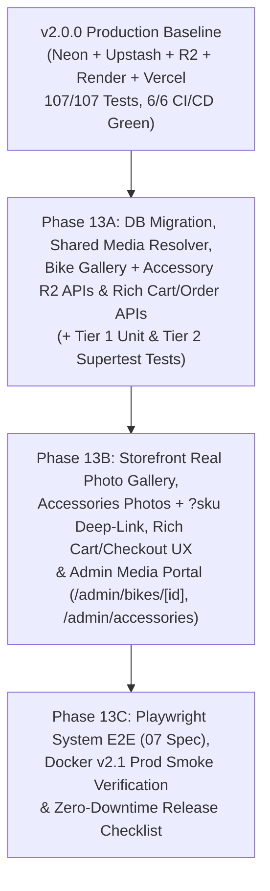

# 13. Lộ trình Triển khai Expansion v2.1 (Phase 13A → Phase 13C) & Vận hành Zero-Downtime

> **Nền tảng khởi đầu:** `v2.0.0` đã hoàn thiện và đang chạy thực tế trên hạ tầng **\$0/tháng** (**Neon PostgreSQL + Upstash Redis + Cloudflare R2 + Render API + Vercel Web**, GitHub Actions CI/CD 6/6 jobs xanh, 107/107 tests passed, 100% Pure JavaScript ESM, song ngữ EN/VI mặc định EN).  
> **Đặc tả thiết kế gốc:** [12-real-product-media-and-rich-cart.md](./12-real-product-media-and-rich-cart.md).  
> **Nguyên tắc thực thi:** Triển khai tuần tự từng sub-phase **13A → 13B → 13C**, dừng nghiệm thu đầy đủ **Definition of Done (DoD)** bằng lệnh tự động trước khi sang bước kế tiếp. **100% source code, tên biến, API, comment, test case và commit message viết bằng Tiếng Anh; toàn bộ UI hỗ trợ song ngữ EN / VI (mặc định EN).**

---

## 1. Đồ thị Phụ thuộc & Lộ trình `v2.1` (Phase 13A → Phase 13C)

> **Lý do tách 3 sub-phase gọn gàng:**
> - **Phase 13A** khóa chặt contract dữ liệu (Migration zero-downtime + `@dirtfit/shared` resolver + toàn bộ API Media & Enriched Cart/Order + Supertest) để Frontend ở 13B bám sát dữ liệu thật, không phải mock.
> - **Phase 13B** tập trung trọn vẹn cho trải nghiệm người dùng cuối và Admin Portal (Gallery, Lightbox, `onError` Wireframe fallback, Deep-Link `/accessories?sku=...`, Rich Cart/Checkout, Admin Photo Managers) kèm kiểm chứng `next build` và i18n parity.
> - **Phase 13C** chốt chất lượng toàn hệ thống bằng Playwright Chromium E2E thật (upload ảnh qua `STORAGE_DRIVER=local`, hiển thị ở Storefront & Cart, click deep-link), build & smoke Docker production (`--expect-prod`), cập nhật tài liệu vận hành và release checklist.

---

## 2. Chi tiết Kế hoạch Từng Sub-Phase & Definition of Done (DoD)

### Phase 13A: Database Migration, Shared Media Resolver, Bike & Accessory Media APIs & Enriched Cart/Order APIs

- **Mục tiêu:** Hoàn thiện 100% tầng Database (zero-downtime cho Neon), Shared Contracts/Helpers, Storage Key & Local Preview Route, Backend API quản trị ảnh xe & phụ kiện, làm giàu payload Cart/Order/Chatbot, và phủ đầy đủ Unit + Supertest Integration Tests.
- **Phụ thuộc:** `v2.0.0`.
- **Deliverables chính:**
  1. **Shared Package (`packages/shared/`):**
     - Tạo `packages/shared/src/media.js` chứa pure helpers: `resolveBikeMedia(mediaList)`, `resolveAccessoryMedia(accessory)`, `buildBikeProductUrl(slug)`, `buildAccessoryProductUrl(sku)`, `isSafeImageUrl(url)`. Export tại `packages/shared/src/index.js`.
     - Mở rộng `packages/shared/src/schemas/media.schema.js`: bổ sung `BikeMediaReorderSchema`, `AccessoryMediaPresignSchema`, `AccessoryMediaConfirmSchema` (đều dùng `.strict()`, MIME `image/jpeg|png|webp`, `<= 5MB`).
     - Thêm Unit test `packages/shared/tests/media.test.js`.
  2. **Database & Zero-Downtime Migration (`apps/api/prisma/`):**
     - Cập nhật `schema.prisma`: thêm `imageStorageKey String? @map("image_storage_key") @db.VarChar(255)` trên model `Accessory`.
     - Tạo migration additive `apps/api/prisma/migrations/20261126000000_v21_product_media/migration.sql` gồm: (a) CTE chống trùng `ranked_primary_photos` trước khi tạo index, (b) `CREATE UNIQUE INDEX "uq_bike_single_primary_photo"`, và (c) `ALTER TABLE "accessories" ADD COLUMN "image_storage_key" VARCHAR(255)`.
     - Chạy kiểm chứng `db:validate`, `db:migrate:deploy`, `db:generate`, `db:seed` (đảm bảo idempotent).
  3. **Storage & Upload Engine (`apps/api/src/common/storage/` & `modules/uploads/`):**
     - Mở rộng `magic-bytes.js`: thêm `buildSafeBikeStorageKey(bikeId, mediaType, mimeType)` (`photos/` | `blueprint/` | `specs/`), `buildSafeAccessoryStorageKey(accessoryId, mimeType)`, `validateSafeBikeStorageKey()` (hỗ trợ cả key mới lẫn key phẳng cũ), `validateSafeAccessoryStorageKey()`, `validateAnySafeStorageKey()`.
     - Cập nhật `local-mock.adapter.js`: thêm `getLocalObject(storageKey)` và đổi `getPublicUrl(storageKey)` trả `${apiBaseUrl}/api/v1/media/local/${storageKey}` khi chạy ở driver `local`.
     - Trong `uploads.routes.js`: mount `GET /api/v1/media/local/*` **chỉ khi `app.storage.driver === 'local' && app.env.NODE_ENV !== 'production'`** (header `X-Content-Type-Options: nosniff`, `Cross-Origin-Resource-Policy: cross-origin`).
     - Bổ sung Unit test `apps/api/tests/unit/media-storage-keys.test.js`.
  4. **Bike Media Management & Catalog Contract (`modules/uploads/` + `modules/catalog/`):**
     - Hoàn thiện các route dưới `/api/v1/admin/bikes/:id/media/*`: `presign`, `confirm` (tự động xử lý `isPrimary` theo đúng miền `HERO`/`GALLERY` vs `SIDE_PROFILE_BLUEPRINT`), `PATCH .../:mediaId/primary`, `PATCH .../reorder`, `DELETE .../:mediaId` (soft-delete + auto-promote cover kế tiếp + best-effort R2 delete), giữ nguyên 100% 2 route alias cũ `/admin/media/presign` & `/admin/media/confirm`.
     - Chặn `PATCH .../calibration` trên media khác `SIDE_PROFILE_BLUEPRINT` (`400 VALIDATION_ERROR`).
     - Cập nhật `catalog.mapper.js` bổ sung `coverImageUrl`, `coverImageKind`, `primaryPhoto`, `galleryImages`, `blueprintImageUrl`, `primaryBlueprint` (giữ nguyên `media[]`).
  5. **Accessory Media APIs (`modules/accessories/` + `modules/uploads/`):**
     - Bổ sung 3 endpoint `ADMIN`-only: `POST /api/v1/admin/accessories/:id/media/presign`, `POST /api/v1/admin/accessories/:id/media/confirm` (4KB Magic Bytes + dọn object cũ best-effort + `AuditLog` + `invalidateCatalogCache`), và `DELETE /api/v1/admin/accessories/:id/media`.
  6. **Rich Cart, Order & Chatbot Grounding Enrichment (`modules/cart/`, `modules/orders/`, `modules/chatbot/`):**
     - Bỏ `take: 2` trên `bike.media` trong `cart.repository.js`; bổ sung `productUrl`, `imageUrl`, `imageKind`, `brand` vào `buildHydratedCart()`.
     - Snapshot `slug`/`productUrl`/`imageUrl`/`imageKind` vào `OrderItem.metadataJson` lúc checkout + join lightweight trong `orders.repository.js` / `orders.mapper.js` cho cả đơn cũ lẫn đơn mới.
     - Đính kèm `coverImageUrl` & `coverImageKind` vào `recommendedBikes[]` của `chatbot/context-builder.js`.
  7. **Tier 2 Supertest Integration Tests:**
     - Mở rộng `database.constraints.test.js` (`uq_bike_single_primary_photo` + coexistence với `uq_bike_single_primary_blueprint`).
     - Mở rộng `catalog-ergonomics-media.test.js` (full bike gallery lifecycle, full accessory R2/local upload + magic bytes reject + RBAC `403` + delete, non-prod local media serve vs prod `404`).
     - Mở rộng `commerce-checkout-payments.test.js` (kiểm chứng enriched cart & order `imageUrl`, `imageKind`, `productUrl`).
- **Definition of Done (DoD) — Phase 13A:**
  - [x] `pnpm --filter @dirtfit/api run db:validate && pnpm --filter @dirtfit/api run db:migrate:deploy && pnpm --filter @dirtfit/api run db:generate` thoát mã `0`.
  - [x] `pnpm check:pure-js && pnpm lint && pnpm format:check` thoát mã `0`.
  - [x] `pnpm test:unit` pass 100% (bao gồm `packages/shared/tests/media.test.js` và `apps/api/tests/unit/media-storage-keys.test.js`).
  - [x] `pnpm test:integration` (Supertest, chạy 2 lần liên tiếp không flaky, kể cả với `ENABLE_MOCK_OAUTH=true` & `GOOGLE_OAUTH_ENABLED=true`) pass 100%.

---

### Phase 13B: Storefront Real Photo Gallery, Accessories Photos + `?sku` Deep-Link, Rich Cart/Checkout UX & Admin Media Portal

- **Mục tiêu:** Triển khai trọn bộ giao diện Storefront và Admin Portal chuẩn **Industrial Motorsport / Technical Editorial**, song ngữ **EN / VI (mặc định EN)**, chống vỡ ảnh 100%, và bảo toàn nguyên vẹn mọi selector Playwright cũ.
- **Phụ thuộc:** Phase 13A.
- **Deliverables chính:**
  1. **Resilient Media Components (`apps/web/src/components/ui/`):**
     - `ProductThumbnail.jsx`: Component thumbnail dùng chung cho Cart, Checkout, Account Orders, Admin Tables và MiniFitCard — tự xử lý `onError` fallback mượt về mini bike wireframe SVG hoặc technical SKU box, zero broken image.
     - `BikePhotoGallery.jsx`: Gallery ảnh thật cho `/bikes/[slug]` (`aspect-[16/10]`, `object-contain`, thumbnail strip, Radix Dialog Lightbox hỗ trợ phím mũi tên/Esc, fallback về 2D Wireframe preview khi chưa có ảnh thật).
  2. **Storefront Upgrades (`apps/web/src/`):**
     - `BikeCard.jsx` (`/` & `/bikes`): Khung `aspect-[16/10]` hiển thị `coverImageUrl` (`object-cover`) + badge `2D FIT READY`, fallback mượt về 2D Parametric Wireframe SVG + badge `2D SPEC PREVIEW`.
     - `BikeDetailClient.jsx` (`/bikes/[slug]`): Tích hợp `BikePhotoGallery` vào Tier 1 trái, giữ nguyên `<RiderFitSimulator bike={bike} />` (`#simulator`) hiển thị ngay tại Tier 2.
     - `accessories/page.jsx` & `AccessoriesClient.jsx` (`/accessories` & `/accessories?sku=...`): Thêm khung ảnh `aspect-[4/3]` (`object-contain`) + technical SKU fallback; hỗ trợ đọc `searchParams.sku`, highlight card khớp (`data-highlighted-sku`), auto-scroll và nút xóa lọc nhanh.
     - `cart/page.jsx` (`/cart`) & `checkout/page.jsx` (`/checkout`): Hiển thị thumbnail clickable, tiêu đề `<Link href={productUrl}>`, nút phụ `View bike` / `View item`, và danh sách item tóm tắt có thumbnail trong `<aside>` Checkout (không thêm `<input>` vào form).
     - `account/page.jsx` (Orders tab), `admin/orders/page.jsx` (Order drawer) & `MiniFitCard.jsx` (Chatbot): Hiển thị thumbnail gọn + link sản phẩm đồng bộ.
  3. **Admin Portal Media Management (`apps/web/src/components/admin/` & `app/admin/`):**
     - `BikePhotoManager.jsx` gắn vào khu vực 1 của Tab `Media & Calibration` trên `/admin/bikes/[id]`: upload nhiều ảnh thật lên R2/local kèm tiến độ 3 bước, lưới ảnh với badge `COVER PHOTO`, nút **Set as Cover**, **Reorder (←/→)**, **Delete**.
     - Cập nhật `BlueprintCalibrationTool.jsx` (khu vực 2 trên `/admin/bikes/[id]`): lọc riêng `SIDE_PROFILE_BLUEPRINT`, khóa upload vào nhóm blueprint để không bao giờ lẫn với ảnh thật bán hàng.
     - `AccessoryPhotoUploader.jsx` & cập nhật `admin/accessories/page.jsx`: thêm cột thumbnail trên bảng và khung upload/replace/remove ảnh R2 ngay trong modal **Create** (2-step tự động) & **Edit**.
  4. **i18n EN / VI & Next.js Config:**
     - Đồng bộ 100% key từ điển mới trên cả `apps/web/src/lib/i18n/en.js` và `apps/web/src/lib/i18n/vi.js`.
     - Cập nhật `apps/web/next.config.mjs` (bổ sung `remotePatterns` ghi nhận nguồn ảnh R2/local nếu cần, giữ `unoptimized: true`).
- **Definition of Done (DoD) — Phase 13B:**
  - [x] `pnpm check:pure-js && pnpm lint && pnpm format:check` thoát mã `0`.
  - [x] `pnpm test:unit` pass 100% (bao gồm `apps/web/tests/i18n.test.js` xác nhận 0 thiếu key EN/VI).
  - [x] `pnpm --filter @dirtfit/web build` biên dịch production sạch lỗi (0 warning breaking).
  - [x] Toàn bộ 6 Playwright specs hiện hữu (`01`–`06`) vẫn pass 100% không bị regression.

---

### Phase 13C: Playwright System E2E (`07`), Docker v2.1 Smoke Verification & Release Checklist

- **Mục tiêu:** Kiểm chứng hộp đen end-to-end toàn bộ luồng upload ảnh xe/phụ kiện + hiển thị Storefront + Rich Cart Deep-Link trên Chromium thật, build & smoke production Docker stack, và cập nhật tài liệu triển khai `v2.1`.
- **Phụ thuộc:** Phase 13B.
- **Deliverables chính:**
  1. **Playwright System E2E mới (`tests/system/07-media-gallery-and-rich-cart.spec.js`):**
     - Phủ đầy đủ: Admin upload ảnh thật xe trên `/admin/bikes/[id]` (khẳng định `COVER PHOTO` + 2D Calibration còn nguyên) → Admin upload ảnh phụ kiện trên `/admin/accessories` → Storefront `/bikes`, `/bikes/[slug]`, `/accessories` tải thật `` (`naturalWidth > 0`) → thêm cả xe & phụ kiện vào `/cart` → kiểm tra thumbnail & bấm deep-link `/bikes/[slug]` và `/accessories?sku=...` (highlight đúng SKU) → dọn sạch dữ liệu test cuối kịch bản.
  2. **Smoke Script & Deployment Docs:**
     - Mở rộng `scripts/smoke-stack.mjs`: xác nhận schema media mới trên `/api/v1/bikes`, xác nhận `/api/v1/media/local/*` trả `404` khi `--expect-prod`, và xác nhận `/cart` + `/accessories?sku=ACC-ZETA-LINK-30` trả HTTP `200`.
     - Cập nhật `docs/DEPLOYMENT_FREE_TIER.md` (chi tiết cấu hình Cloudflare R2 CORS cho cả custom domain & Vercel preview, hướng dẫn verify upload thật sau deploy) và `README.md`.
  3. **Full Verification & Docker Prod Stack:**
     - Build và chạy `docker compose -f docker-compose.prod.yml up -d --build --wait` → chạy `node scripts/smoke-stack.mjs --api-url http://127.0.0.1:4000 --web-url http://127.0.0.1:3000 --expect-prod` → dọn prod stack & khôi phục dev containers.
- **Definition of Done (DoD) — Phase 13C:**
  - [x] `pnpm check:pure-js && pnpm lint && pnpm format:check && pnpm audit --prod --audit-level=high && pnpm audit --audit-level=high` thoát mã `0`.
  - [x] `pnpm test:unit` pass 100% (`< 5s`).
  - [x] `pnpm test:integration` (Supertest, chạy với `ENABLE_MOCK_OAUTH=true` & `GOOGLE_OAUTH_ENABLED=true`) pass 100% 2 lần liên tiếp.
  - [x] `pnpm test:system` (Playwright Chromium, **7/7 E2E specs**) pass 100%.
  - [x] `docker compose -f docker-compose.prod.yml up -d --build --wait` đạt `healthy` cả 4 containers và `smoke-stack.mjs --expect-prod` trả `"status": "PASSED"`.
  - [ ] Toàn bộ CI/CD workflows trên GitHub Actions xanh 100% sau khi push bản `v2.1.0`.

---

## 3. Checklist Triển khai Zero-Downtime lên Production (Neon + R2 + Render + Vercel)

1. **Trước khi merge `v2.1.0` vào `main`:**
   - Kiểm tra **Cloudflare R2 Bucket CORS Policy** trên bucket `dirtfit-media` đã cho phép domain Vercel production (`AllowedMethods: ["GET", "PUT", "HEAD"]`, `AllowedHeaders: ["Content-Type"]`, `ExposeHeaders: ["ETag"]`).
   - Xác nhận biến `R2_PUBLIC_BASE_URL` trên Render (ví dụ `https://pub-xxxx.r2.dev` hoặc `https://cdn.dirtfit.vn`) đã bật **Public Development URL** hoặc **Custom Domain** truy cập được công khai qua HTTPS.
2. **Thứ tự tự động của `.github/workflows/cd.yml`:**
   - `prisma migrate deploy` chạy qua `DIRECT_URL` trên Neon: CTE dọn trùng `is_primary` → tạo `uq_bike_single_primary_photo` → thêm cột nullable `accessories.image_storage_key` (mất `< 100ms`, không khóa bảng kéo dài, không làm lỗi bản API `v2.0` đang chạy).
   - Render deploy bản API `v2.1` → vượt qua `/health/ready`.
   - Vercel deploy bản Web `v2.1` → chạy `smoke-stack.mjs --expect-prod` nghiệm thu sau deploy.
3. **Sau khi lên Production (`Day-0 Content Upload`):**
   - Admin đăng nhập `/admin/bikes/[id]` tải ảnh thật cho 8 xe đầu tiên (ảnh đầu tiên tự động thay thế `HERO` seed placeholder làm Cover Photo, 2D Blueprint giữ nguyên).
   - Admin đăng nhập `/admin/accessories` tải ảnh thật cho các phụ kiện chính.

---

## 4. Sổ Quản trị Rủi ro Kỹ thuật `v2.1` (Risk Register)

| Rủi ro | Mức độ | Biện pháp giảm thiểu đã nhúng vào kiến trúc |
| :--- | :---: | :--- |
| **`CREATE UNIQUE INDEX uq_bike_single_primary_photo` thất bại (`23505`) trên Neon production** do dữ liệu đã tồn tại 2 ảnh `HERO`/`GALLERY` cùng `is_primary=true` | Cao | Migration chạy sẵn câu lệnh CTE `ROW_NUMBER()` hạ `is_primary = false` các bản ghi dư thừa **ngay trước** câu lệnh `CREATE UNIQUE INDEX`. |
| **Broken image trên 8 xe seeded** vì URL `https://cdn.dirtfit.vn/bikes/<slug>/hero.webp` chưa có file thật | Cao | Mọi điểm hiển thị ảnh dùng component `ProductThumbnail` / `BikePhotoGallery` / `BikeCard` có `onError` tự động chuyển tức thì sang 2D Wireframe SVG (`2D Spec Preview`) hoặc Technical SKU Card; trên Admin Grid hiện rõ cảnh báo `URL Unreachable` để Admin thay ảnh thật. |
| **R2 CORS Preflight thất bại khi upload ảnh từ trình duyệt** | Trung bình | `PutObjectCommand` trong `r2.adapter.js` chỉ ký duy nhất header `ContentType` (khớp 100% `AllowedHeaders: ["Content-Type"]` của CORS policy đang chạy trên R2); hướng dẫn CORS đầy đủ trong `DEPLOYMENT_FREE_TIER.md`. |
| **Rác dung lượng R2 (10 GB Free Tier)** khi Admin thay hoặc xóa ảnh nhiều lần | Trung bình | Lưu `imageStorageKey` trên `Accessory` và `storageKey` trên `BikeMedia`; gọi `deleteObject()` best-effort ngay sau khi commit thay thế/xóa ảnh; giới hạn cứng `<= 5MB/file`. |
| **Lộ endpoint local mock media lên production** | Cao | Route `GET /api/v1/media/local/*` chỉ được mount khi `app.storage.driver === 'local' && app.env.NODE_ENV !== 'production'`, đồng thời được kiểm chứng trả `404` tự động trong cả Supertest lẫn `scripts/smoke-stack.mjs --expect-prod`. |
| **Làm vỡ các Playwright E2E hiện có (`E2E-01`, `E2E-05`, `E2E-06`)** | Trung bình | Giữ `#simulator` luôn hiển thị trực tiếp ở Tier 2 `/bikes/[slug]`; không chèn `<input>` vào `<aside>` Checkout; giữ nguyên 4 Radix tabs trên `/admin/bikes/[id]` và cấu trúc canvas SVG của `BlueprintCalibrationTool`. |
