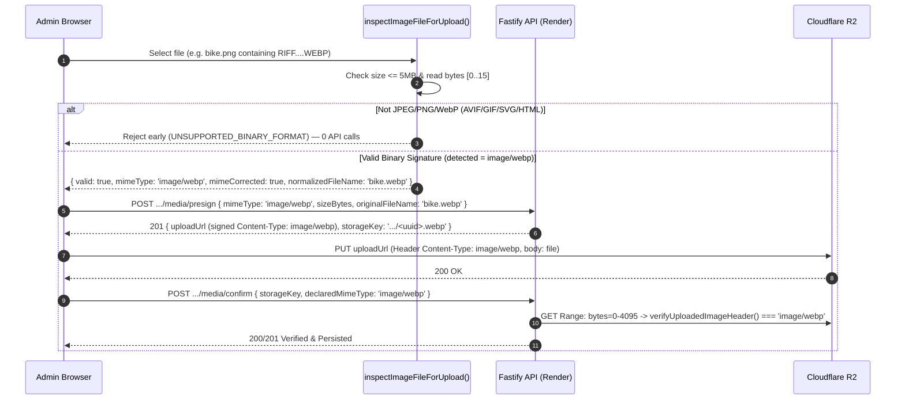
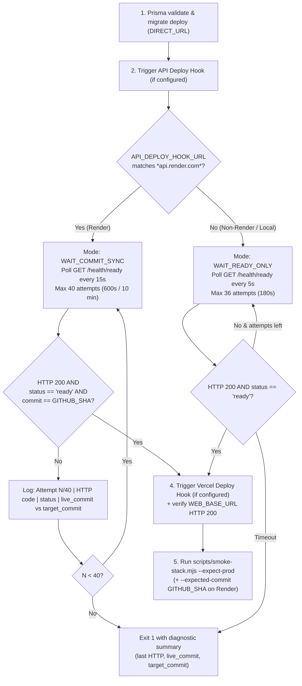

# 14. Kế hoạch Tinh chỉnh Vận hành & Trải nghiệm Sản phẩm `v2.1.1` (Media Sniffer, CD Commit Sync & Chatbot Refinements)

> **Trạng thái nền tảng:** **DirtFit Commerce `v2.1.0`** đang vận hành ổn định trên hạ tầng **\$0/tháng** (**Neon PostgreSQL + Upstash Redis + Cloudflare R2 + Render API + Vercel Web**, GitHub Actions CI/CD xanh 100%, 100% Pure JavaScript ESM, song ngữ EN/VI mặc định EN).  
> **Mục tiêu `v2.1.1`:** Xử lý triệt để 3 vấn đề thực tế phát hiện trong quá trình nghiệm thu production mà **không nới lỏng bất kỳ rào chắn bảo mật nào**, giữ nguyên 100% Pure JavaScript ESM và tương thích ngược hoàn toàn với `v2.1.0`.  
> **Quy ước khi triển khai ở lượt kế tiếp:** 100% Pure JS ESM (`.js` / `.mjs` / `.jsx`), toàn bộ source code / comment / test / commit viết Tiếng Anh, giao diện song ngữ **EN / VI (mặc định EN)**.

---

## 1. Tổng quan 3 Điểm Cải tiến Thực tế từ Nghiệm thu Production

| # | Trụ cột | Triệu chứng thực tế trên Production `v2.1.0` | Giải pháp kiến trúc `v2.1.1` |
| :-: | :--- | :--- | :--- |
| **1** | **Client-Side Image Magic Bytes Sniffer** (`apps/web`) | Admin tải ảnh xe/phụ kiện từ CDN hãng về máy có đuôi `.png` hoặc `.jpg`, nhưng nội dung nhị phân thực chất là `WebP` (`RIFF....WEBP`) → upload bị API chặn **`422 INVALID_UPLOAD_FILE`** vì lệch giữa `file.type` (trình duyệt đoán theo đuôi file) và 4KB Magic Bytes check phía Backend. | Bổ sung bộ đọc 16 byte đầu file ngay trên trình duyệt (`detectBrowserImageMime` + `inspectImageFileForUpload`) trong `apps/web/src/lib/media-helpers.js`, tự chuẩn hóa MIME nhị phân thật cho cả 3 bước `presign → PUT → confirm` và chặn sớm định dạng không hỗ trợ (AVIF/GIF/SVG/HTML) trước khi gọi API. **Giữ nguyên 100% lớp chặn 4KB Magic Bytes trên Backend.** |
| **2** | **Đồng bộ Commit Deploy Render trong `cd.yml`** (`RENDER_GIT_COMMIT`) | Sau khi gọi Render Deploy Hook, bước chờ `/health/ready` nhận ngay HTTP `200` từ **container cũ** đang chạy trong lúc Render vẫn đang build Docker (mất 4–9 phút trên Free Tier) → `smoke-stack.mjs` chạy quá sớm vào bản cũ (race condition). | Trả thêm trường không nhạy cảm `commit` (`RENDER_GIT_COMMIT` / `GIT_COMMIT_SHA`) trên `GET /health/ready`; nâng cấp vòng chờ trong `.github/workflows/cd.yml` để chờ đồng thời `status === "ready"` **VÀ** `commit === "${GITHUB_SHA}"` khi dùng Render Deploy Hook, rồi mới chạy `smoke-stack.mjs --expect-prod`. |
| **3** | **Tinh chỉnh AI Support Chatbot** (`apps/api`) | (a) Khách mở web mặc định `EN` rồi nhắn Tiếng Việt (`"alo"`, `"tôi muốn mua"`) bị bot trả lời bằng Tiếng Anh; (b) `"alo"` và `"tôi muốn mua"` không khớp 7 luật từ khóa cũ nên rơi vào `OUT_OF_SCOPE`; (c) khi Gemini fallback về `GroundedFallbackAdapter`, log cảnh báo thiếu `errorCode`, `latencyMs` và tóm tắt nguyên nhân an toàn. | Bổ sung bộ nhận diện ngôn ngữ theo tin nhắn thực tế (`resolveEffectiveLocale`), bổ sung 2 intent mới **`GREETING`** (fast-path deterministic tiết kiệm quota Gemini) và **`GENERAL_PURCHASE`** (tư vấn danh mục live + hỏi vóc dáng/địa hình) kèm migration enum zero-downtime, giữ nguyên 100% guardrails prompt-injection/`OUT_OF_SCOPE`, và chuẩn hóa structured `logger.warn` khi Gemini fallback (tuyệt đối không lộ API key). |

---

## 2. Trụ cột 1 — Client-Side Image Magic Bytes Sniffer (`apps/web`)

### 2.1. Phân tích Nguyên nhân gốc

1. Nhiều CDN bán hàng và công cụ tìm kiếm ảnh áp dụng cơ chế *Content Negotiation* (`Accept: image/webp,*/*`): máy chủ trả payload nén định dạng **WebP** (`52 49 46 46 .... 57 45 42 50`) nhưng giữ nguyên tên file gốc đuôi `.png` hoặc `.jpg` (ví dụ `honda-crf300l.png`).
2. Khi Admin chọn tệp từ máy tính qua `<input type="file">`, hệ điều hành và trình duyệt gán thuộc tính `file.type` **thuần túy theo phần mở rộng đuôi tệp** (`image/png` hoặc `image/jpeg`), không kiểm tra byte nhị phân bên trong.
3. Trong `v2.1.0`, `validateImageFileForUpload(file)` tại `apps/web/src/lib/media-helpers.js` tin tưởng `file.type`:
   - `POST .../media/presign` ký `PutObjectCommand` với `ContentType: 'image/png'` và tạo key `.../<uuid>.png`.
   - Trình duyệt `PUT` payload WebP kèm header `Content-Type: image/png` lên Cloudflare R2.
   - `POST .../media/confirm` gửi `declaredMimeType: 'image/png'`.
   - Tại Backend (`apps/api/src/common/storage/magic-bytes.js`, `verifyUploadedImageHeader()`, dòng 239–245), máy chủ đọc 4KB đầu (`Range: bytes=0-4095`), nhận diện đúng `detectedMime = 'image/webp'`, thấy `detectedMime !== declaredMimeType` → **xóa ngay object trên R2**, ghi `AuditLog` (`MEDIA_UPLOAD_REJECTED`) và trả **`422 INVALID_UPLOAD_FILE`**.
4. Tương tự, các tệp không hỗ trợ bị đổi đuôi thành `.jpg`/`.png` (AVIF, GIF, HEIC, SVG, HTML/JS) hiện vẫn tốn 1 lượt gọi `presign` + 1 lượt `PUT` lên R2 trước khi bị Backend chặn ở bước `confirm`.

### 2.2. Thiết kế Bộ Sniffer Nhị phân trong `apps/web/src/lib/media-helpers.js`

Bổ sung 4 helper thuần Pure JS ESM (khớp 1:1 chữ ký byte với `apps/api/src/common/storage/magic-bytes.js`):

#### Bảng Chữ ký Nhị phân Chuẩn (16 byte đầu)

| Định dạng ảnh | Độ dài tối thiểu | Offset & Byte Signature (Hex) | MIME chuẩn trả về |
| :--- | :---: | :--- | :--- |
| **PNG** | 8 bytes | Byte `0..7`: `89 50 4E 47 0D 0A 1A 0A` | `'image/png'` |
| **JPEG** | 3 bytes | Byte `0..2`: `FF D8 FF` | `'image/jpeg'` |
| **WebP** | 12 bytes | Byte `0..3`: `52 49 46 46` (`RIFF`) **VÀ** Byte `8..11`: `57 45 42 50` (`WEBP`) | `'image/webp'` |
| **Khác** (AVIF `ftypavif`, GIF `47 49 46 38`, SVG `<svg`, HTML/JS, `< 12` bytes) | — | Không khớp 3 mẫu trên | `null` |

#### Contract chi tiết các hàm mới

1. **`detectImageMimeFromBytes(bytes)`** *(đồng bộ, pure function)*:
   - Nhận `Uint8Array` (hoặc `ArrayBuffer`).
   - Nếu `!bytes || bytes.length < 12` → trả `null` (khớp ngưỡng tối thiểu 12 byte của Backend `verifyUploadedImageHeader` để tránh file cụt).
   - Khớp lần lượt PNG → JPEG → WebP và trả `'image/png' | 'image/jpeg' | 'image/webp' | null`.

2. **`detectBrowserImageMime(file)`** *(async, tương thích mọi trình duyệt hiện đại & Vitest/jsdom)*:
   - Nếu `!file || typeof file.slice !== 'function'` → trả `null`.
   - Cắt đúng 16 byte đầu `const headBlob = file.slice(0, 16);` (tiêu tốn O(1) RAM, không bao giờ nạp toàn bộ 5MB vào bộ nhớ).
   - Đọc buffer an toàn theo 2 tầng tương thích:
     - Ưu tiên `typeof headBlob.arrayBuffer === 'function' ? await headBlob.arrayBuffer() : await new Response(headBlob).arrayBuffer()`.
     - Chuyển sang `new Uint8Array(buffer)` rồi gọi `detectImageMimeFromBytes(bytes)`.

3. **`normalizeFilenameExtension(fileName, detectedMime)`** *(pure helper)*:
   - Map `MIME_TO_EXTENSION`: `'image/jpeg' -> 'jpg'`, `'image/png' -> 'png'`, `'image/webp' -> 'webp'`.
   - Nếu `fileName` có phần mở rộng không khớp `detectedMime` (ví dụ `crf300l.png` nhưng ruột là `image/webp`), thay phần mở rộng cuối thành `.webp` → `crf300l.webp` (giới hạn `<= 180` ký tự cho khớp `originalFileName` của Zod schema).
   - *Lưu ý:* Backend vẫn tự tạo UUID key an toàn (`buildSafeBikeStorageKey` / `buildSafeAccessoryStorageKey`) theo `mimeType`, nhưng việc chuẩn hóa `originalFileName` giúp đồng bộ hoàn toàn metadata và thông báo hiển thị trên UI.

4. **`inspectImageFileForUpload(file)`** *(async, thay thế vị trí gọi `validateImageFileForUpload` trên UI upload)*:
   - Thứ tự kiểm tra tối ưu:
     1. **Kiểm tra rỗng:** `!file || typeof file.size !== 'number' || file.size <= 0` → `{ valid: false, errorCode: 'EMPTY_FILE' }`.
     2. **Kiểm tra dung lượng `<= 5MB`:** `file.size > MAX_UPLOAD_IMAGE_BYTES` (`5 * 1024 * 1024`) → `{ valid: false, errorCode: 'FILE_TOO_LARGE' }` *(chặn ngay trước khi đọc bytes)*.
     3. **Kiểm tra độ dài tối thiểu:** `file.size < 12` → `{ valid: false, errorCode: 'UNSUPPORTED_BINARY_FORMAT' }`.
     4. **Sniff Magic Bytes:** `const detectedMime = await detectBrowserImageMime(file);`
        - Nếu `!detectedMime` → `{ valid: false, errorCode: 'UNSUPPORTED_BINARY_FORMAT', declaredMime }` *(chặn tức thì AVIF, GIF, HEIC, SVG, HTML/JS đổi đuôi ở Client — 0 request API, 0 object rác trên R2!)*.
     5. **Tự động chuẩn hóa khi lệch đuôi hợp lệ:**
        - `declaredMime = typeof file.type === 'string' ? file.type.trim().toLowerCase() : ''`
        - `mimeCorrected = Boolean(declaredMime && declaredMime !== detectedMime)`
        - `normalizedFileName = normalizeFilenameExtension(file.name || 'upload', detectedMime)`
        - Trả về:
          ```js
          {
            valid: true,
            mimeType: detectedMime,          // Luôn là MIME nhị phân thật ('image/webp' | 'image/png' | 'image/jpeg')
            declaredMime: declaredMime || null,
            mimeCorrected,                   // true nếu đuôi cũ lệch chữ ký thật (vd .png chứa WebP)
            sizeBytes: file.size,
            normalizedFileName,
          }
          ```
   - **Tương thích ngược:** Giữ nguyên hàm đồng bộ `validateImageFileForUpload(file)` đã export trong `media-helpers.js` để không làm gãy bất kỳ unit test cũ nào, đồng thời bổ sung bộ unit test đầy đủ cho `detectImageMimeFromBytes`, `detectBrowserImageMime` và `inspectImageFileForUpload`.

### 2.3. Luồng Upload Đồng nhất 3 Bước & Điểm Tích hợp trên 3 Component Admin



#### Danh sách điểm chỉnh sửa chính xác trên UI Admin

| File | Vị trí & Thay đổi cụ thể |
| :--- | :--- |
| `apps/web/src/components/admin/AccessoryPhotoUploader.jsx` | 1. Trong `uploadAccessoryPhotoFile(accessoryId, file, { onStep })`: thay `validateImageFileForUpload(file)` bằng `await inspectImageFileForUpload(file)`; truyền `check.mimeType` và `check.normalizedFileName` đồng nhất cho `presign`, header `content-type` của `PUT`, và `declaredMimeType` của `confirm`.<br>2. Trong `handleFileChange`: đổi sang `await inspectImageFileForUpload(file)` để chặn sớm ở cả chế độ **Create** (khi gán `pendingFile`) lẫn **Edit**; bổ sung map mã lỗi `UNSUPPORTED_BINARY_FORMAT` → `t('media.unsupportedBinaryFormat')`; khi `check.mimeCorrected === true` hiển thị thông báo nhẹ (`t('media.mimeAutoNormalized', ...)`) giúp Admin hiểu hệ thống đã tự nhận diện đúng định dạng thật. |
| `apps/web/src/components/admin/BikePhotoManager.jsx` | Trong `handleMultiUpload`: duyệt trước danh sách `files` với `await inspectImageFileForUpload(file)` (thu mảng `inspectedItems`), báo lỗi ngay theo tên file nếu bất kỳ file nào sai chữ ký nhị phân hoặc vượt 5MB; truyền `item.mimeType` và `item.normalizedFileName` đồng nhất qua cả 3 bước `presign → PUT → confirm`. |
| `apps/web/src/components/admin/BlueprintCalibrationTool.jsx` | Trong `handleFileUpload`: thay `validateImageFileForUpload(file)` bằng `await inspectImageFileForUpload(file)`, truyền `check.mimeType` và `check.normalizedFileName` đồng nhất qua `presign → PUT → confirm`; map thêm lỗi `UNSUPPORTED_BINARY_FORMAT`. |
| `apps/web/src/lib/i18n/en.js` & `vi.js` | Bổ sung cặp key đối xứng 100% dưới namespace `media`:<br>- `unsupportedBinaryFormat`: EN `"File content is not a valid JPEG, PNG, or WebP image (AVIF, GIF, SVG, and renamed files are not supported)."` / VI `"Nội dung nhị phân của tệp không phải ảnh JPEG, PNG hoặc WebP hợp lệ (không hỗ trợ AVIF, GIF, SVG hoặc tệp đổi đuôi)."`<br>- `mimeAutoNormalized`: EN `"Detected actual format {detected} (original extension: {declared})."` / VI `"Đã tự động chuẩn hóa định dạng thực tế là {detected} (đuôi gốc: {declared})."` |

### 2.4. Cam kết Bảo mật Tuyệt đối (Defense-in-Depth)

- **KHÔNG chỉnh sửa, KHÔNG nới lỏng** bất kỳ dòng nào trong `apps/api/src/common/storage/magic-bytes.js` và `apps/api/src/modules/uploads/uploads.service.js`.
- Mọi request upload trực tiếp tới API (kể cả tấn công bỏ qua trình duyệt qua `curl`/Postman) vẫn bị chặn nghiêm ngặt bởi lớp kiểm tra 4KB HTTP Range Magic Bytes + bộ lọc XSS SVG/HTML/XML + xóa ngay object trên R2 + ghi `MEDIA_UPLOAD_REJECTED` vào `AuditLog`.

---

## 3. Trụ cột 2 — Đồng bộ Commit Deploy Render trong `cd.yml` (`RENDER_GIT_COMMIT`)

### 3.1. Phân tích Race Condition trên Production `v2.1.0`

Trong `.github/workflows/cd.yml` hiện tại (dòng 38–89):
1. Bước `Trigger API Deploy Hook` gửi `POST "$API_DEPLOY_HOOK_URL"` tới Render → Render lập tức trả HTTP `200` (chỉ xác nhận đã đưa job vào hàng đợi build Docker).
2. Trên **Render Free Tier**, build Docker multi-stage cho `apps/api` mất trung bình **4–9 phút**. Trong suốt khoảng thời gian đó, **container bản cũ** vẫn tiếp tục phục vụ traffic bình thường.
3. Bước `Wait for API /health/ready` gọi `GET /health/ready` và thoát thành công ngay tại **Attempt 1** vì container cũ trả HTTP `200`!
4. Hệ quả: `cd.yml` kích hoạt `smoke-stack.mjs --expect-prod` vào **container API cũ** trước khi bản mới thực sự live, gây lỗi kiểm chứng giả khi bản mới thêm trường contract mới (như `coverImageUrl` ở `v2.1.0`) hoặc bỏ sót lỗi khởi động của bản mới.

### 3.2. Thiết kế Payload `GET /health/ready` (`apps/api`)

Render tự động nạp biến môi trường **`RENDER_GIT_COMMIT`** (chuỗi SHA 40 ký tự khớp tuyệt đối với `${GITHUB_SHA}` trên GitHub Actions) vào container khi build & runtime.

1. **Cập nhật `apps/api/src/config/env.js`:**
   - Thêm 2 biến tùy chọn (không bắt buộc): `RENDER_GIT_COMMIT: z.string().trim().min(7).max(64).optional()` và `GIT_COMMIT_SHA: z.string().trim().min(7).max(64).optional()`, nạp từ `rawSource.RENDER_GIT_COMMIT || undefined` và `rawSource.GIT_COMMIT_SHA || undefined`.
   - *Lợi ích kiểm thử:* Cho phép Supertest truyền `envOverrides: { RENDER_GIT_COMMIT: '...' }` mà không cần sửa biến toàn cục `process.env`.
2. **Cập nhật `apps/api/src/modules/health/health.routes.js`:**
   - Trong handler `GET /health/ready`, tính toán trường không nhạy cảm:
     ```js
     const commit =
       app.env?.RENDER_GIT_COMMIT ||
       app.env?.GIT_COMMIT_SHA ||
       process.env.RENDER_GIT_COMMIT ||
       process.env.GIT_COMMIT_SHA ||
       null;
     ```
   - Payload trả về (cả `200 ready` lẫn `503 degraded`):
     ```json
     {
       "status": "ready",
       "commit": "9f86d081884c7d659a2feaa0c55ad015a3bf4f1b",
       "checks": {
         "postgres": "ok",
         "redis": "ok"
       },
       "timestamp": "2026-11-26T01:05:00.000Z"
     }
     ```
3. **Kiểm chứng Tương thích ngược 100%:**
   - `docker-compose.prod.yml` và `apps/api/Dockerfile`: healthcheck chỉ kiểm tra `r.ok` → không ảnh hưởng.
   - `scripts/smoke-stack.mjs`: chỉ kiểm tra `readyJson.status === 'ready'`, `checks.postgres === 'ok'`, `checks.redis === 'ok'`; việc in `health: readyJson` nay tự động hiển thị luôn `commit` trong log smoke.
   - Bổ sung cờ tùy chọn `--expected-commit <sha>` vào `scripts/smoke-stack.mjs` (mặc định không bắt buộc để lệnh smoke local không đổi, nhưng `cd.yml` có thể truyền khi deploy Render để khẳng định lần cuối).
   - **An toàn thông tin:** Commit SHA là metadata công khai của mã nguồn Git, không chứa bất kỳ thông tin nhạy cảm, secret hay PII nào.

### 3.3. Thiết kế State Machine Chờ Deploy trong `.github/workflows/cd.yml`



#### Chi tiết Kỹ thuật Quan trọng khi Triển khai `cd.yml`

1. **Xử lý chuẩn xác lần chuyển tiếp đầu tiên (`v2.1.0` → `v2.1.1`):**
   - Trong lần push `v2.1.1` đầu tiên lên `main`, container `v2.1.0` đang chạy **chưa có trường `commit`** (`commit: null` / `undefined`), trong khi container `v2.1.1` mới build xong sẽ trả `commit === "${GITHUB_SHA}"`.
   - Do đó, quyết định bật chế độ chờ khớp commit (`EXPECT_COMMIT_SYNC=true`) **phải dựa trên việc `API_DEPLOY_HOOK_URL` trỏ về `api.render.com`**, KHÔNG được bỏ qua kiểm tra commit chỉ vì lần poll đầu trả `commit === null`!
   - Ngược lại, nếu không cấu hình `API_DEPLOY_HOOK_URL` hoặc hook không thuộc Render (ví dụ Koyeb/VPS không có `RENDER_GIT_COMMIT`), bước chờ tự động giữ nhánh `WAIT_READY_ONLY` (`status === "ready"`) nên không làm vỡ bất kỳ hạ tầng nào ngoài Render.
2. **Parse JSON bằng `node -e` (không phụ thuộc `jq`):**
   - Runner đã cài sẵn Node.js 22 (`actions/setup-node@v4`), sử dụng `node -e` để đọc an toàn `{ status, commit }` từ body `/health/ready` (kể cả khi Render trả trang HTML 502/503 lúc đang restart container — tránh lỗi crash script shell).
3. **Thông số chu kỳ & Timeout tối ưu cho Render Free Tier:**
   - **40 lần × 15 giây = 600 giây (10 phút)** cho nhánh Render (`WAIT_COMMIT_SYNC`): đủ rộng cho cả cold Docker build không cache (~5–9 phút) + khởi động Prisma/Redis, nhưng vẫn chặn được trường hợp build fail vĩnh viễn trên Render mà không ngốn quá nhiều phút GitHub Actions.
   - Bổ sung ghi log tiến độ rõ ràng từng nhịp:
     `[Attempt 14/40] HTTP=200 status=ready live_commit=6d3f12a... target_commit=9f86d08...`
   - Nếu hết 40 lần vẫn chưa khớp, in rõ nguyên nhân (`last HTTP`, `last status`, `last live_commit`, `expected GITHUB_SHA`, nhắc kiểm tra Render Build/Deploy Logs) và thoát mã `1`.
4. **Thời điểm kích hoạt Vercel Deploy Hook & Tránh gọi Smoke sớm:**
   - **Giữ thứ tự an toàn API-first:** Kích hoạt `VERCEL_DEPLOY_HOOK_URL` **sau khi** Render đã live đúng `GITHUB_SHA` để Frontend mới không bao giờ SSR trúng API cũ chưa có field mới (đồng thời nếu Render build lỗi, Vercel sẽ không deploy lệch phiên bản).
   - *Lưu ý thực tế:* Nếu dự án Vercel đã nối GitHub Integration auto-deploy từ nhánh `main`, Vercel thực chất tự build song song ngay khi push; trong trường hợp Admin **vẫn cấu hình** `VERCEL_DEPLOY_HOOK_URL`, thêm một vòng kiểm tra ngắn (`12 × 5s = 60s` chờ `WEB_BASE_URL` HTTP `200`, kèm khoảng đệm 15s nếu hook vừa được trigger) trước khi chạy `smoke-stack.mjs --expect-prod` để đảm bảo cả API lẫn Web đều ổn định.
   - Truyền thêm `--expected-commit "$GITHUB_SHA"` vào `smoke-stack.mjs` khi `API_DEPLOY_HOOK_URL` thuộc Render để log kiểm chứng cuối cùng đóng dấu đúng commit đang phục vụ.

---

## 4. Trụ cột 3 — Tinh chỉnh AI Support Chatbot (`apps/api/src/modules/chatbot/`)

### 4.1. Phân tích Hiện trạng & Nguyên nhân Lỗi Nghiệm thu

1. **Nguyên nhân `"alo"` và `"tôi muốn mua"` bị rơi vào `OUT_OF_SCOPE`:**
   - Trong `apps/api/src/modules/chatbot/intent-router.js` (dòng 161–266), `classifyChatIntent()` kiểm tra tuần tự:
     1. `entities.hasExplicitDimensions` → `RIDER_FIT_ADVICE`
     2. 7 bộ `KEYWORD_RULES` (`ORDER_STATUS_HELP`, `SHOWROOM_TEST_RIDE`, `POLICY_ORDERING`, `POLICY_WARRANTY`, `POLICY_TERMS`, `RIDER_FIT_ADVICE`, `CATALOG_PRICING`)
     3. `mentionedSlugs.length > 0` → `CATALOG_PRICING`
     4. Mặc định rơi xuống **`CHAT_INTENTS.OUT_OF_SCOPE`**.
   - Các câu chào tự nhiên (`"alo"`, `"xin chào"`, `"chào shop"`, `"hi"`, `"hello"`) và nhu cầu mua/tư vấn chung (`"tôi muốn mua"`, `"muốn mua xe"`, `"cần tư vấn"`, `"buy a bike"`, `"recommend a bike"`) **không trùng bất kỳ regex nào trong 7 luật hiện có**, nên bị đóng dấu `OUT_OF_SCOPE` → cả `GroundedFallbackAdapter` lẫn Gemini (nhận thẻ `detected_intent="OUT_OF_SCOPE"`) đều trả về câu từ chối lạnh lùng!
2. **Nguyên nhân bot trả lời Tiếng Anh khi khách nhắn Tiếng Việt:**
   - `apps/web/src/components/chat/SupportChatWidget.jsx` (dòng 119) gửi `locale` lấy từ cookie giao diện (`dirtfit_locale`, mặc định `'en'`).
   - `apps/api/src/modules/chatbot/chatbot.service.js` (dòng 81) dùng cứng `const safeLocale = payload.locale === 'vi' ? 'vi' : 'en'` mà không quan sát ngôn ngữ thực tế của câu khách nhắn.
   - Khi người dùng Việt Nam truy cập web (mặc định giao diện EN) và nhắn Tiếng Việt vào khung chat mà chưa bấm đổi nút `VI` trên thanh header, toàn bộ pipeline (`context-builder.js`, `system.prompt.md`, `GroundedFallbackAdapter`, `buildGuardrailRefusalMessage`) phản hồi bằng Tiếng Anh.
3. **Nguyên nhân khó chẩn đoán khi Gemini fallback về `GroundedFallbackAdapter`:**
   - Trong `apps/api/src/modules/chatbot/adapters/gemini.adapter.js` (dòng 68–75 & 130–139), khi Gemini trả lỗi HTTP `4xx`/`5xx`, `invokeOnce()` không đọc body lỗi JSON (`error.status` như `RESOURCE_EXHAUSTED`, `API_KEY_INVALID`, `NOT_FOUND`) và `logger.warn` thiếu `errorCode`, `latencyMs`, `attempts`, `intent`, `errorSummary`. Đồng thời `chat-adapter.factory.js` không ghi log cảnh báo một lần nếu `CHAT_PROVIDER=auto` nhưng thiếu `GEMINI_API_KEY`.

### 4.2. Thiết kế Bộ Nhận diện Ngôn ngữ Tin nhắn (`resolveEffectiveLocale`)

Bổ sung hàm thuần `resolveEffectiveLocale(message, uiLocale = 'en')` tại `apps/api/src/modules/chatbot/intent-router.js` theo quy tắc ưu tiên 4 tầng:

| Tầng ưu tiên | Điều kiện nhận diện | Kết quả `effectiveLocale` | Ví dụ |
| :---: | :--- | :---: | :--- |
| **1** | **Ký tự có dấu Tiếng Việt:** `/[àáạảãâầấậẩẫăằắặẳẵèéẹẻẽêềếệểễìíịỉĩòóọỏõôồốộổỗơờớợởỡùúụủũưừứựửữỳýỵỷỹđ]/i` | `'vi'` | `"tôi muốn mua"`, `"giá xe bao nhiêu?"`, `"chào shop"` |
| **2** | **Cụm từ Tiếng Việt không dấu đặc trưng** *(so khớp trên chuỗi thường, tách ranh giới từ `\b`)*: `/\b(alo+|xin chao|chao shop|chao ad|chao ban|co ai khong|shop oi|toi muon|minh muon|muon mua|can mua|can tu van|tu van|gia xe|bao nhieu|dat coc|coc xe|chieu cao|can nang|chong chan|lai thu|phu kien|ha yen|bao hanh|dieu khoan|don hang|xe nao|mua xe)\b/i` | `'vi'` | `"alo"`, `"toi muon mua"`, `"tu van gia xe"`, `"dat coc bao nhieu"` |
| **3** | **Cụm từ Tiếng Anh rõ ràng:** `/\b(hello|hi there|hey|good morning|good afternoon|how much|how do|how does|which bike|want to buy|buy a bike|looking for|recommend|deposit|warranty|returns|terms|privacy|test ride|seat height|fits me|fit me|check my order|order status|what is|can i|do you)\b/i` | `'en'` | `"hello"`, `"How do bike deposits work?"`, `"buy a bike"` |
| **4** | **Câu trung tính / ngắn / mã kỹ thuật** (không rơi vào tầng 1–3) | Giữ nguyên `uiLocale === 'vi' ? 'vi' : 'en'` | `"KTM 350 EXC-F"`, `"CRF300L"`, `"168cm 65kg"`, `"DF-20261125-001"`, `"COD"` |

#### Kiểm tra Tác động tới Bộ Test hiện hữu (`Zero Regression`)
- `chatbot-grounded.test.js`:
  - `"How long does a deposit hold stock..."` (`locale: 'en'`) → Tầng 3 (`'en'`).
  - `"Quy trình đặt cọc giữ chỗ 15 phút..."` (`locale: 'vi'`) → Tầng 1 (`'vi'`).
  - `"Cao 1m65 nặng 60kg..."` (`locale: 'vi'`) → Tầng 1 (`'vi'`).
  - `"Showroom ở đâu vậy?"` (`locale: 'vi'`) → Tầng 1 (`'vi'`).
  - `"Check COD limit"` (`locale: 'en'`) → Tầng 4 (giữ `'en'`).
- `04-ai-chatbot-e2e.spec.js`:
  - `"How do bike deposits and COD rules work?"` (`locale: 'en'`) → Tầng 3 (`'en'`).
  - `"I'm 165cm 60kg — which dual-sport bike fits me?"` (`locale: 'en'`) → Tầng 3 (`'en'`).
- **Điểm gọi trong `chatbot.service.js`:** Tính `const effectiveLocale = resolveEffectiveLocale(cleanedMessage, uiLocale);` ngay sau `sanitizeChatInput(payload.message)` → dùng thống nhất cho:
  1. `buildGuardrailRefusalMessage(effectiveLocale)` (nếu dính prompt injection bằng Tiếng Việt vẫn từ chối lịch sự bằng Tiếng Việt),
  2. `buildGroundedChatContext({ ..., locale: effectiveLocale })`,
  3. `persistChatTurn(..., { locale: effectiveLocale })`.
- *Lưu ý UX:* Không thay đổi cookie `dirtfit_locale` của toàn trang Storefront (tránh làm nhảy ngôn ngữ giao diện bất ngờ), chỉ tự thích ứng ngôn ngữ phản hồi của trợ lý theo đúng ngôn ngữ khách nhắn!

### 4.3. Thiết kế 2 Intent Mới (`GREETING` & `GENERAL_PURCHASE`) và Chiến lược Định tuyến An toàn

#### Phát hiện quan trọng về Prisma Enum `ChatIntent` (Zero-Downtime Migration)
Trong `apps/api/prisma/schema.prisma` (dòng 167–176 & 685), cột `chat_messages.intent` sử dụng **PostgreSQL Enum `ChatIntent`**. Để lưu chính xác 2 intent mới (và hiển thị tách bạch trên Dashboard `/api/v1/admin/chat/metrics`), cần bổ sung:
1. `packages/shared/src/enums.js`: thêm `GREETING: 'GREETING'` và `GENERAL_PURCHASE: 'GENERAL_PURCHASE'` vào `CHAT_INTENTS`.
2. `apps/api/prisma/schema.prisma`: thêm `GREETING` và `GENERAL_PURCHASE` vào `enum ChatIntent`.
3. Tạo migration additive `apps/api/prisma/migrations/<timestamp>_v211_chat_intents/migration.sql`:
   ```sql
   ALTER TYPE "ChatIntent" ADD VALUE IF NOT EXISTS 'GREETING';
   ALTER TYPE "ChatIntent" ADD VALUE IF NOT EXISTS 'GENERAL_PURCHASE';
   ```
   - **Zero-Downtime 100% trên Neon PostgreSQL 16:** Lệnh `ALTER TYPE ... ADD VALUE IF NOT EXISTS` chỉ cập nhật catalog metadata (`< 10ms`), không khóa ghi bảng `chat_messages`, không rewrite dữ liệu, và tương thích hoàn toàn với bản API `v2.1.0` đang chạy trong lúc `cd.yml` áp migration trước khi deploy bản `v2.1.1`.

#### Thứ tự Ưu tiên Định tuyến trong `classifyChatIntent()` (`intent-router.js`)

```text
1. detectPromptInjection() [trong chatbot.service.js — LUÔN chạy trước tiên!]
   └─ Blocked -> provider: 'guardrail', intent: 'OUT_OF_SCOPE'

2. entities.hasExplicitDimensions (vd: "Alo shop, cao 1m68 65kg đi xe nào?")
   └─ -> RIDER_FIT_ADVICE

3. 7 KEYWORD_RULES chuyên biệt hiện có (ORDER_STATUS_HELP -> SHOWROOM_TEST_RIDE -> POLICY_ORDERING -> POLICY_WARRANTY -> POLICY_TERMS -> RIDER_FIT_ADVICE -> CATALOG_PRICING)

4. mentionedSlugs.length > 0 (khách nhắc tên xe cụ thể, vd "CRF300L")
   └─ -> CATALOG_PRICING

5. GENERAL_PURCHASE (nhu cầu mua xe / cần tư vấn chung, không có số đo cụ thể)
   ├─ VI (folded): /\b(muon mua|can mua|tim mua|mua xe|can tu van|tu van giup|tu van cho|tu van xe|chon xe|gioi thieu xe|shop ban gi|co nhung xe|xem xe|dat xe)\b/i
   └─ EN: /\b(want to buy|looking to buy|buy a (bike|motorcycle)|need advice|help me choose|recommend (a |me )?(bike|motorcycle)|what bikes do you (sell|have)|looking for a (bike|motorcycle)|shopping for)\b/i
   └─ -> GENERAL_PURCHASE (preferredDocSlug: POLICY_DOC_SLUGS.RIDER_FIT_FAQ)

6. GREETING (chỉ khớp khi tin nhắn là lời chào mở đầu ngắn gọn, KHÔNG chứa câu hỏi lạc đề dài)
   ├─ Giới hạn độ dài token hợp lý (ví dụ <= 6 từ hoặc toàn bộ chuỗi khớp mẫu chào + từ xưng hô)
   ├─ Mẫu khớp trên chuỗi folded đã bỏ dấu câu biên:
   │   /^(alo+|a lo|xin chao|chao|chao shop|chao ad|chao admin|chao ban|hello|hi|hey|hi there|good morning|good afternoon|good evening|shop oi|ad oi|co ai khong|co ai o day khong)(\s+(shop|ad|admin|ban|dirtfit|there|everyone|moi nguoi))?$/i
   └─ -> GREETING (preferredDocSlug: null)

7. Mặc định: OUT_OF_SCOPE (thời tiết, code Python, thơ ca, chính trị, toán học...)
```

> **Kiểm soát Biên Chống Lọt Lạc Đề (Anti-Bypass):**
> - Nếu khách nhắn `"Alo, viết giúp tôi code Python sắp xếp mảng"` → độ dài / nội dung vượt khỏi mẫu chào thuần (`^...$`) và không khớp domain DirtFit → rơi đúng về **`OUT_OF_SCOPE`**.
> - Nếu khách nhắn `"Alo, tôi muốn mua xe"` → bước 5 (`GENERAL_PURCHASE`) bắt trước bước 6 (`GREETING`) → đi thẳng vào luồng tư vấn mua xe!
> - Nếu khách nhắn `"Alo, cao 1m68 nặng 65kg đi xe nào?"` → bước 2 (`hasExplicitDimensions`) bắt ngay → chạy `@dirtfit/ergonomics-engine` trả Mini Fit Card tức thì!

#### Hành vi Phản hồi & Chiến lược Tiết kiệm Quota Gemini

| Intent | Gọi Gemini LLM? | Ngữ cảnh Grounded (`context-builder.js`) | Nội dung Phản hồi Chuẩn (`EN` / `VI`) |
| :--- | :---: | :--- | :--- |
| **`GREETING`** | **KHÔNG (Deterministic Fast-Path)** | Không truy vấn KB/Rider-Fit (`retrievedChunks = []`, `citations = []`, `recommendedBikes = []`) — trả trực tiếp trong `< 20ms`, **tiết kiệm 100% quota Gemini Free Tier** cho các câu hỏi tư vấn thực sự. | Chào thân thiện, súc tích đúng `effectiveLocale` và nêu rõ 3 năng lực thật:<br>1. **Tư vấn Rider Fit 2D** theo chiều cao / cân nặng / giày bảo hộ (`@dirtfit/ergonomics-engine`)<br>2. **Tra cứu giá bán, tiền cọc & tồn kho live** các dòng xe cào cào / Dual-Sport / Enduro / Adventure & phụ kiện hạ yên<br>3. **Giải đáp đặt cọc PayOS VietQR, luật COD, bảo hành, điều khoản & đặt lịch lái thử** tại 3 showroom (Hà Nội, Đà Nẵng, TP.HCM). |
| **`GENERAL_PURCHASE`** | **CÓ (nếu `CHAT_PROVIDER=auto`/`gemini`)**, tự fallback mượt về `GroundedFallbackAdapter` | Nạp **Live Catalog** từ `CatalogCache` (chọn tối đa 4–5 mẫu xe tiêu biểu phủ các phân khúc có sẵn như `DUAL_SPORT`, `ENDURO`, `ADVENTURE`, `MOTOCROSS` kèm giá VND + tồn kho live), đính kèm citation link tới các xe tiêu biểu (`/bikes/[slug]`) và hướng dẫn đặt hàng (`/policies/ordering`). Không tự bịa số đo Rider Fit (`recommendedBikes = []`). | Giới thiệu nhanh các phân khúc xe hiện có kèm khoảng giá live từ Catalog (không bịa số liệu), đồng thời **chủ động hỏi 3 thông tin của khách**: **chiều cao (cm)**, **cân nặng (kg)** và **địa hình chạy chủ yếu** (đi phố/tour nhẹ Dual-Sport, đi rừng Enduro/Motocross hay đường dài Adventure) để tính điểm chống chân thực tế ở lượt tiếp theo. |

- **Cập nhật nhỏ `apps/api/src/modules/chatbot/prompts/system.prompt.md`:** Bổ sung 1 câu hướng dẫn gọn cho `detected_intent="GENERAL_PURCHASE"` (trình bày các phân khúc tiêu biểu + khoảng giá từ `<live_catalog_context>` và mời khách cung cấp chiều cao, cân nặng, địa hình; giữ nguyên `{{LOCALE}}` và tất cả placeholder bắt buộc nên `prompt-loader.test.js` pass 100%).

### 4.4. Minh bạch Log Cảnh báo An toàn khi Gemini Fallback (`gemini.adapter.js`, `chat-adapter.factory.js`, `chatbot.service.js`)

1. **Chuẩn hóa bắt lỗi & làm sạch trong `GeminiChatAdapter.invokeOnce()` (`apps/api/src/modules/chatbot/adapters/gemini.adapter.js`):**
   - Bổ sung helper `sanitizeErrorSummary(rawText)`:
     - Gỡ mọi chuỗi token giống key Google (`/\bAIza[0-9A-Za-z_-]{10,}\b/g` → `[REDACTED]`) và ký tự xuống dòng thừa, cắt ngắn tối đa `160` ký tự.
   - Ghi nhận `attemptStartedAt = Date.now()` để đo chính xác `latencyMs`.
   - Khi `!response.ok`:
     - Đọc giới hạn body lỗi (`(await response.text().catch(() => '')).slice(0, 512)`), parse JSON nếu hợp lệ để trích:
       - `errorCode`: `parsed?.error?.status || null` (ví dụ `RESOURCE_EXHAUSTED`, `PERMISSION_DENIED`, `INVALID_ARGUMENT`, `NOT_FOUND`, `UNAVAILABLE`).
       - `errorSummary`: `sanitizeErrorSummary(parsed?.error?.message || rawText)`.
     - Trả `{ ok: false, status: response.status, errorCode, retryable: response.status >= 500, reason: `HTTP_${response.status}`, errorSummary, latencyMs }`.
   - Khi dính exception mạng/timeout (`catch (err)`):
     - Trả `{ ok: false, status: isTimeout ? 504 : 503, errorCode: isTimeout ? 'TIMEOUT' : (err?.code || err?.name || 'NETWORK_ERROR'), retryable: !isTimeout, reason: isTimeout ? 'TIMEOUT' : (err?.name || 'NETWORK_ERROR'), errorSummary: sanitizeErrorSummary(err?.message || ''), latencyMs }`.

2. **Structured Warning Log chuẩn trên `GeminiChatAdapter.generate()`:**
   - Nếu `groundedContext.intent === CHAT_INTENTS.GREETING`: trả thẳng từ `this.fallbackAdapter.generate(groundedContext)` với `degraded: false` (không gọi Gemini, không ghi warn).
   - Khi Gemini thất bại (kể cả sau tối đa 1 lần retry `5xx`) và lùi về `GroundedFallbackAdapter`, ghi `this.logger.warn`:
     ```js
     this.logger.warn(
       {
         event: 'chatbot_gemini_fallback',
         model: this.model,
         intent: groundedContext.intent,
         locale: groundedContext.locale,
         statusCode: attemptResult.status,
         errorCode: attemptResult.errorCode ?? null,
         reason: attemptResult.reason,
         errorSummary: attemptResult.errorSummary || null,
         attempts,
         latencyMs: Date.now() - totalStartedAt,
       },
       'Gemini chat request failed; fell back to GroundedFallbackAdapter'
     );
     ```
   - **Tách biệt nguyên nhân cấu hình vs lỗi runtime (`chat-adapter.factory.js`):**
     - Khi `CHAT_PROVIDER === 'auto'` và `GEMINI_API_KEY` trống, ghi cảnh báo **đúng 1 lần mỗi process** (`event: 'chatbot_gemini_unconfigured'`) để kỹ sư vận hành đọc Render Logs biết ngay vì sao hệ thống đang chạy ở chế độ fallback (thiếu key vs lỗi 429/timeout/model).
   - **Đảm bảo Zero Secret / Zero PII:** Tuyệt đối không đưa `this.apiKey`, header `x-goog-api-key`, `renderedPrompt`, hay nội dung tin nhắn khách hàng vào object log; vẫn giữ nguyên danh sách Pino `redact` trong `apps/api/src/app.js`.

---

## 5. Danh sách File sẽ Chỉnh sửa khi Triển khai `v2.1.1`

Không phát sinh file thừa; phạm vi khoanh gọn vào đúng 15 file hiện hữu + 1 file migration additive:

| Nhóm | Đường dẫn File | Thay đổi chính |
| :--- | :--- | :--- |
| **Shared** | `packages/shared/src/enums.js` | Thêm `GREETING`, `GENERAL_PURCHASE` vào `CHAT_INTENTS`. |
| **Database** | `apps/api/prisma/schema.prisma` | Thêm `GREETING`, `GENERAL_PURCHASE` vào `enum ChatIntent`. |
| **Database** | `apps/api/prisma/migrations/<ts>_v211_chat_intents/migration.sql` *(mới)* | `ALTER TYPE "ChatIntent" ADD VALUE IF NOT EXISTS 'GREETING';` & `'GENERAL_PURCHASE';`. |
| **API Health** | `apps/api/src/config/env.js` | Thêm biến tùy chọn `RENDER_GIT_COMMIT`, `GIT_COMMIT_SHA`. |
| **API Health** | `apps/api/src/modules/health/health.routes.js` | Bổ sung trường không nhạy cảm `commit` vào `GET /health/ready`. |
| **Chatbot API** | `apps/api/src/modules/chatbot/intent-router.js` | Thêm `resolveEffectiveLocale()`, luật định tuyến `GENERAL_PURCHASE` và `GREETING`. |
| **Chatbot API** | `apps/api/src/modules/chatbot/context-builder.js` | Xử lý ngữ cảnh nhẹ cho `GREETING` (0 KB/catalog lookup dư) và nạp danh mục đại diện + citation cho `GENERAL_PURCHASE`. |
| **Chatbot API** | `apps/api/src/modules/chatbot/adapters/fallback.adapter.js` | Bổ sung formatter EN/VI tự nhiên cho `GREETING` và `GENERAL_PURCHASE`. |
| **Chatbot API** | `apps/api/src/modules/chatbot/adapters/gemini.adapter.js` | Fast-path `GREETING`, trích xuất `errorCode` / `errorSummary` (đã làm sạch secret) + `latencyMs` + `attempts`, ghi structured `logger.warn`. |
| **Chatbot API** | `apps/api/src/modules/chatbot/adapters/chat-adapter.factory.js` | Ghi log 1 lần mỗi process khi `CHAT_PROVIDER=auto` thiếu `GEMINI_API_KEY`. |
| **Chatbot API** | `apps/api/src/modules/chatbot/chatbot.service.js` | Áp dụng `resolveEffectiveLocale(cleanedMessage, uiLocale)` cho cả guardrail refusal, grounding context và persistence. |
| **Chatbot Prompt** | `apps/api/src/modules/chatbot/prompts/system.prompt.md` | Bổ sung hướng dẫn ngắn cho `GENERAL_PURCHASE` (giữ nguyên mọi placeholder bắt buộc). |
| **Web Media** | `apps/web/src/lib/media-helpers.js` | Thêm `detectImageMimeFromBytes`, `detectBrowserImageMime`, `normalizeFilenameExtension`, `inspectImageFileForUpload`. |
| **Web Admin UI** | `apps/web/src/components/admin/AccessoryPhotoUploader.jsx`, `BikePhotoManager.jsx`, `BlueprintCalibrationTool.jsx` | Dùng `await inspectImageFileForUpload(file)` đồng bộ 3 bước `presign → PUT → confirm` + thông báo EN/VI rõ ràng. |
| **Web i18n** | `apps/web/src/lib/i18n/en.js`, `apps/web/src/lib/i18n/vi.js` | Thêm `media.unsupportedBinaryFormat` và `media.mimeAutoNormalized` đối xứng 100%. |
| **CD & Smoke** | `.github/workflows/cd.yml`, `scripts/smoke-stack.mjs` | State machine chờ `status === "ready" && commit === GITHUB_SHA` cho Render + cờ tùy chọn `--expected-commit`. |
| **Tests** | `apps/web/tests/media-helpers.test.js`, `apps/api/tests/unit/chatbot-engine.test.js`, `apps/api/tests/integration/chatbot-grounded.test.js` | Bổ sung full test matrix cho 3 trụ cột (chi tiết mục 6). |

---

## 6. Ma trận Kiểm thử 3 Tầng & Tiêu chí Nghiệm thu (DoD `v2.1.1`)

### 6.1. Ma trận Test Bổ sung

#### Tier 1 — Unit Tests (`pnpm test:unit`, 0 DB/Redis, `< 5s`)

| File Test | Kịch bản kiểm thử mới bắt buộc |
| :--- | :--- |
| `apps/web/tests/media-helpers.test.js` | - `detectImageMimeFromBytes()` & `detectBrowserImageMime()`: nhận diện đúng byte chuẩn JPEG (`FF D8 FF`), PNG (`89 50 4E 47 0D 0A 1A 0A`), WebP (`RIFF....WEBP`).<br>- `inspectImageFileForUpload()`: file tên `bike.png` (`type: 'image/png'`) chứa byte WebP → trả `{ valid: true, mimeType: 'image/webp', mimeCorrected: true, normalizedFileName: 'bike.webp' }`.<br>- `inspectImageFileForUpload()`: chặn sớm file giả mạo SVG (`<svg...>` đổi đuôi `.png`), GIF (`GIF89a...`), AVIF (`....ftypavif`), file `< 12` bytes (`UNSUPPORTED_BINARY_FORMAT`), file rỗng (`EMPTY_FILE`), và file `> 5MB` (`FILE_TOO_LARGE`). |
| `apps/web/tests/i18n.test.js` *(tự động phủ)* | - Khẳng định 100% đối xứng leaf keys EN ↔ VI sau khi thêm `media.unsupportedBinaryFormat` và `media.mimeAutoNormalized`. |
| `apps/api/tests/unit/chatbot-engine.test.js` | - `resolveEffectiveLocale()`: `"alo"` / `"tôi muốn mua"` / `"gia xe bao nhieu"` với `uiLocale='en'` → `'vi'`; `"How do deposits work?"` với `uiLocale='vi'` → `'en'`; `"KTM 350 EXC-F"` / `"168cm 65kg"` giữ nguyên `uiLocale`.<br>- `classifyChatIntent()`: `"alo"`, `"xin chào"`, `"hello"` → `GREETING`; `"tôi muốn mua"`, `"cần tư vấn mua xe"`, `"I want to buy a bike"` → `GENERAL_PURCHASE`; `"Alo, cao 1m68 65kg đi xe nào?"` → `RIDER_FIT_ADVICE`; `"Alo viết code Python"` / `"Thời tiết hôm nay"` / `"Explain quantum computing"` → vẫn `OUT_OF_SCOPE`.<br>- `GeminiChatAdapter`: fast-path `GREETING` (0 lượt gọi `fetchImpl`, `degraded: false`); khi gặp `429` JSON `RESOURCE_EXHAUSTED` chứa chuỗi giả lập `AIza...`, `logger.warn` ghi đủ `{ event: 'chatbot_gemini_fallback', statusCode: 429, errorCode: 'RESOURCE_EXHAUSTED', model, latencyMs, attempts }` và **không chứa API key**. |

#### Tier 2 — Supertest Integration Tests (`pnpm test:integration`)

| File Test | Kịch bản kiểm thử mới bắt buộc |
| :--- | :--- |
| `apps/api/tests/integration/chatbot-grounded.test.js` | - Gửi `"alo"` với `locale: 'en'` → HTTP `201`, `intent === 'GREETING'`, phản hồi bằng **Tiếng Việt** giới thiệu 3 năng lực DirtFit.<br>- Gửi `"tôi muốn mua"` với `locale: 'en'` → HTTP `201`, `intent === 'GENERAL_PURCHASE'`, phản hồi bằng **Tiếng Việt** kèm giá/xe live từ Catalog, citation `/bikes/*`, và gợi ý khách cung cấp chiều cao/cân nặng/địa hình.<br>- Gửi `"Viết code Python sort mảng"` với `locale: 'en'` → vẫn `intent === 'OUT_OF_SCOPE'` bằng Tiếng Việt.<br>- Kiểm chứng `GET /health/ready` trả `status === 'ready'`, `checks.postgres === 'ok'`, `checks.redis === 'ok'`, và trường `commit` khớp `RENDER_GIT_COMMIT` khi được cấu hình (hoặc `null` khi không đặt). |

#### Tier 3 — System E2E Tests (`pnpm test:system`, Playwright Chromium)
- Giữ xanh **100% toàn bộ 7/7 Playwright E2E specs hiện hữu (`01` → `07`)**, đặc biệt xác nhận:
  - `04-ai-chatbot-e2e.spec.js`: không regression bất kỳ luồng EN/VI, citation chip hay Mini Fit Card nào.
  - `07-media-gallery-and-rich-cart.spec.js`: upload ảnh PNG thật qua `BikePhotoManager` và `AccessoryPhotoUploader` (nay đi qua `inspectImageFileForUpload()`) pass 100%.

### 6.2. Definition of Done (DoD) trước khi Release `v2.1.1`

- [ ] `pnpm --filter @dirtfit/api run db:validate && pnpm --filter @dirtfit/api run db:migrate:deploy && pnpm --filter @dirtfit/api run db:generate` thoát mã `0`.
- [ ] `pnpm check:pure-js && pnpm lint && pnpm format:check && pnpm audit --prod --audit-level=high` thoát mã `0`.
- [ ] `pnpm test:unit` pass 100% trên cả 5 packages (`< 5s`).
- [ ] `$env:ENABLE_MOCK_OAUTH='true'; $env:GOOGLE_OAUTH_ENABLED='true'; pnpm test:integration` pass 100%.
- [ ] `pnpm --filter @dirtfit/web build && pnpm test:system` pass **7/7** Playwright specs.
- [ ] `docker compose -f docker-compose.prod.yml up -d --build --wait` + `node scripts/smoke-stack.mjs --expect-prod` trả `"status": "PASSED"` kèm trường `health.commit`.

---

## 7. Checklist Triển khai & Xác minh Production Sau khi Push `v2.1.1`

1. **Giám sát `.github/workflows/cd.yml`:**
   - Xác nhận bước `prisma migrate deploy` áp dụng sạch `*_v211_chat_intents` trên Neon qua `DIRECT_URL` (`< 100ms`, zero downtime).
   - Quan sát log nhịp polling của bước `Wait for API /health/ready`: ở lần triển khai đầu `v2.1.0 → v2.1.1`, `live_commit` ban đầu là `none`, sau khi Render build xong sẽ chuyển sang đúng `${GITHUB_SHA}` rồi mới chuyển sang Vercel và `smoke-stack.mjs --expect-prod`.
2. **Xác minh thực tế 3 cải tiến trên domain production:**
   - **Media Sniffer:** Mở `/admin/accessories` hoặc `/admin/bikes/[id]`, tải thử 1 ảnh WebP mang đuôi `.png` → xác nhận hệ thống tự chuẩn hóa thành `image/webp` và upload thành công lên Cloudflare R2 (`200/201`); tải thử 1 file `.svg` đổi đuôi `.png` → xác nhận bị chặn ngay tại trình duyệt (0 request `presign` trong Network tab).
   - **Health Commit:** Gọi `GET https://<api-domain>/health/ready` → xác nhận có `"commit": "<40-char-sha>"` khớp commit mới nhất trên `main`.
   - **Chatbot UX & Observability:** Mở khung chat ở giao diện mặc định `EN`, nhắn `"alo"` → nhận lời chào Tiếng Việt tức thì; nhắn `"tôi muốn mua"` → nhận danh sách xe & câu hỏi gợi mở chiều cao/cân nặng/địa hình bằng Tiếng Việt; nhắn `"Viết code Python"` → vẫn bị từ chối `OUT_OF_SCOPE`; kiểm tra Render Logs xác nhận không có lỗi secret leak và log `chatbot_gemini_fallback` đầy đủ nếu Gemini hết quota.
