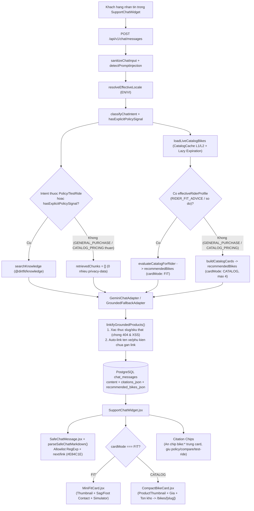

# 15. Kế hoạch Thiết kế Chi tiết `v2.1.2` — Chatbot Clickable Bike/Accessory Links, Interactive Product Cards & Precision Citations

> **Phiên bản mục tiêu:** DirtFit Commerce `v2.1.2` (Maintenance & Product UX Release trên nền `v2.1.1` Live Production)  
> **Phạm vi:** 100% Pure JavaScript ESM (`.js`/`.mjs`/`.jsx`), song ngữ **EN / VI** (mặc định **EN**), **0 thay đổi Database Schema / 0 Prisma Migration**, **\$0/tháng** chi phí hạ tầng tăng thêm.  
> **Trạng thái:** Bản thiết kế chi tiết chờ duyệt — **chưa chỉnh sửa code ứng dụng**.

---

## 1. Bối cảnh & Mục tiêu Nghiệp vụ

Qua kiểm thử vận hành thực tế trên production `v2.1.1` (Neon + Upstash + Cloudflare R2 + Render API + Vercel Web), Chatbot đã nhận diện chuẩn Tiếng Việt ngay cả khi UI ở mặc định `EN` và xử lý tự nhiên các intent `GREETING` / `GENERAL_PURCHASE`. Tuy nhiên, còn **3 điểm nghẽn trải nghiệm mua hàng trực tiếp trong khung chat** cần giải quyết dứt điểm trong `v2.1.2`:

1. **Tên xe & phụ kiện vẫn là raw text tĩnh:** Khi khách hỏi *"tôi muốn mua xe"*, *"giá KTM 350 EXC-F"*, hoặc hỏi tư vấn vóc dáng, các mẫu xe được liệt kê dưới dạng chữ in đậm (`**Honda CRF250R**`) không bấm được. Khách phải tự đóng chat và tìm lại xe trên thanh điều hướng.
2. **Thiếu thẻ sản phẩm trực quan cho intent mua hàng / hỏi giá / so sánh:** Hiện `recommendedBikes[]` chỉ được nạp khi có `effectiveRiderProfile` (`RIDER_FIT_ADVICE`). Với `GENERAL_PURCHASE` và `CATALOG_PRICING`, khung chat chưa tận dụng ảnh thật `coverImageUrl` & `ProductThumbnail` (đã triển khai từ `v2.1`) để hiển thị thẻ xe gọn bấm 1 chạm.
3. **Nhiễu Citation chính sách không liên quan:** Khi khách gửi `"tôi muốn mua xe"` (`GENERAL_PURCHASE`), câu trả lời bị kéo theo citation `[privacy-data] Bảo mật Dữ liệu Cá nhân, Số đo Vóc dáng & Lịch sử Chat` vì BM25 retriever vẫn chạy tìm kiếm toàn kho chính sách với ngưỡng thấp (`minScore: 0.15`) trên các từ phổ thông `"mua"` và `"xe"`. Ngoài ra, kiểm tra mã nguồn phát hiện thêm một lỗi nhỏ ở `context-builder.js` (`ergo-disclaimer` không khớp ID thật `ergonomics-disclaimer` trong `terms-and-conditions.md`, khiến `RIDER_FIT_ADVICE` bị rơi nhầm vào mục đầu tiên `[account-security]`).

### 1.1. Ánh xạ Chính xác sang Kiến trúc Hiện hữu (`Zero DB Migration`)

Để bảo đảm **0 Prisma migration** và tương thích ngược 100% với lịch sử chat đã lưu trên Neon production, `v2.1.2` tái sử dụng toàn bộ enum & cột JSONB đang có:

| Khái niệm Sản phẩm | Ánh xạ Chính xác trong Codebase hiện tại | Lưu trữ DB |
| :--- | :--- | :--- |
| Tư vấn mua xe tổng quát | `CHAT_INTENTS.GENERAL_PURCHASE` | `ChatMessage.intent` (đã có từ `v2.1.1`) |
| Hỏi thông tin xe / giá / tồn kho / so sánh 2+ xe | `CHAT_INTENTS.CATALOG_PRICING` (`mentionedSlugs` 1 hoặc `>= 2` xe, hoặc theo `category`) | `ChatMessage.intent` (đã có) |
| Tư vấn vóc dáng & 2D Rider Fit | `CHAT_INTENTS.RIDER_FIT_ADVICE` | `ChatMessage.intent` (đã có) |
| Hỏi chính sách / lái thử / đơn hàng | `POLICY_ORDERING`, `POLICY_WARRANTY`, `POLICY_TERMS`, `SHOWROOM_TEST_RIDE`, `ORDER_STATUS_HELP` | `ChatMessage.intent` (đã có) |
| Danh sách thẻ xe gắn với tin nhắn Assistant | `assistantMessage.recommendedBikes[]` (phân nhánh bằng `cardMode: 'FIT' \| 'CATALOG'`) | `ChatMessage.recommendedBikesJson` (`Json?` / PostgreSQL `JSONB` — **0 migration**) |
| Nguồn trích dẫn | `assistantMessage.citations[]` | `ChatMessage.citationsJson` (`Json?` — **0 migration**) |

---

## 2. Luồng Kiến trúc Tổng thể `v2.1.2`



---

## 3. Hạng mục 1 — Inline Clickable Markdown Links & Server-Side Link Grounding

### 3.1. Chuẩn hóa Markdown Link từ các Adapter & Prompts

1. **`apps/api/src/modules/chatbot/adapters/fallback.adapter.js`:**
   - Thêm helper thuần nội bộ:
     - `formatBikeLink(bike)` → `[${bike.name}](/bikes/${bike.slug})`
     - `formatAccessoryLink(acc)` → `[${acc.name}](/accessories?sku=${encodeURIComponent(acc.sku)})`
   - Cập nhật mọi formatter có nhắc sản phẩm:
     - **`formatGeneralPurchaseResponse()`:** `- **[${bike.name}](/bikes/${bike.slug})** (${bike.category} · ${bike.engineCc}cc) — ...` (và khi danh mục trống gắn link `[Xe địa hình](/bikes)` / `[Motorcycles](/bikes)`).
     - **`formatCatalogResponse()`:** Gắn link `**[${bike.name}](/bikes/${bike.slug})**` cho từng mẫu xe; nếu người dùng nêu từ **2 mẫu xe trở lên** (`matchedCatalogBikes.length >= 2`), bổ sung một dòng gợi ý mở trực tiếp màn hình so sánh 2D Ghost Overlay: `[So sánh 2D Ghost Overlay](/compare?bikeA=${b0.slug}&bikeB=${b1.slug})` (EN: `[Compare in 2D Ghost Overlay](/compare?bikeA=...)`) khớp đúng query params `bikeA` / `bikeB` của `apps/web/src/app/compare/page.jsx`.
     - **`formatRiderFitResponse()`:** Gắn link `**[${bike.name}](/bikes/${bike.slug})**` cho từng mẫu xe; khi có phụ kiện hạ yên gợi ý (`bike.loweringAccessorySku` & `bike.loweringAccessoryName`), gắn kèm link `[${bike.loweringAccessoryName}](/accessories?sku=${encodeURIComponent(bike.loweringAccessorySku)})`. Đồng thời sửa nhãn `[ergo-disclaimer]` → `[ergonomics-disclaimer]` để khớp chính xác section ID thật trong `terms-and-conditions.md`.
     - **`formatOrderStatusHelp()` & `formatPolicyResponse()` (`SHOWROOM_TEST_RIDE`):** Dùng link nội bộ gọn `[Tài khoản](/account)` / `[Account](/account)` và `[Lái thử](/test-ride)` / `[Test Ride](/test-ride)`.
   - **Tương thích ngược với các test hiện hữu:** Vì chuỗi `**[KTM 350 EXC-F](/bikes/ktm-350-exc-f)**` vẫn chứa nguyên văn `'KTM 350 EXC-F'`, toàn bộ assertion `.toContain(...)` hiện tại vẫn pass 100%.

2. **Prompt Governance (`apps/api/src/modules/chatbot/prompts/`):**
   - **`system.prompt.md`:** Bổ sung quy tắc rõ ràng (giữ nguyên placeholder `{{LOCALE}}` để pass `prompt-loader.test.js`):
     - Khi nhắc bất kỳ mẫu xe nào từ `<live_catalog_context>` hoặc `<ergonomics_evaluation>`, luôn định dạng thành Markdown link nội bộ `[Exact Bike Name](/bikes/<slug>)` chỉ sử dụng `slug` có thật trong ngữ cảnh.
     - Khi nhắc phụ kiện hạ yên tương thích có kèm `sku` trong `<live_catalog_context>`, định dạng thành `[Accessory Name](/accessories?sku=<SKU>)`.
     - Tuyệt đối không tự bịa `slug`, `sku` hoặc xuất đường dẫn ngoài (`http://`, `https://`).
   - **`guardrails.prompt.md`:** Cập nhật Mục 5 (`Safe Output Format`) — giữ nguyên tiêu đề `## Security & Prompt-Injection Guardrails` để pass `prompt-loader.test.js` — cho phép Markdown link nội bộ hợp lệ (`/bikes/<slug>`, `/accessories?sku=<sku>`, `/policies/<slug>`, `/compare`, `/test-ride`) và vẫn cấm tuyệt đối HTML thô, `javascript:`, `data:` hoặc URL ngoài.
   - **`context-builder.js` (`liveCatalogText`):** Bổ sung danh sách gọn tối đa 2 phụ kiện hạ yên đang `ACTIVE` (`sku` + `name`) trên mỗi xe trong `<live_catalog_context>` để Gemini có dữ liệu SKU thật để gắn link khi cần, vẫn bảo đảm tổng ngân sách prompt `<= ~2,500 tokens`.

### 3.2. Server-Side Link Grounder & Anti-Hallucination Validator (`link-grounder.js`)

Tạo module thuần mới **`apps/api/src/modules/chatbot/link-grounder.js`** (0 I/O, 0 DB, dễ test đơn vị độc lập) xuất hàm `linkifyGroundedProducts(answer, groundedBikes, groundedAccessories)` và gọi ngay trong `chatbot.service.js` sau `adapter.generate(groundedContext)` và **trước** `persistChatTurn()`:

> **Tại sao chạy ở tầng Service trước khi lưu PostgreSQL?**  
> Cả phản hồi từ `GeminiChatAdapter` lẫn `GroundedFallbackAdapter` đều đi qua cùng một chốt kiểm duyệt duy nhất; nội dung lưu vào `ChatMessage.content` đã được làm sạch & gắn link xác thực sẵn, nhờ đó khi người dùng tải lại trang (`GET /api/v1/chat/session`) giao diện hiển thị tức thì và nhất quán 100%.

#### Thuật toán 2 Lượt Xác định (Deterministic 2-Pass Algorithm)

1. **Chuẩn bị bảng tra cứu từ dữ liệu thật (`liveBikes` & `compatibilities[].accessory`):**
   - `validBikesBySlug`: `Map<slugLower, bike>` (toàn bộ xe `ACTIVE` trong `liveBikes`).
   - `validBikesByFoldedName`: `Map<foldedName, bike>` (phục vụ sửa link khi LLM viết đúng tên xe nhưng gõ nhầm slug).
   - `validAccessoriesBySku`: `Map<skuUpper, accessory>` gom duy nhất từ `groundedAccessories` hoặc trích xuất từ `liveBikes[].compatibilities[].accessory`.
   - `ALLOWED_STATIC_PATH_RE`: khớp chặt `/bikes`, `/accessories`, `/compare`, `/test-ride`, `/cart`, `/account`, `/policies/(ordering|terms|warranty|rider-fit)(#[a-z0-9-]+)?` cùng query an toàn cho `/compare?bikeA=...&bikeB=...` (xác thực cả `bikeA`, `bikeB` tồn tại trong `validBikesBySlug`!) và `/bikes/<slug>?heightCm=...`.

2. **Lượt 1 — Xác thực & Thanh lọc mọi Markdown link hiện có `[label](rawHref)`:**
   - Duyệt regex `/\[([^\]\n]{1,140})\]\(([^)\s]{1,260})\)/g`:
     - **Case `/bikes/<slug>...`:** Nếu `validBikesBySlug.has(slug)` → giữ nguyên link hợp lệ và ghi nhận `slug` vào `linkedBikeSlugs`. Nếu `slug` **không tồn tại trong DB** (LLM bịa như `/bikes/yamaha-yz999` hoặc `/bikes/crf-300l-pro`): kiểm tra `validBikesByFoldedName` theo `label` (nếu khớp 1-1 tên xe thật → sửa sang `/bikes/${realBike.slug}`; nếu không khớp → **tước bỏ link, giữ lại `label` thuần** để chống 404).
     - **Case `/accessories?sku=<sku>`:** Chỉ giữ nếu `sku` tồn tại trong `validAccessoriesBySku`; ngược lại tước link giữ `label` thuần.
     - **Case `/compare?bikeA=<a>&bikeB=<b>`:** Chỉ giữ nếu cả `a` và `b` tồn tại trong `validBikesBySlug` (hoặc `/compare` không query); ngược lại hạ cấp về `/compare` hoặc `label` thuần.
     - **Case static/policy hợp lệ:** Giữ nếu pass `ALLOWED_STATIC_PATH_RE` (không chứa `..`, `//`, `\`, scheme ngoài).
     - **Mọi URL khác (`https://...`, `http://...`, `javascript:...`, `data:...`, `//evil.com`, `/admin/...`):** **Tước bỏ link hoàn toàn, chỉ trả về `label` thuần.**

3. **Lượt 2 — Tự động bọc Link cho Lần Xuất hiện Đầu tiên bị LLM bỏ sót:**
   - Tách văn bản thành mảng segment bảo vệ: các đoạn đã là Markdown link `[...](...)` hoặc inline code `` `...` `` được đánh dấu `protected: true` để **tuyệt đối không bao giờ lồng link trong link** hay phá code block.
   - Sắp xếp `groundedBikes` theo `name.length` giảm dần (tránh trùng tiền tố kiểu `"Honda CRF300L Rally"` vs `"Honda CRF300L"`).
   - Với mỗi xe chưa có trong `linkedBikeSlugs`: tìm lần xuất hiện đầu tiên (không phân biệt hoa/thường, có biên từ an toàn) trong các segment `protected: false`, thay bằng `[${matchedText}](/bikes/${bike.slug})`, đánh dấu đã link và tách lại segment thành `protected: true`.
   - Tương tự với `groundedAccessories` (có `sku` hợp lệ và `name.length >= 6`, chưa nằm trong `linkedAccessorySkus`): bọc lần xuất hiện đầu tiên bằng `[${matchedText}](/accessories?sku=${encodeURIComponent(acc.sku)})`.
   - Giữ an toàn giới hạn độ dài `<= 4000` ký tự (khớp `sanitizeAssistantOutput`).

### 3.3. Safe Markdown Renderer & Rào chắn XSS / Open Redirect trên Frontend

1. **Nâng cấp `isSafeInternalUrl(rawUrl)` tại `apps/web/src/lib/chat-markdown.js`:**
   - Thay kiểm tra `startsWith` đơn giản bằng RegExp allowlist chặt kèm kiểm tra chống path traversal & double encoding:
     ```js
     const SAFE_INTERNAL_URL_REGEX =
       /^\/(?:bikes|accessories|compare|test-ride|policies|cart|account)(?:\/[a-zA-Z0-9._-]+)*(?:\?[a-zA-Z0-9._=&%-]+)?(?:#[a-zA-Z0-9._-]+)?$/;

     export function isSafeInternalUrl(rawUrl) {
       if (typeof rawUrl !== 'string') return false;
       const trimmed = rawUrl.trim();
       if (!trimmed || trimmed.startsWith('//') || trimmed.includes('\\')) return false;
       if (/(?:^|\/)\.\.(?:\/|$)|%2e%2e|%2f|%5c/i.test(trimmed)) return false;
       return SAFE_INTERNAL_URL_REGEX.test(trimmed);
     }
     ```
   - **Lưu ý tương thích ngược:** Giữ `/account` trong nhóm allowlist để 100% tương thích với unit test hiện hữu `apps/web/tests/chat-renderer.test.js:34` (`isSafeInternalUrl('/account') === true`) và link tới đơn hàng cá nhân của `ORDER_STATUS_HELP`, đồng thời mở rộng hỗ trợ đầy đủ `/bikes`, `/accessories`, `/accessories?sku=...`, `/cart`, `/compare?bikeA=...&bikeB=...`, `/test-ride`, `/policies/*#anchor`.
   - **Chặn tuyệt đối:** `javascript:alert(1)`, `JAVASCRIPT:...`, `data:text/html,...`, `vbscript:...`, `http://...`, `https://...`, `//evil.com`, `/\evil.com`, `/bikes/../admin`, `/admin/bikes`, `/api/v1/...`.

2. **Nâng cấp `parseInlineRuns(line)` tại `apps/web/src/lib/chat-markdown.js`:**
   - Không cài thêm thư viện ngoài (0 KB bundle bloat, 0 `dangerouslySetInnerHTML`).
   - Hỗ trợ đồng thời 3 dạng viết link phổ biến của Fallback & Gemini cùng với bold/code:
     - `**[Label](/bikes/slug)**` → `{ type: 'link', label: 'Label', href: '/bikes/slug', bold: true }`
     - `[**Label**](/bikes/slug)` → `{ type: 'link', label: 'Label', href: '/bikes/slug', bold: true }`
     - `[Label](/bikes/slug)` → `{ type: 'link', label: 'Label', href: '/bikes/slug', bold: false }`
     - `**bold**` → `{ type: 'bold', value: 'bold' }`
     - `` `code` `` → `{ type: 'code', value: 'code' }`
     - `*emphasis*` → `{ type: 'bold', value: 'emphasis' }`
   - Nếu `href` trong `[label](href)` **không vượt qua `isSafeInternalUrl(href)`**: tự động hạ cấp thành `{ type: bold ? 'bold' : 'text', value: label }` — hoàn toàn vô hiệu hóa XSS / Open Redirect ngay tại AST.

3. **Nâng cấp `apps/web/src/components/chat/SafeChatMessage.jsx`:**
   - Bổ sung prop tùy chọn `onNavigate` (truyền `() => setIsOpen(false)` từ `SupportChatWidget.jsx`, đồng nhất hành vi với `MiniFitCard` và Citation Chips để khi bấm link chuyển trang SPA, drawer tự khép gọn không che màn hình trên mobile/desktop).
   - Render `{ type: 'link' }` bằng Next.js `<Link href={run.href} onClick={onNavigate}>`:
     - Phong cách *Industrial Motorsport / Technical Editorial*: `text-signal font-semibold underline decoration-signal/35 underline-offset-2 transition-colors hover:text-ink hover:decoration-ink` (màu `#E84C1E`, tương phản chuẩn trên nền trắng `#FFFFFF`, có thể nhận biết ngay là link bấm được).

---

## 4. Hạng mục 2 — Structured Interactive Bike Cards cho Mọi Intent có Sản phẩm

### 4.1. Hợp đồng Dữ liệu Mở rộng (`recommendedBikes[]`, 0 Migration)

Tại `apps/api/src/modules/chatbot/context-builder.js`, bổ sung hàm thuần `buildCatalogRecommendationCards(bikes, maxResults = 4)` và hợp nhất đầu ra `recommendedBikes[]` theo trường phân biệt `cardMode`:

| Chế độ (`cardMode`) | Khi nào kích hoạt | Trường dữ liệu (JSON-safe, `toSafeVndNumber()`) |
| :--- | :--- | :--- |
| **`'FIT'`** | `effectiveRiderProfile !== null` (`RIDER_FIT_ADVICE` hoặc tin nhắn có chiều cao/cân nặng/inseam) | Giữ nguyên 100% trường hiện có (`id`, `slug`, `name`, `brandName`, `category`, `coverImageUrl`, `commercialImageUrl`, `coverImageKind`, `unladenSeatHeightMm`, `effectiveSeatHeightMm`, `riderSagMm`, `contactStatus`, `fitScore`, `priceVnd`, `depositAmountVnd`, `availableQty`, `recommendedLoweringMm`, `loweringTip`, `simulatorUrl`) + bổ sung additive: `cardMode: 'FIT'`, `productUrl: '/bikes/' + slug`, `engineCc`, `loweringAccessorySku`, `loweringAccessoryName`. |
| **`'CATALOG'`** | `effectiveRiderProfile === null` VÀ thuộc một trong các trường hợp:<br>• `intent === CHAT_INTENTS.GENERAL_PURCHASE`<br>• `intent === CHAT_INTENTS.CATALOG_PRICING`<br>• `mentionedSlugs.length > 0` (bao gồm hỏi thông tin xe, hỏi giá/tồn kho, so sánh 2+ xe) | `cardMode: 'CATALOG'`, `id`, `slug`, `name`, `brandName`, `category`, `engineCc`, `unladenSeatHeightMm`, `priceVnd`, `depositAmountVnd`, `availableQty`, `coverImageUrl`, `commercialImageUrl`, `coverImageKind`, `productUrl: '/bikes/' + slug`. Giới hạn tối đa **4 thẻ** (`maxResults = 4`) để không làm dài quá mức bong bóng chat. |
| **`[]` (rỗng)** | `GREETING`, `OUT_OF_SCOPE`, `POLICY_*`, `SHOWROOM_TEST_RIDE`, `ORDER_STATUS_HELP` (khi không nêu tên xe cụ thể) | Không render thẻ xe dư thừa. |

**Đảm bảo Zero Regression:**
- `evaluateCatalogForRider()` giữ nguyên chính xác giá trị `simulatorUrl: '/bikes/${slug}?heightCm=...&weightKg=...'` để bảo toàn 100% các test hiện tại (`chatbot-engine.test.js:207`, `chatbot-grounded.test.js:155-156`, `04-ai-chatbot-e2e.spec.js:35-41`).
- Các bản ghi `ChatMessage` cũ đã lưu trong DB trước `v2.1.2` không có trường `cardMode` → Frontend suy luận an toàn:
  ```js
  const isFitCard = bike?.cardMode === 'FIT' || typeof bike?.effectiveSeatHeightMm === 'number';
  ```

### 4.2. Thiết kế UI `CompactBikeCard.jsx` & Tối ưu Bố cục `SupportChatWidget.jsx`

1. **Component mới `apps/web/src/components/chat/CompactBikeCard.jsx` (Pure JS JSX):**
   - Toàn bộ thẻ là một Next.js `<Link href={safeHref} onClick={onNavigate}>` (xác thực qua `isSafeInternalUrl(bike.productUrl)` với fallback `/bikes/${bike.slug}`), thêm `data-testid="chat-compact-bike-card"` để test E2E định vị sạch.
   - **Tái sử dụng `ProductThumbnail` (`apps/web/src/components/ui/ProductThumbnail.jsx`):**
     - Truyền `itemType="BIKE"`, `src={bike.coverImageUrl || bike.commercialImageUrl}`, `alt={bike.name}`, `size="sm"` (`h-12 w-16`, `64×48px`), **không truyền `href`** cho `ProductThumbnail` (tránh lồng `<a>` bên trong `<Link>` vi phạm HTML spec!).
     - Nhờ `ProductThumbnail`, xe có ảnh thật trên R2/local sẽ hiện ảnh thật `object-cover`; xe chưa có ảnh thật hoặc URL lỗi tự động hiển thị khung dây kỹ thuật CAD SVG chuẩn Industrial Motorsport (0 ảnh vỡ).
   - **Cấu trúc thẻ ngang 3 cột gọn (không bao giờ tràn ngang trên mobile `320px` lẫn desktop `420px`):**
     - **Trái (`64px`, `shrink-0`):** `ProductThumbnail` (`size="sm"`).
     - **Giữa (`min-w-0 flex-1`):**
       - Dòng 1 (micro-kicker): `{brandName} · {categoryLabel}` + `{engineCc}cc` (`text-[10px] font-bold uppercase tracking-wider text-ink-muted truncate`).
       - Dòng 2 (tên xe): `truncate text-xs font-bold text-ink group-hover:text-signal`.
       - Dòng 3 (telemetry): Giá VND (`font-mono text-xs font-bold text-ink tabular-telemetry`) · Yên (`{seat}mm`, `font-mono text-[10px] text-ink-muted`) · Trạng thái kho (chấm màu `emerald-600` + `Còn {qty} xe` / `{qty} in stock`, hoặc `text-ink-muted` `Hết hàng` / `Out of stock` khi `availableQty <= 0`).
     - **Phải (`shrink-0`):** Icon `ArrowUpRight` chuyển sang `#E84C1E` khi hover.
   - **Đồng bộ `MiniFitCard.jsx`:** Thay khối `` rời hiện tại trong `MiniFitCard.jsx` bằng `<ProductThumbnail itemType="BIKE" src={bike.coverImageUrl || bike.commercialImageUrl} alt={bike.name} size="xs" />` để xe chưa có ảnh thật cũng có thumbnail CAD đồng nhất, giữ nguyên toàn bộ số liệu Sag/Foot Contact/Fit Score và nút `Open 2D Simulator`.

2. **Tối ưu hiển thị trong `SupportChatWidget.jsx`:**
   - Phân nhánh render cho `msg.recommendedBikes`:
     - `isFitCard` → `<MiniFitCard ... />`
     - Còn lại (`cardMode === 'CATALOG'`) → `<CompactBikeCard ... />`
   - **Chống lặp rối mắt giữa Thẻ Xe và Citation Chip:**
     - Backend vẫn giữ nguyên bike citations trong `citations[]` (bảo toàn 100% API contract & test `chatbot-grounded.test.js:438`).
     - Trên UI `SupportChatWidget.jsx`, tạo tập `renderedBikeUrls = new Set(recs.map((b) => `/bikes/${b.slug}`))` và lọc bỏ các citation chip `citation.id?.startsWith('bike:')` đã xuất hiện dưới dạng `MiniFitCard` hoặc `CompactBikeCard` ngay phía trên — giữ nguyên 100% các chip `/policies/*`, `/test-ride`, `/compare`.
   - **Kiểm soát chiều rộng & cuộn (`420px` desktop / `calc(100vw - 2rem)` mobile):**
     - Danh sách thẻ xếp dọc `space-y-1.5` bên trong vùng cuộn của bong bóng tin nhắn; mỗi thẻ cao `~64px`, nên 3–4 thẻ xe chỉ chiếm `~260px` và luôn vừa khít không phát sinh thanh cuộn ngang.

3. **Bổ sung i18n đối xứng 100% (`apps/web/src/lib/i18n/en.js` & `vi.js`):**

| Key (`chat.*`) | `en.js` | `vi.js` |
| :--- | :--- | :--- |
| `chat.seatShortLabel` | `'Seat'` | `'Yên'` |
| `chat.inStockShort` | `'{count} in stock'` | `'Còn {count} xe'` |
| `chat.outOfStockShort` | `'Out of stock'` | `'Hết hàng'` |
| `chat.viewBikeAria` | `'View {name} details'` | `'Xem chi tiết xe {name}'` |

---

## 5. Hạng mục 3 — Lọc Citation Chính sách Không Liên quan

### 5.1. Truy vết Nguyên nhân Gốc (Verified Code Audit)

1. **Nguyên nhân câu `"tôi muốn mua xe"` bị dính `[privacy-data]`:**
   - Trong `intent-router.js:328-334`, `"tôi muốn mua xe"` được phân loại là `CHAT_INTENTS.GENERAL_PURCHASE` với `preferredDocSlug: 'rider-fit-faq'`.
   - Trong `context-builder.js:230-259`, hàm `retrieveGroundedPolicyChunks()` chỉ bỏ qua tìm kiếm BM25 cho `OUT_OF_SCOPE` và `GREETING`, nên vẫn gọi `searchKnowledge("tôi muốn mua xe", { locale: 'vi', topK: 4, minScore: 0.15, preferredDocSlug: 'rider-fit-faq' })` trên **cả 4 tài liệu chính sách**.
   - Trong `packages/knowledge/src/retriever.js:107-152`, `"tôi muốn mua xe"` tách thành `['toi', 'muon', 'mua', 'xe', 'toi_muon', 'muon_mua', 'mua_xe', 'acc:tôi', 'acc:muốn']` (vì `STOP_WORDS` không loại `toi`, `muon`, `mua`, `xe`).
   - Trong `packages/knowledge/content/vi/terms-and-conditions.md:42-46`, mục `## [privacy-data]` rất ngắn (3 dòng bullet, `tokensLength` nhỏ trong mẫu số BM25) và vô tình chứa đồng thời từ **`mua`** (*"không **mua** bán"*) và **`xe`** (*"giao **xe**/lái thử"*). Do hiệu ứng chuẩn hóa độ dài ngắn của BM25, `[privacy-data]` đạt điểm `>= 0.15` và lọt thẳng vào `citations[]`.

2. **Lỗi phụ phát hiện trong quá trình rà soát (`context-builder.js:310-326`):**
   - `buildStructuredCitations()` tìm section `s.sectionId === 'ergo-disclaimer'` trong `terms-and-conditions`, nhưng ID thật trong cả `en/terms-and-conditions.md:22` và `vi/terms-and-conditions.md:22` là **`ergonomics-disclaimer`**. Kết quả `.find(...)` trả `undefined` và rơi về `termsDoc.sections[0]` (`[account-security]`)! Cần sửa dứt điểm thành `'ergonomics-disclaimer'` trong `v2.1.2`.

### 5.2. Quy tắc Gắn Citation Chính xác theo Intent (`intent-router.js` + `context-builder.js`)

1. **Bổ sung hàm thuần `hasExplicitPolicySignal(message)` tại `apps/api/src/modules/chatbot/intent-router.js`:**
   - Nhận diện tín hiệu hỏi chính sách rõ ràng (đặt cọc, PayOS, VietQR, COD, giữ chỗ 15 phút, hủy đơn, thanh toán, bảo hành, đổi trả, hoàn tiền, PDI, bàn giao/giao xe, điều khoản, quyền riêng tư/bảo mật dữ liệu, miễn trừ, OAuth, lái thử/showroom):
     ```js
     const EXPLICIT_POLICY_SIGNAL_REGEX =
       /\b(deposit|dat coc|coc xe|payos|vietqr|\bcod\b|cash on delivery|thu ho|giu cho|reservation|15 ?min|15 phut|huy don|cancel order|thanh toan|payment|warranty|bao hanh|returns?|doi tra|hoan tien|refund|\bpdi\b|handover|ban giao|giao xe|terms?|dieu khoan|dieu kien|privacy|quyen rieng tu|du lieu ca nhan|bao mat|disclaimer|mien tru|oauth|showroom|test[- ]?ride|lai thu)\b/i;
     ```
   - Trả `{ intent, preferredDocSlug, hasPolicySignal, entities, mentionedSlugs }` (hoặc export hàm `hasExplicitPolicySignal(message)` dùng trực tiếp trong `context-builder.js`).

2. **Ma trận Luật Truy xuất Chính sách trong `retrieveGroundedPolicyChunks()`:**

| Nhóm Intent | Có gọi `searchKnowledge()`? | Điều kiện lọc & Kết quả `citations[]` |
| :--- | :--- | :--- |
| `GREETING`, `OUT_OF_SCOPE` | **Không (`[]`)** | `citations = []` |
| `GENERAL_PURCHASE`, `CATALOG_PRICING` | **Chỉ khi `hasExplicitPolicySignal(message) === true`** (nâng ngưỡng `minScore: 0.35`, `topK: 2`) | • Câu thuần mua/hỏi giá/so sánh (VD: `"tôi muốn mua xe"`, `"giá KTM 350"`, `"so sánh CRF300L và KLX230"`): `retrievedChunks = []` → **0 citation chính sách nhiễu**, không bao giờ dính `[privacy-data]`, chỉ có citation `/bikes/*` (và `/compare?bikeA=...&bikeB=...` nếu `>= 2` xe).<br>• Câu kết hợp hỏi chính sách (VD: `"Mua Honda CRF300L đặt cọc và bảo hành thế nào?"`): chỉ kéo đúng chunk liên quan (`ordering` / `warranty`). |
| `RIDER_FIT_ADVICE` | **Có** — nếu `!hasExplicitPolicySignal(message)` thì chỉ giữ chunk thuộc `docSlug === 'rider-fit-faq'` (tránh kéo nhầm `[privacy-data]` vì từ `"chiều cao"` / `"vóc dáng"` có xuất hiện trong `[privacy-data]`!) | Luôn giữ đúng `[ergonomics-disclaimer]` (`/policies/terms#ergonomics-disclaimer`) + chunk `rider-fit-faq` phù hợp + `/bikes/*`. |
| `POLICY_ORDERING`, `POLICY_WARRANTY`, `POLICY_TERMS`, `SHOWROOM_TEST_RIDE`, `ORDER_STATUS_HELP` | **Giữ nguyên 100%** (`topK: 4`, `minScore: 0.15`, fallback `preferredDocSlug` sections) | Bảo toàn 100% citation chính sách và toàn bộ bài test hiện hữu (`chatbot-grounded.test.js`, `04-ai-chatbot-e2e.spec.js`). |

> **Chi tiết tinh tế cho `RIDER_FIT_ADVICE`:** Trong `vi/terms-and-conditions.md:44`, mục `[privacy-data]` có chứa cụm `"Số đo Vóc dáng"`, nên khi khách hỏi tư vấn vóc dáng thuần (`RIDER_FIT_ADVICE`) mà không hỏi về bảo mật, giới hạn kết quả BM25 về `docSlug === 'rider-fit-faq'` (cộng thêm mục bắt buộc `[ergonomics-disclaimer]`) sẽ chặn triệt để `[privacy-data]` xuất hiện nhầm trên cả luồng Rider Fit!

3. **Bổ sung nhận diện nhẹ cho câu hỏi so sánh xe (`intent-router.js`):**
   - Trong `KEYWORD_RULES` của `CATALOG_PRICING`, bổ sung `\b(compare|so sanh)\b` để ngay cả câu so sánh ngắn cũng định tuyến về `CATALOG_PRICING` cùng `mentionedSlugs`, sinh `CompactBikeCard` cho cả 2 xe và gắn link `/compare?bikeA=...&bikeB=...`.

---

## 6. Danh sách Chính xác các File sẽ Chỉnh sửa khi Triển khai `v2.1.2`

Không phát sinh migration DB, không thêm dependency bên ngoài (`package.json` giữ nguyên 0 thư viện mới). Phạm vi khoanh gọn vào **2 file mới nhỏ** + **12 file hiện hữu**:

| Nhóm | Đường dẫn File | Trạng thái | Thay đổi chính |
| :--- | :--- | :---: | :--- |
| **Backend Link Grounder** | `apps/api/src/modules/chatbot/link-grounder.js` | **Mới** | Hàm thuần `linkifyGroundedProducts(answer, groundedBikes, groundedAccessories)` thực thi 2 lượt: xác thực/sửa/tước link bịa & link ngoài, và auto-link tên xe/phụ kiện chưa gắn link không lồng nhau. |
| **Backend Router** | `apps/api/src/modules/chatbot/intent-router.js` | Sửa | Thêm `hasExplicitPolicySignal(message)`, thêm từ khóa `compare \| so sanh` vào `CATALOG_PRICING`, đặt `preferredDocSlug: null` cho `GENERAL_PURCHASE` / `CATALOG_PRICING` khi không có tín hiệu chính sách. |
| **Backend Grounding** | `apps/api/src/modules/chatbot/context-builder.js` | Sửa | Áp dụng ma trận lọc `retrieveGroundedPolicyChunks()`; sửa `'ergo-disclaimer'` → `'ergonomics-disclaimer'`; bổ sung `buildCatalogRecommendationCards()` (`cardMode: 'CATALOG'`, tối đa 4 xe) và `cardMode: 'FIT'` + `productUrl` + `loweringAccessorySku` trên `evaluateCatalogForRider()`; gắn citation `/compare?bikeA=...&bikeB=...` khi `mentionedSlugs.length >= 2`; đính kèm SKU phụ kiện gọn vào `liveCatalogText`. |
| **Backend Service** | `apps/api/src/modules/chatbot/chatbot.service.js` | Sửa | Chạy `linkifyGroundedProducts()` lên `adapterResult.content` trước `persistChatTurn()` để cả Gemini & Fallback đều được kiểm duyệt link trước khi lưu DB và trả client. |
| **Backend Fallback** | `apps/api/src/modules/chatbot/adapters/fallback.adapter.js` | Sửa | Gắn Markdown link nội bộ `[Bike Name](/bikes/<slug>)`, `[Accessory](/accessories?sku=<sku>)`, `[Compare 2D Ghost Overlay](/compare?...)`, sửa `[ergo-disclaimer]` → `[ergonomics-disclaimer]`. |
| **Backend Prompts** | `apps/api/src/modules/chatbot/prompts/system.prompt.md`, `guardrails.prompt.md` | Sửa | Hướng dẫn Gemini dùng `[Exact Bike Name](/bikes/<slug>)` và `[Accessory](/accessories?sku=<sku>)` từ `<live_catalog_context>`, giữ nguyên toàn bộ `REQUIRED_PLACEHOLDERS` & heading bảo vệ test `prompt-loader.test.js`. |
| **Frontend Markdown** | `apps/web/src/lib/chat-markdown.js` | Sửa | Nâng cấp `isSafeInternalUrl()` bằng strict anchored allowlist RegExp (chặn XSS, Open Redirect, `..`, `%2f`, `/admin`) và nâng cấp `parseInlineRuns()` hỗ trợ `**[label](href)**`, `[**label**](href)`, `[label](href)` an toàn không HTML. |
| **Frontend Message** | `apps/web/src/components/chat/SafeChatMessage.jsx` | Sửa | Render token `type === 'link'` qua `next/link` với styling `#E84C1E` + hover underline và prop `onNavigate`. |
| **Frontend Product Cards** | `apps/web/src/components/chat/CompactBikeCard.jsx` | **Mới** | Thẻ xe gọn cho `cardMode === 'CATALOG'` dùng `ProductThumbnail` (`size="sm"`), giá `tabular-nums`, chiều cao yên, trạng thái kho, bấm toàn thẻ sang `/bikes/[slug]`. |
| **Frontend Fit Card & Widget** | `apps/web/src/components/chat/MiniFitCard.jsx`, `apps/web/src/components/chat/SupportChatWidget.jsx` | Sửa | Dùng `ProductThumbnail` (`size="xs"`) trong `MiniFitCard`; phân nhánh render `MiniFitCard` vs `CompactBikeCard` trong `SupportChatWidget`; truyền `onNavigate={() => setIsOpen(false)}` cho `SafeChatMessage`; ẩn chip `bike:*` đã hiển thị dưới dạng card. |
| **Frontend i18n** | `apps/web/src/lib/i18n/en.js`, `apps/web/src/lib/i18n/vi.js` | Sửa | Bổ sung 4 khóa `chat.*` đối xứng 100% cho `CompactBikeCard`. |
| **Tests (3 Tiers)** | `apps/api/tests/unit/chatbot-engine.test.js`, `apps/web/tests/chat-renderer.test.js`, `apps/api/tests/integration/chatbot-grounded.test.js`, `tests/system/04-ai-chatbot-e2e.spec.js` | Sửa | Phủ đủ 3 tầng Unit, Supertest Integration và Playwright System E2E (chi tiết mục 7). |

---

## 7. Ma trận Kiểm thử 3 Tầng & Tiêu chí Nghiệm thu (DoD `v2.1.2`)

### 7.1. Ma trận Test Bổ sung

#### Tier 1 — Unit Tests (`pnpm test:unit`, 0 DB/Redis, `< 5s`)

| File Test | Kịch bản kiểm thử mới bắt buộc |
| :--- | :--- |
| `apps/api/tests/unit/chatbot-engine.test.js` | - **`linkifyGroundedProducts()`:**<br>&nbsp;&nbsp;1. Tự bọc tên xe xuất hiện lần đầu chưa có link (`"Thử xem Honda CRF300L"`) → `"[Honda CRF300L](/bikes/honda-crf300l)"`, không bọc trùng lần xuất hiện thứ 2 và không lồng link bên trong link hoặc `` `code` ``.<br>&nbsp;&nbsp;2. Giữ nguyên link hợp lệ `[Honda CRF300L](/bikes/honda-crf300l)` và `[Zeta Link](/accessories?sku=ACC-ZETA-LINK-30)`.<br>&nbsp;&nbsp;3. Chống hallucinated slug: `[Fake Bike](/bikes/yamaha-yz999)` → tước link còn `"Fake Bike"`; `[Honda CRF300L](/bikes/wrong-slug)` → tự sửa về `[Honda CRF300L](/bikes/honda-crf300l)`.<br>&nbsp;&nbsp;4. Chặn URL ngoài & XSS: `[Click](https://evil.com)`, `[XSS](javascript:alert(1))`, `[Admin](/admin/bikes)` → tước link còn text thuần.<br>- **`hasExplicitPolicySignal()`:** `"tôi muốn mua xe"` / `"giá KTM 350"` → `false`; `"mua xe đặt cọc bao lâu?"` / `"chính sách bảo mật"` / `"bảo hành xe"` → `true`. |
| `apps/web/tests/chat-renderer.test.js` | - **`parseSafeChatMarkdown()` / `parseInlineRuns()`:**<br>&nbsp;&nbsp;1. Parse chuẩn `[Honda CRF300L](/bikes/honda-crf300l)`, `**[Honda CRF300L](/bikes/honda-crf300l)**`, `[**Honda CRF300L**](/bikes/honda-crf300l)`, `[Zeta Link](/accessories?sku=ACC-ZETA-LINK-30)` thành `{ type: 'link', label, href, bold }`.<br>&nbsp;&nbsp;2. Vô hiệu hóa link độc hại trong Markdown: `[Evil](javascript:alert(1))`, `[Phish](https://evil.com)`, `[Proto](//evil.com)`, `[Trav](/bikes/../admin)`, `[Admin](/admin/bikes)` → hạ cấp thành `{ type: 'text' }` (0 node `type === 'link'`).<br>- **`isSafeInternalUrl()`:** Pass `/bikes`, `/bikes/honda-crf300l`, `/accessories?sku=ACC-ZETA-LINK-30`, `/compare?bikeA=honda-crf300l&bikeB=ktm-350-exc-f`, `/policies/ordering#cod-rules`, `/test-ride`, `/cart`, `/account`; reject `javascript:`, `data:`, `http://`, `https://`, `//`, `..`, `%2f`, `/admin`.<br>- Kiểm tra `CompactBikeCard.jsx` cũng có **0 `dangerouslySetInnerHTML`**. |
| `apps/web/tests/i18n.test.js` *(tự động phủ)* | - Khẳng định đối xứng 100% leaf keys EN ↔ VI sau khi bổ sung 4 key `chat.*`. |

#### Tier 2 — Supertest Integration Tests (`pnpm test:integration`)

| File Test | Kịch bản kiểm thử mới bắt buộc |
| :--- | :--- |
| `apps/api/tests/integration/chatbot-grounded.test.js` | - Gửi `"tôi muốn mua xe"` với `locale: 'en'` → HTTP `201`, `intent === 'GENERAL_PURCHASE'`:<br>&nbsp;&nbsp;1. `content` chứa ít nhất 1 Markdown link hợp lệ khớp `/\[[^\]]+\]\(\/bikes\/[a-z0-9-]+\)/`.<br>&nbsp;&nbsp;2. `recommendedBikes.length >= 1`, mỗi phần tử có `cardMode === 'CATALOG'`, `productUrl === '/bikes/' + slug`, `priceVnd` (Number), `availableQty` (Number).<br>&nbsp;&nbsp;3. `citations` **KHÔNG** chứa `id === 'privacy-data'` hoặc `url.includes('/policies/terms#privacy-data')`.<br>- Gửi `"Alo cho mình hỏi giá KTM 350"` → `intent === 'CATALOG_PRICING'`, `content` chứa `[KTM 350 EXC-F](/bikes/ktm-350-exc-f)`, `recommendedBikes` chứa thẻ `KTM 350 EXC-F` (`cardMode === 'CATALOG'`), không dính `[privacy-data]`.<br>- Gửi `"Cao 1m65 nặng 60kg nên chọn xe dual-sport nào?"` → `recommendedBikes[0].cardMode === 'FIT'`, `citations` chứa `ergonomics-disclaimer` (`/policies/terms#ergonomics-disclaimer`) và không dính `[privacy-data]` hay `[account-security]`.<br>- Gửi `"Mua Honda CRF300L có được thanh toán COD hay đặt cọc không?"` → vẫn có citation `/policies/ordering` (không mất citation khi câu hỏi thực sự hỏi chính sách).<br>- Tải lại phiên qua `GET /api/v1/chat/session` → xác nhận Markdown links & `recommendedBikes` (`CATALOG` và `FIT`) được lưu nguyên vẹn trong DB. |

#### Tier 3 — System E2E Tests (`pnpm test:system`, Playwright Chromium)

| File Test | Kịch bản kiểm thử mới bắt buộc |
| :--- | :--- |
| `tests/system/04-ai-chatbot-e2e.spec.js` | - Giữ nguyên toàn bộ kịch bản hiện có (Policy Ordering chip → Rider Fit `MiniFitCard` → Simulator → Reload persistence → Feedback UP → Reset).<br>- Bổ sung bước kiểm chứng trực tiếp luồng `v2.1.2`:<br>&nbsp;&nbsp;1. Mở drawer ở UI mặc định `EN`, gửi `"tôi muốn mua xe"`.<br>&nbsp;&nbsp;2. Xác nhận **không** hiển thị citation `[privacy-data]`.<br>&nbsp;&nbsp;3. Xác nhận hiển thị cả **inline clickable link** (`a[href^="/bikes/"]` trong nội dung tin nhắn) và **`CompactBikeCard`** (`[data-testid="chat-compact-bike-card"]`).<br>&nbsp;&nbsp;4. Bấm trực tiếp vào inline link (hoặc `CompactBikeCard`) → điều hướng SPA thành công sang `/bikes/[slug]`, drawer tự đóng gọn, trang chi tiết xe hiển thị đúng tên xe & thông số. |

### 7.2. Definition of Done (DoD) trước khi Release `v2.1.2`

- [ ] **0 Prisma migration mới** (xác nhận `git diff apps/api/prisma/` rỗng, `pnpm --filter @dirtfit/api run db:validate` thoát mã `0`).
- [ ] `pnpm check:pure-js && pnpm lint && pnpm format:check` thoát mã `0`.
- [ ] `pnpm test:unit` pass 100% trên cả 5 packages (`< 5s`), bao gồm toàn bộ test mới cho `linkifyGroundedProducts()` và `parseSafeChatMarkdown()` / XSS allowlist.
- [ ] `$env:ENABLE_MOCK_OAUTH='true'; $env:GOOGLE_OAUTH_ENABLED='true'; pnpm test:integration` pass 100% (2 lần liên tiếp).
- [ ] `pnpm --filter @dirtfit/web build && pnpm test:system` pass **7/7** Playwright specs (kèm bước bấm link/thẻ xe trong `04-ai-chatbot-e2e.spec.js`).
- [ ] `docker compose -f docker-compose.prod.yml up -d --build --wait` + `node scripts/smoke-stack.mjs --api-url http://127.0.0.1:4000 --web-url http://127.0.0.1:3000 --expect-prod` trả `"status": "PASSED"`.

---

## 8. Checklist Xác minh trên Production Sau khi Deploy `v2.1.2`

1. Mở Storefront production (giao diện mặc định `EN`), mở Chatbot và nhắn `"tôi muốn mua xe"`:
   - Kiểm tra câu trả lời bằng Tiếng Việt có **link màu cam `#E84C1E`** bấm trực tiếp trên tên từng mẫu xe.
   - Kiểm tra hiển thị **Compact Bike Cards** có ảnh thật từ Cloudflare R2 (hoặc CAD wireframe nếu xe chưa up ảnh), giá VND `tabular-nums`, trạng thái còn hàng, không tràn ngang trên cả desktop và mobile.
   - Kiểm tra **không còn** citation `[privacy-data]`.
   - Bấm 1 lần vào tên xe hoặc thẻ xe → chuyển mượt sang `/bikes/[slug]` mà không reload cả trang.
2. Nhắn tiếp `"Cao 1m68 nặng 65kg đi xe nào?"` → xác nhận `MiniFitCard` hiển thị đủ ảnh thật, thông số Rider Sag / chống chân, nút mở 2D Simulator, và citation đúng mục `[ergonomics-disclaimer]`.
3. Nhắn `"Quy trình đặt cọc và luật COD?"` → xác nhận citation `/policies/ordering` vẫn hoạt động đầy đủ 100%.
