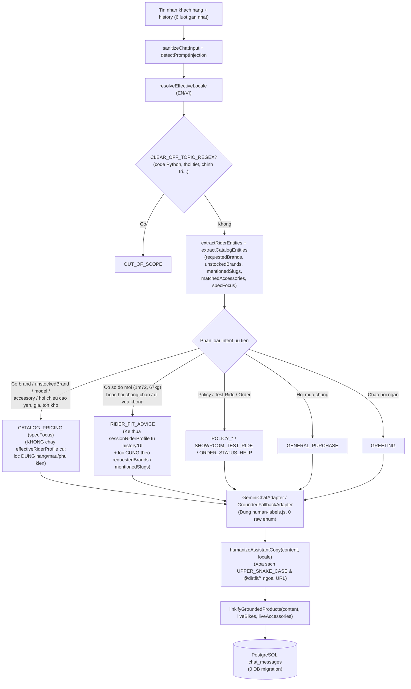

# 16. Kế hoạch Thiết kế Chi tiết `v2.1.3` — Chatbot NLU Entity Filtering, Session State Hygiene & Human-Readable Copy

> **Phiên bản mục tiêu:** DirtFit Commerce `v2.1.3` (Maintenance & NLU/UX Refinement Release trên nền `v2.1.2` Live Production)  
> **Phạm vi:** 100% Pure JavaScript ESM (`.js`/`.mjs`/`.jsx`), song ngữ **EN / VI** (mặc định **EN**), **0 thay đổi Database Schema / 0 Prisma Migration**, **0 dependency mới**, **\$0/tháng** chi phí hạ tầng tăng thêm.  
> **Trạng thái:** Bản thiết kế chi tiết chờ duyệt — **chưa chỉnh sửa code ứng dụng**.

---

## 1. Bối cảnh & Truy vết 3 Vấn đề Nghiệm thu Thực tế

Sau khi triển khai `v2.1.2` lên production (inline clickable bike links + `CompactBikeCard` + `MiniFitCard` hoạt động ổn định), quá trình nghiệm thu thực tế theo kịch bản hội thoại nhiều lượt phát hiện **3 điểm yếu nghiêm trọng về NLU, lọc thực thể và ngôn ngữ hiển thị**:

| # | Biểu hiện Thực tế trên Production | Nguyên nhân Gốc (Đã xác minh trong mã nguồn) |
| :-: | :--- | :--- |
| **1** | Hỏi `"có xe ktm không"` hoặc `"có sản phẩm của ktm không"` bị trả lời từ chối **`OUT_OF_SCOPE`**. | 1. `extractMentionedBikeSlugs()` (`intent-router.js:162-199`) chỉ khớp tên đầy đủ/slug/mã có số (`350`, `crf300l`), **chưa nhận diện tên hãng (`ktm`, `honda`, `yamaha`, `kawasaki`, `husqvarna`)** hay hãng phụ kiện (`alpinestars`, `zeta`, `wp`, `rox`).<br>2. `KEYWORD_RULES` (`CATALOG_PRICING`) và `GENERAL_PURCHASE_PATTERNS` chưa có mẫu hỏi tồn tại theo hãng (`có xe ... không`, `có sản phẩm của ... không`, `bên shop bán ... gì`, `do you have ...`).<br>3. Lỗi phụ phát hiện khi audit: `extractMentionedBikeSlugs()` dòng 187 khớp token số thuần `"350"` dẫn tới `"giá KTM 350"` bị kéo dính cả **`Husqvarna FE 350`**. |
| **2** | Câu trả lời để lộ **raw enum & tên package lập trình**: `(DUAL_SPORT)`, `(MOTOCROSS)`, `(ADVENTURE)`, `(ENDURO)`, `(BALLS_OF_FEET)`, `(SNEAKERS)`, `@dirtfit/ergonomics-engine`. | 1. `fallback.adapter.js:19-35` cố tình ghép `(${status})` vào `getContactLabel()`.<br>2. `fallback.adapter.js:112, 115, 120, 127, 148, 150, 229, 231, 253` chèn trực tiếp `${bike.category}`, `${effectiveRiderProfile.footwear}`, `@dirtfit/ergonomics-engine` và `${o.orderType}` / `${o.status}` / `${s.code}`.<br>3. `context-builder.js:154` gắn `${bestUpsell.afterContactStatus}` vào `loweringTip` (lộ cả trong text lẫn `MiniFitCard.jsx`) và dòng `397` gắn `${bike.category}` vào citation.<br>4. `system.prompt.md:10` chưa có luật cấm Gemini in raw enum `UPPER_SNAKE_CASE` hoặc `@dirtfit/*`, và chưa có lớp hậu kiểm sanitizer khi LLM sinh văn bản. |
| **3** | Sau khi lượt 1 hỏi `"1m72, 67kg đi xe gì"`, sang lượt 2 hỏi `"chiều cao yên của ktm là bao nhiêu"` bị định tuyến nhầm vào **`RIDER_FIT_ADVICE`**, tự chạy lại vóc dáng `172 cm / 67 kg` trên toàn bộ danh mục và trả về **Honda/Yamaha/Kawasaki** thay vì chiều cao yên của **KTM**. | 1. `intent-router.js:242`: luật `RIDER_FIT_ADVICE` đặt **trước** `CATALOG_PRICING` và chứa cụm **`seat height\|chieu cao yen`** → mọi câu hỏi thông số chiều cao yên thuần bị kéo nhầm vào `RIDER_FIT_ADVICE`.<br>2. `SupportChatWidget.jsx:120-125` luôn đính kèm `riderProfile` hiện tại của trình duyệt, khiến `context-builder.js:485` lập tức tái chạy mô phỏng trên vóc dáng cũ.<br>3. `evaluateCatalogForRider()` (`context-builder.js:79-88`) chưa hỗ trợ lọc cứng theo `brandSlugs` (`requestedBrands`) hay `mentionedSlugs`, nên trả về Top 3 toàn danh mục thay vì khóa đúng các mẫu **KTM**. |

---

## 2. Kiến trúc Luồng NLU, Lọc Thực thể & Làm sạch Ngôn ngữ `v2.1.3`



---

## 3. Trụ cột 1 — Nhận diện Thực thể & Tách bạch Intent trong `intent-router.js`

### 3.1. Chốt chặn Lạc đề trước khi Nhận diện Thương hiệu (`CLEAR_OFF_TOPIC_REGEX`)

Để ngăn các câu gài tên hãng nhưng bản chất ngoài phạm vi (ví dụ `"viết code python về ktm"`, `"dự báo thời tiết Đà Nẵng cho chuyến đi Honda"`), kiểm tra `CLEAR_OFF_TOPIC_REGEX` ngay đầu `classifyChatIntent()`:

```js
const CLEAR_OFF_TOPIC_REGEX =
  /\b(viet code|lap trinh|python|javascript|typescript|c\+\+|java\b|html|css|sql|sort mang|thuat toan|algorithm|quantum computing|thoi tiet|weather|du bao thoi tiet|chung khoan|bitcoin|crypto|chinh tri|politics|nau an|recipe|chua benh|medical advice)\b/i;
```

Nếu khớp → trả ngay `CHAT_INTENTS.OUT_OF_SCOPE` (trừ khi đã bị chặn ở bước `detectPromptInjection` trước đó).

### 3.2. Bộ Trích xuất Thực thể Catalog Động (`extractCatalogEntities`)

Thay vì hardcode cứng danh sách xe/hãng dễ lỗi thời, hàm thuần `extractCatalogEntities(message, catalogBikes = [], catalogAccessories = [])` kết hợp **dữ liệu động từ Live Catalog** với bảng alias phổ biến:

1. **Hãng xe đang kinh doanh (`requestedBrands[]` — slug chuẩn từ DB):**
   - Quét động toàn bộ `(bike.brand.slug, bike.brand.name)` có trong `catalogBikes` (hiện tại: `honda`, `yamaha`, `kawasaki`, `ktm`, `husqvarna`; tự động cập nhật nếu Admin thêm hãng mới).
   - Bổ sung alias phổ biến map về slug thật (chỉ kích hoạt nếu slug đó tồn tại trong `catalogBikes`):
     - `husky` / `hqv` → `husqvarna`
     - `kawa` → `kawasaki`
     - `crf` → `honda` (khi không ghi rõ số đời)
     - `klx` → `kawasaki`
     - `tenere` / `wr155` → `yamaha`
     - `exc` / `excf` / `exc-f` → `ktm`
   - So khớp bằng ranh giới từ `\b...\b` trên chuỗi đã gấp dấu (`foldVietnameseText`) để không khớp nhầm chuỗi con.

2. **Hãng xe phổ biến ngoài Catalog (`unstockedBrands[]`):**
   - Danh sách các hãng mô tô thường được khách hỏi: `ducati`, `bmw`, `suzuki`, `triumph`, `aprilia`, `beta`, `gasgas`, `sherco`, `cfmoto`, `cf moto`, `benelli`, `royal enfield`, `harley`, `harley-davidson`, `vespa`, `piaggio`.
   - **Loại trừ động:** Nếu một hãng trong danh sách trên **đã có trong `catalogBikes`** (VD: Admin sau này thêm `Suzuki DR-Z400S`), nó tự động chuyển sang `requestedBrands` và bị loại khỏi `unstockedBrands`.

3. **Sửa lỗi trùng mã phân khối trong `extractMentionedBikeSlugs()`:**
   - **Lỗi cũ:** `KTM 350 EXC-F` và `Husqvarna FE 350` cùng chứa token `"350"`, nên câu `"giá KTM 350"` khớp nhầm cả hai xe.
   - **Luật mới:**
     - Khớp tên đầy đủ, slug đầy đủ, hoặc token mã **có cả chữ lẫn số** (`/[a-z]/ && /\d/` và độ dài `>= 4`, như `crf300l`, `crf250r`, `crf150l`, `klx230`, `wr155r`, `fe350`, `350excf`), hoặc tên dòng riêng biệt (`tenere`).
     - Với token **thuần số** (`^\d{3,4}$` như `350`, `700`): **chỉ khớp** một mẫu xe nếu trong tin nhắn đồng thời có tên hãng của xe đó (`bike.brand.slug` trong `requestedBrands`) HOẶC một mã dòng chữ đi kèm (`exc`, `fe`).
     - Nếu `requestedBrands.length > 0` và kết quả có lẫn xe của hãng khác, lọc giữ các xe thuộc `requestedBrands` (trừ trường hợp khách nêu rõ từ 2 hãng khác nhau như `"so sánh Honda CRF300L và KTM 350"`).

4. **Phụ kiện & Hãng phụ kiện (`matchedAccessorySkus[]`, `requestedAccessoryBrands[]`, `hasAccessoryQuery`):**
   - Quét động `catalogAccessories` (`name`, `sku`, `brandName`: `Alpinestars`, `Zeta Racing`/`zeta`, `Soubeyras`, `Lust Racing`, `Seat Concepts`, `PowerParts`, `Rox Speed FX`/`rox`, `WP Pro Components`/`wp`).
   - Nhận diện từ khóa phụ kiện EN/VI: `phu kien`, `accessories`, `accessory`, `do bao ho`, `giay mx`, `giay bao ho`, `ung mx`, `ung bao ho`, `mx boots`, `adv boots`, `link ha phuoc`, `lowering link`, `yen thap`, `low seat`, `nang ghi dong`, `bar riser`, `lo xo phuoc`, `shock spring`.

5. **Phân loại Trọng tâm Thông số (`specFocus`):**

| Giá trị `specFocus` | Điều kiện nhận diện (`folded`) | Ví dụ |
| :--- | :--- | :--- |
| `'SEAT_HEIGHT'` | `\b(chieu cao yen\|do cao yen\|yen cao bao nhieu\|yen bao nhieu\|cao yen\|seat height\|unladen seat)\b` | `"chiều cao yên của ktm là bao nhiêu"`, `"seat height of CRF300L"` |
| `'WEIGHT'` | `\b(trong luong\|nang bao nhieu\|can nang cua xe\|xe nang\|wet weight\|curb weight\|how heavy)\b` | `"KTM 350 nặng bao nhiêu kg?"` |
| `'PRICE'` | `\b(gia ban\|gia xe\|hoi gia\|gia bao nhieu\|bao nhieu tien\|price\|cost\|how much)\b` | `"giá KTM 350 EXC-F bao nhiêu?"` |
| `'STOCK'` | `\b(ton kho\|con hang\|con xe\|co hang\|san kho\|stock\|available\|availability\|in stock)\b` | `"CRF300L còn hàng không?"` |
| `'SPECS'` | `\b(thong so\|specs?\|specification\|phan khoi\|dung tich\|bao nhieu cc\|ma luc\|khoang sang gam\|ground clearance\|hanh trinh phuoc\|suspension travel\|binh xang\|fuel capacity)\b` | `"thông số kỹ thuật KLX230"` |
| `'ACCESSORY'` | Có tín hiệu phụ kiện / `matchedAccessorySkus.length > 0` / `requestedAccessoryBrands.length > 0` (và không hỏi mua xe chính) | `"có giày Alpinestars không"`, `"có link hạ phuộc không"` |
| `'GENERAL'` | Mặc định khi hỏi tồn tại/sản phẩm theo hãng hoặc so sánh | `"có xe ktm không"`, `"có sản phẩm của ktm không"`, `"có xe Ducati không"` |

### 3.3. Tách bạch Tuyệt đối `"Chiều cao yên"` (`CATALOG_PRICING`) vs `"Vóc dáng người lái"` (`RIDER_FIT_ADVICE`)

1. **Tách `seat height | chieu cao yen` ra khỏi `RIDER_FIT_ADVICE`:**
   - Regex mới cho tín hiệu Fit người lái (`EXPLICIT_FIT_SIGNAL_REGEX`):
     ```js
     const EXPLICIT_FIT_SIGNAL_REGEX =
       /\b(rider ?fit|chong chan|flat[- ]?foot|tip[- ]?toe|balls of feet|di vua|co vua|vua khong|ngoi vua|chong toi|chong duoc|fit me|fits me|tu van chon xe|chon xe nao|xe nao phu hop|phu hop voi|voc dang|simulator|mo phong 2d|\bsag\b|preload)\b/i;
     ```
   - Với từ khóa `ha yen | lowering | low seat | lowering link`:
     - Nếu đi kèm tín hiệu hỏi mua/giá/tồn kho (`gia`, `bao nhieu`, `co ban`, `co khong`, `ton kho`, `buy`, `price`, `stock`, `do you have`) và KHÔNG có số đo cơ thể / `chong chan` → đi vào **`CATALOG_PRICING` (`specFocus: 'ACCESSORY'`)**.
     - Nếu đi kèm tín hiệu vóc dáng/chống chân hoặc câu hỏi cơ chế hạ yên chung (`hạ yên giảm được bao nhiêu mm?`, `1m62 cần hạ yên không?`) → đi vào **`RIDER_FIT_ADVICE`**.

2. **Thứ tự ưu tiên mới trong `classifyChatIntent()`:**
   1. `CLEAR_OFF_TOPIC_REGEX` → `OUT_OF_SCOPE`.
   2. `entities.hasExplicitDimensions` (có chiều cao/cân nặng/inseam mới) → `RIDER_FIT_ADVICE`.
   3. Các luật nghiệp vụ ưu tiên: `ORDER_STATUS_HELP`, `SHOWROOM_TEST_RIDE`, `POLICY_ORDERING`, `POLICY_WARRANTY`, `POLICY_TERMS`.
   4. `EXPLICIT_FIT_SIGNAL_REGEX` (khả năng chống chân, đi vừa không, tư vấn vóc dáng, Rider Sag, 2D Simulator) → `RIDER_FIT_ADVICE`.
   5. **`CATALOG_PRICING`** khi thỏa bất kỳ điều kiện nào:
      - Khớp từ khóa catalog / thông số / hỏi tồn tại (`co xe ... khong`, `co san pham`, `ben shop ban`, `do you have`, `do you sell`, `chieu cao yen`, `seat height`, `trong luong`, `gia`, `ton kho`, `thong so`, `compare`, `so sanh`, tên phân khúc `dual-sport`/`enduro`/`motocross`/`adventure`/`supermoto`), HOẶC
      - `mentionedSlugs.length > 0`, HOẶC
      - `requestedBrands.length > 0`, HOẶC
      - `unstockedBrands.length > 0`, HOẶC
      - `matchedAccessorySkus.length > 0` / `requestedAccessoryBrands.length > 0` / `hasAccessoryQuery`.
   6. `GENERAL_PURCHASE_PATTERNS` → `GENERAL_PURCHASE`.
   7. `isPureGreetingMessage` → `GREETING`.
   8. Mặc định → `OUT_OF_SCOPE`.

3. **Cập nhật `UNACCENTED_VI_REGEX` trong `resolveEffectiveLocale()`:**
   - Bổ sung `co xe|co san pham|san pham cua|ben shop|ban xe|cao yen|yen xe|trong luong|di vua|co vua` để các câu không dấu như `"co xe ktm khong"` hay `"chieu cao yen ktm"` trên giao diện EN vẫn trả lời Tiếng Việt.

---

## 4. Trụ cột 2 — Lọc Thực thể Chính xác & Quản lý Session Rider Profile (`context-builder.js` & `fallback.adapter.js`)

### 4.1. Nạp Live Accessories qua CatalogCache (0 Chi phí DB thêm)

- Bổ sung key `CATALOG_KEYS.PUBLIC_ACCESSORIES = 'df:catalog:accessories:public'` trong `apps/api/src/common/cache/catalog-cache.js`.
- Trong `context-builder.js`, gọi song song `loadLiveCatalogBikes(app)` và `loadLiveAccessories(app)` (dùng `getOrSetCatalogCache(..., () => findPublicAccessories(app.prisma, {}), { l2TtlSec: 120 })`).
- Tự động đồng bộ invalidation khi Admin CRUD phụ kiện (vì `invalidateCatalogCache()` xóa toàn bộ prefix `df:catalog:*`), và bổ sung thêm toàn bộ phụ kiện độc lập như **`Alpinestars Tech 7 MX Boots`** vào cả nhận diện thực thể lẫn `linkifyGroundedProducts()`.

### 4.2. Luật Lọc Thực thể Chặt (`Entity-Scoped Filtering`)

#### A. Cho `CATALOG_PRICING` & `GENERAL_PURCHASE`

| Tình huống Truy vấn | `catalogScopeStatus` | `matchedCatalogBikes` & `recommendedBikes` (`CATALOG`) | `matchedAccessories` |
| :--- | :---: | :--- | :--- |
| Hỏi hãng chưa kinh doanh (`"có xe Ducati không"`, `"có BMW không"`) | `'UNSTOCKED_BRAND'` | `[]` (**0 thẻ xe hãng khác**) | `[]` |
| Hỏi mẫu xe cụ thể (`"giá KTM 350"`, `"so sánh CRF300L và KLX230"`) | `'SCOPED_MODELS'` | Chỉ đúng các mẫu khớp `mentionedSlugs` | Phụ kiện tương thích các mẫu đó (tối đa 3) |
| Hỏi theo hãng (`"có xe ktm không"`, `"có sản phẩm của ktm không"`, `"chiều cao yên của ktm là bao nhiêu"`) | `'SCOPED_BRAND'` | **Chỉ đúng các mẫu xe có `bike.brand.slug ∈ requestedBrands`** (VD: chỉ `KTM 350 EXC-F`, **0 xe Honda/Yamaha/Kawasaki**) | Nếu hỏi *"sản phẩm"* / *"phụ kiện"*: phụ kiện tương thích xe hãng đó hoặc `brandName` khớp (tối đa 3) |
| Hỏi chuyên về phụ kiện (`"có giày Alpinestars không"`, `"có link hạ phuộc không"`) | `'SCOPED_ACCESSORY'` | `[]` (không spam thẻ xe nếu khách không nhắc xe) | Các phụ kiện khớp tìm kiếm (kèm link `/accessories?sku=...`) |
| Hỏi theo phân khúc (`"có xe Enduro nào?"`) | `'SCOPED_CATEGORY'` | Chỉ xe thuộc phân khúc đó (tối đa 4) | `[]` |
| Hỏi mua chung / danh mục chung (`"tôi muốn mua xe"`) | `'REPRESENTATIVE'` | `selectRepresentativeBikes(liveBikes, 4)` | `[]` |

#### B. Cho `RIDER_FIT_ADVICE` (`evaluateCatalogForRider()`)

Mở rộng tham số `evaluateCatalogForRider({ bikes, riderProfile, locale = 'en', category = null, brandSlugs = [], mentionedSlugs = [], maxResults = 3 })`:
1. **Lọc cứng theo mẫu xe:** Nếu `mentionedSlugs.length > 0`, lọc `byModel = filtered.filter((b) => mentionedSet.has(b.slug))`. Nếu `byModel.length > 0` → `filtered = byModel` (chỉ tính và hiển thị đúng mẫu khách hỏi, không điền thêm hãng khác!).
2. **Lọc cứng theo hãng xe:** Else nếu `brandSlugs.length > 0`, lọc `byBrand = filtered.filter((b) => brandSet.has(b.brand?.slug))`. Nếu `byBrand.length > 0` → `filtered = byBrand` (khi khách hỏi `"1m72 đi xe KTM có vừa không?"` hoặc `"tôi đi vừa KTM không?"`, **chỉ** tính và hiển thị xe KTM!).
3. **Lọc theo phân khúc:** Nếu `category` được nêu → lọc theo `b.category === category`.
4. **Trường hợp hãng chưa kinh doanh kèm vóc dáng (`"1m72 đi Ducati được không?"`):** Nếu `unstockedBrands.length > 0 && requestedBrands.length === 0 && mentionedSlugs.length === 0`, thông báo trung thực chưa có hãng đó thay vì im lặng trả Honda/Yamaha.

### 4.3. Kiểm soát Chặt Kế thừa `sessionRiderProfile` Giữa Các Lượt

Bổ sung hàm thuần `extractLatestRiderProfileFromHistory(history = [])` trong `context-builder.js`:
- Duyệt ngược mảng `history` (tối đa 6 tin nhắn gần nhất) cho các bản ghi `role === 'USER'`, dùng `extractRiderEntities(turn.content)` để lấy vóc dáng gần nhất khách từng chủ động khai báo trong cuộc trò chuyện (ví dụ `172 cm / 67 kg`).
- **Quy tắc sử dụng bất biến:**
  1. Nếu `intent !== CHAT_INTENTS.RIDER_FIT_ADVICE && !entities.hasExplicitDimensions` → **`effectiveRiderProfile = null`** (tuyệt đối KHÔNG chạy lại mô phỏng vóc dáng khi khách chuyển sang hỏi thông số xe `"chiều cao yên của ktm là bao nhiêu"` hay hỏi tồn kho `"có xe ktm không"`!).
  2. Nếu `intent === CHAT_INTENTS.RIDER_FIT_ADVICE`: thứ tự ưu tiên độ tin cậy của số đo:
     1. Số đo trực tiếp trong tin nhắn hiện tại (`entities`)
     2. Số đo từ lượt chat `USER` gần nhất trong `history` (`historyRiderProfile`)
     3. `riderProfileInput` từ client UI (`SupportChatWidget`)
     4. `UserBodyProfile` mặc định đã lưu của tài khoản đã đăng nhập
     5. `DEFAULT_FALLBACK_RIDER` (`170 cm / 68 kg / ADV_BOOTS`)
  3. **Gợi mở thông minh cho `specFocus === 'SEAT_HEIGHT'`:** Khi khách hỏi `"chiều cao yên của ktm là bao nhiêu"` (`CATALOG_PRICING`) và `historyRiderProfile` (từ lượt trước) có số đo `heightCm` / `weightKg`, câu trả lời vẫn là thông số chiều cao yên nguyên bản của riêng các xe KTM + `CompactBikeCard` xe KTM, kèm đúng 1 câu gợi ý ngắn ở cuối:
     - *VI:* `Nếu bạn muốn tính chiều cao yên thực tế sau độ lún phuộc (Rider Sag) theo vóc dáng **172 cm / 67 kg**, hãy nhắn **"Tôi đi vừa KTM không?"** nhé!`
     - *EN:* `Want to check real seat height after Rider Sag for **172 cm / 67 kg**? Just ask **"Does KTM fit me?"**.`

### 4.4. Đồng bộ Ngữ cảnh gửi cho Gemini (`<live_catalog_context>`)

Khi `catalogScopeStatus` là `'SCOPED_BRAND'`, `'SCOPED_MODELS'`, `'SCOPED_ACCESSORY'` hoặc `'UNSTOCKED_BRAND'`, `<live_catalog_context>` đặt rõ khối `Scope Filter:` ở đầu:
- Với `'SCOPED_BRAND'` / `'SCOPED_MODELS'`: chỉ liệt kê các xe khớp phạm vi (kèm thông số `unladenSeatMm`, `seatWidthMm`, `wetWeightKg`, `groundClearanceMm`, `engineCc`, `price`, `availableQty` và phụ kiện tương thích) để Gemini không bị nhiễu và không tự liệt kê hãng khác.
- Với `'UNSTOCKED_BRAND'`: ghi rõ `Requested brand(s) NOT available in DirtFit catalog: Ducati. Currently stocked brands: Honda, Yamaha, Kawasaki, KTM, Husqvarna.`

---

## 5. Trụ cột 3 — Human-Readable Copy & Loại bỏ 100% Raw Enum / Package Name

### 5.1. Module Ánh xạ Nhãn Chuẩn hóa (`apps/api/src/modules/chatbot/human-labels.js`)

Tạo module thuần **`apps/api/src/modules/chatbot/human-labels.js`** (0 I/O, đồng bộ 100% với tên enum thực tế trong `packages/shared/src/enums.js` và `packages/ergonomics-engine/src/constants.js` + nhãn Storefront trong `apps/web/src/lib/i18n/{en,vi}.js`):

| Nhóm Enum | Giá trị Raw (Codebase + Alias dự phòng) | Nhãn Tiếng Anh (`en`) | Nhãn Tiếng Việt (`vi`) |
| :--- | :--- | :--- | :--- |
| **`BIKE_CATEGORIES`** | `DUAL_SPORT` | `Dual-Sport` | `Dual-Sport (Đa địa hình)` |
| | `MOTOCROSS` | `Motocross` | `Motocross (Cào cào thi đấu)` |
| | `ENDURO` | `Enduro` | `Enduro (Địa hình kỹ thuật)` |
| | `ADVENTURE` | `Adventure` | `Adventure (Touring địa hình)` |
| | `SUPERMOTO` | `Supermoto` | `Supermoto` |
| **`CONTACT_STATUSES`** | `FLAT_FOOT` *(+ alias `FLAT_FOOT_BOTH`)* | `Flat-Foot Both Sides` | `Chống phẳng cả hai bàn chân` |
| | `BALLS_OF_FEET` | `Balls of Both Feet` | `Chống phần ức bàn chân vững` |
| | `TIP_TOE` *(+ alias `TIPTOES_BOTH`)* | `Tiptoes Both Sides` | `Nhón mũi hai chân` |
| | `ONE_FOOT_SHIFT` *(+ alias `ONE_FOOT_DOWN`)* | `One Foot Down (Hip Shift)` | `Chống một chân nghiêng xe` |
| | `TOO_TALL_UNSAFE` *(+ alias `EXTREME_HEIGHT_WARNING`)* | `Very Tall — Lowering Mod Recommended` | `Yên rất cao — nên hạ yên/phuộc` |
| **`FOOTWEAR_TYPES`** | `SNEAKERS` | `sneakers` | `giày thể thao` |
| | `ADV_BOOTS` | `ADV boots` | `giày bảo hộ ADV` |
| | `MX_BOOTS` | `MX boots` | `giày bảo hộ MX` |
| | `BAREFOOT` *(alias dự phòng)* | `barefoot` | `chân trần` |
| **`ORDER_TYPES`** | `BIKE_DEPOSIT` / `FULL_PURCHASE` / `ACCESSORY_ONLY` | `Bike Deposit` / `Full Purchase` / `Accessories` | `Đặt cọc xe` / `Thanh toán toàn phần` / `Phụ kiện` |
| **`ORDER_STATUSES`** | `PENDING_PAYMENT`, `DEPOSIT_PAID`, `PAID`, `CONFIRMED`, `PREPARING`, `READY_FOR_HANDOVER`, `SHIPPING`, `COMPLETED`, `CANCELLED`, `EXPIRED`, `REFUNDED` | `Pending Payment`, `Deposit Paid`, `Paid`, ... | `Chờ thanh toán`, `Đã đặt cọc`, `Đã thanh toán`, ... |
| **`SHOWROOM_CODES`** | `HN_LONG_BIEN`, `DN_SON_TRA`, `HCM_THU_DUC` | `Hanoi — Long Bien`, `Da Nang — Son Tra`, `HCMC — Thu Duc` | `Hà Nội — Long Biên`, `Đà Nẵng — Sơn Trà`, `TP.HCM — Thủ Đức` |
| **Tên Package nội bộ** | `@dirtfit/ergonomics-engine`, `@dirtfit/knowledge`, `@dirtfit/shared` | `DirtFit 2D Rider Fit simulator` | `hệ thống mô phỏng tư thế 2D DirtFit` |

### 5.2. Danh sách 7 Điểm Cần Dọn Sạch Raw Enum / Package Name

1. **`fallback.adapter.js`:**
   - Xóa hoàn toàn `(${status})` sau nhãn chống chân (`formatContactLabel()`).
   - Dùng `formatCategoryLabel(bike.category, locale)` thay cho `(${bike.category})`.
   - Dùng `formatFootwearLabel(effectiveRiderProfile.footwear, locale)` thay cho `(${effectiveRiderProfile.footwear})`.
   - Thay mọi `@dirtfit/ergonomics-engine` bằng `hệ thống mô phỏng tư thế 2D DirtFit` (VI) / `DirtFit 2D Rider Fit simulator` (EN).
   - Dùng tên showroom tự nhiên (`s.name`) thay cho `s.code` (`HN_LONG_BIEN`) và dùng `formatOrderTypeLabel()` / `formatOrderStatusLabel()` trong `formatOrderStatusHelp()`.
2. **`context-builder.js`:**
   - `evaluateCatalogForRider()` nhận `locale` (mặc định `'en'`) và dựng `loweringTip` với `formatContactLabel(bestUpsell.afterContactStatus, locale)` — chấm dứt rò `BALLS_OF_FEET` cả trong bong bóng chat lẫn `MiniFitCard.jsx`.
   - `buildStructuredCitations()` dùng `formatCategoryLabel(bike.category, locale)` cho `section` của bike citation và `'Hà Nội · Đà Nẵng · TP.HCM'` / `'Hanoi · Da Nang · HCMC'` cho citation showroom.
   - `<live_catalog_context>` và `<ergonomics_evaluation>` truyền sẵn nhãn tự nhiên (`category`, `contactStatus`, `footwear` đã format theo `locale`) để Gemini tự nhiên nói đúng tiếng người.
3. **`prompts/system.prompt.md` & `prompts/guardrails.prompt.md`:**
   - Bổ sung luật **Human-Readable Output Only**: cấm tuyệt đối in raw enum `UPPER_SNAKE_CASE` (`DUAL_SPORT`, `MOTOCROSS`, `ENDURO`, `ADVENTURE`, `FLAT_FOOT`, `BALLS_OF_FEET`, `TIP_TOE`, `ONE_FOOT_SHIFT`, `TOO_TALL_UNSAFE`, `SNEAKERS`, `ADV_BOOTS`, `MX_BOOTS`, `BIKE_DEPOSIT`, `PENDING_PAYMENT`, `HN_LONG_BIEN`) hoặc tên package nội bộ (`@dirtfit/*`) trong câu trả lời cho khách.
   - Giữ nguyên `<!-- PROMPT_VERSION: v2.0.0 -->`, placeholder `{{LOCALE}}` và tiêu đề `## Security & Prompt-Injection Guardrails` để pass 100% `prompt-loader.test.js`.
4. **Lớp Phòng thủ Hậu kiểm `humanizeAssistantCopy(text, locale)` (tại `human-labels.js`, chạy ở `chatbot.service.js` trước `linkifyGroundedProducts()`):**
   - Bảo vệ trước trường hợp LLM (Gemini) đôi lúc vẫn tự lặp lại một raw enum hoặc `@dirtfit/*`.
   - Tách giữ nguyên phần URL `](...)` (để không bao giờ ảnh hưởng `/bikes/...` hay `/accessories?sku=ACC-...`), sau đó:
     - Xóa hậu tố ngoặc lặp ` (FLAT_FOOT)` / ` (BALLS_OF_FEET)` / ` (TIP_TOE)` / ` (ONE_FOOT_SHIFT)` / ` (TOO_TALL_UNSAFE)` / ` (DUAL_SPORT)` ... nếu nhãn mô tả đã đứng trước.
     - Thay thế mọi raw enum và `@dirtfit/...` còn sót bằng nhãn tự nhiên theo `locale`.

---

## 6. Danh sách Chính xác các File sẽ Chỉnh sửa khi Triển khai `v2.1.3`

Không phát sinh DB migration, không thêm dependency bên ngoài. Phạm vi khoanh gọn vào **1 file mới** + **10 file hiện hữu**:

| Nhóm | Đường dẫn File | Trạng thái | Thay đổi chính |
| :--- | :--- | :---: | :--- |
| **Human Labels & Sanitizer** | `apps/api/src/modules/chatbot/human-labels.js` | **Mới** | Bảng ánh xạ EN/VI chuẩn cho mọi enum (`BIKE_CATEGORIES`, `CONTACT_STATUSES` + alias, `FOOTWEAR_TYPES`, `ORDER_TYPES`, `ORDER_STATUSES`, `ACCESSORY_CATEGORIES`, `SHOWROOM_CODES`) và hàm hậu kiểm `humanizeAssistantCopy(text, locale)` bảo toàn URL. |
| **Catalog Cache** | `apps/api/src/common/cache/catalog-cache.js` | Sửa | Thêm `CATALOG_KEYS.PUBLIC_ACCESSORIES` (`df:catalog:accessories:public`) cho bộ phụ kiện live (tự invalidate theo prefix sẵn có). |
| **Intent Router** | `apps/api/src/modules/chatbot/intent-router.js` | Sửa | Thêm `CLEAR_OFF_TOPIC_REGEX`, `extractCatalogEntities()` (hãng có sẵn, hãng ngoài catalog, phụ kiện, `specFocus`), sửa lỗi khớp trùng số `350` trong `extractMentionedBikeSlugs()`, tách `seat height \| chieu cao yen` khỏi `RIDER_FIT_ADVICE` sang `CATALOG_PRICING`, mở rộng `UNACCENTED_VI_REGEX`. |
| **Context Builder** | `apps/api/src/modules/chatbot/context-builder.js` | Sửa | Nạp `liveAccessories` qua `CatalogCache`; thêm `extractLatestRiderProfileFromHistory()`; chặn kế thừa `effectiveRiderProfile` trên `CATALOG_PRICING`/`GENERAL_PURCHASE`; lọc cứng `matchedCatalogBikes`, `matchedAccessories` và `evaluateCatalogForRider()` theo `brandSlugs`/`mentionedSlugs`/`unstockedBrands`; loại bỏ raw enum khỏi `loweringTip`, `citations` và prompt context. |
| **Chatbot Service** | `apps/api/src/modules/chatbot/chatbot.service.js` | Sửa | Chạy `humanizeAssistantCopy()` → `linkifyGroundedProducts()` lên `adapterResult.content` trước `persistChatTurn()`. |
| **Fallback Adapter** | `apps/api/src/modules/chatbot/adapters/fallback.adapter.js` | Sửa | Bổ sung nhánh trả lời trực diện cho `UNSTOCKED_BRAND`, `specFocus: 'SEAT_HEIGHT' \| 'WEIGHT' \| 'ACCESSORY'`, hỏi tồn tại theo hãng (`"có xe ktm không"` / `"có sản phẩm của ktm không"`), gợi ý 1 dòng theo `historyRiderProfile`, và thay 100% raw enum / `@dirtfit/*` bằng `human-labels.js`. |
| **Prompts** | `apps/api/src/modules/chatbot/prompts/system.prompt.md`, `guardrails.prompt.md` | Sửa | Cấm in raw enum `UPPER_SNAKE_CASE` & `@dirtfit/*`; chỉ dẫn bám đúng `Scope Filter` khi khách hỏi theo hãng/thông số. |
| **Tests (3 Tiers)** | `apps/api/tests/unit/chatbot-engine.test.js`, `apps/api/tests/integration/chatbot-grounded.test.js`, `tests/system/04-ai-chatbot-e2e.spec.js` | Sửa | Bổ sung full test matrix cho 3 trụ cột (chi tiết mục 7). |

---

## 7. Ma trận Kiểm thử 3 Tầng & Tiêu chí Nghiệm thu (DoD `v2.1.3`)

### 7.1. Danh sách Token Cấm xuất hiện trong Phản hồi Khách hàng (`FORBIDDEN_RAW_TOKENS`)

Dùng chung trong Unit & Integration tests để khẳng định **0 rò rỉ**:
```js
const FORBIDDEN_RAW_TOKENS = [
  'DUAL_SPORT',
  'MOTOCROSS',
  'ENDURO',
  'ADVENTURE',
  'SUPERMOTO',
  'FLAT_FOOT',
  'FLAT_FOOT_BOTH',
  'BALLS_OF_FEET',
  'TIP_TOE',
  'TIPTOES_BOTH',
  'ONE_FOOT_SHIFT',
  'ONE_FOOT_DOWN',
  'TOO_TALL_UNSAFE',
  'EXTREME_HEIGHT_WARNING',
  'SNEAKERS',
  'ADV_BOOTS',
  'MX_BOOTS',
  'BAREFOOT',
  'BIKE_DEPOSIT',
  'PENDING_PAYMENT',
  'HN_LONG_BIEN',
  '@dirtfit/',
];
```

### 7.2. Ma trận Test Bổ sung

#### Tier 1 — Unit Tests (`pnpm test:unit`, 0 DB/Redis, `< 5s`)

| File Test | Kịch bản kiểm thử mới bắt buộc |
| :--- | :--- |
| `apps/api/tests/unit/chatbot-engine.test.js` | - **`classifyChatIntent()` & `extractCatalogEntities()`:**<br>&nbsp;&nbsp;1. `"có xe ktm không"`, `"có sản phẩm của ktm không"`, `"do you have ktm"` → `CATALOG_PRICING`, `requestedBrands: ['ktm']`.<br>&nbsp;&nbsp;2. `"chiều cao yên của ktm là bao nhiêu"` → `CATALOG_PRICING`, `requestedBrands: ['ktm']`, `specFocus: 'SEAT_HEIGHT'` (KHÔNG phải `RIDER_FIT_ADVICE`).<br>&nbsp;&nbsp;3. `"có xe Ducati không"` → `CATALOG_PRICING`, `unstockedBrands: ['ducati']`, `requestedBrands: []`.<br>&nbsp;&nbsp;4. `"1m72 đi xe KTM có vừa không?"` / `"tôi đi vừa ktm không"` → `RIDER_FIT_ADVICE`, `requestedBrands: ['ktm']`.<br>&nbsp;&nbsp;5. `"giá KTM 350"` → chỉ khớp `ktm-350-exc-f` (KHÔNG kéo nhầm `husqvarna-fe-350`).<br>&nbsp;&nbsp;6. `"viết code python về ktm"` → `OUT_OF_SCOPE`.<br>- **`evaluateCatalogForRider()`:** khi truyền `brandSlugs: ['ktm']`, chỉ trả về xe KTM và `loweringTip` không chứa `BALLS_OF_FEET`/`FLAT_FOOT`.<br>- **`humanizeAssistantCopy()`:** làm sạch chuỗi chứa `(DUAL_SPORT)`, `(BALLS_OF_FEET)`, `(SNEAKERS)`, `@dirtfit/ergonomics-engine` sang tiếng Việt/tiếng Anh tự nhiên mà **giữ nguyên** URL `[Zeta Link](/accessories?sku=ACC-ZETA-LINK-30)` và `[KTM 350 EXC-F](/bikes/ktm-350-exc-f)`. |

#### Tier 2 — Supertest Integration Tests (`pnpm test:integration`)

| File Test | Kịch bản kiểm thử mới bắt buộc |
| :--- | :--- |
| `apps/api/tests/integration/chatbot-grounded.test.js` | - **Kịch bản hội thoại thực tế nhiều lượt (tái hiện 100% bug production):**<br>&nbsp;&nbsp;1. Lượt 1: `"có xe ktm không"` (`locale: 'en'`) → `201`, `intent === 'CATALOG_PRICING'`, trả Tiếng Việt có `[KTM 350 EXC-F](/bikes/ktm-350-exc-f)`, `recommendedBikes` **chỉ** chứa xe KTM (`cardMode: 'CATALOG'`), 0 xe Honda/Yamaha/Kawasaki, 0 token trong `FORBIDDEN_RAW_TOKENS`.<br>&nbsp;&nbsp;2. Lượt 2: `"có sản phẩm của ktm không"` → `201`, `intent === 'CATALOG_PRICING'`, trả xe KTM + phụ kiện tương thích có link `/accessories?sku=...`, 0 raw enum.<br>&nbsp;&nbsp;3. Lượt 3: `"1m72, 67kg đi xe gì"` → `201`, `intent === 'RIDER_FIT_ADVICE'`, trả `MiniFitCard` (`cardMode: 'FIT'`), **0 token trong `FORBIDDEN_RAW_TOKENS`** (trong cả `content` lẫn `recommendedBikes[].loweringTip`!).<br>&nbsp;&nbsp;4. Lượt 4 (ngay sau lượt 3 trong cùng session!): `"chiều cao yên của ktm là bao nhiêu"` → `201`, **`intent === 'CATALOG_PRICING'`**, trả trực diện **`963 mm`** của `[KTM 350 EXC-F](/bikes/ktm-350-exc-f)`, `recommendedBikes` **chỉ gồm xe KTM (`cardMode: 'CATALOG'`)**, KHÔNG trả Honda/Yamaha/Kawasaki, 0 raw enum.<br>&nbsp;&nbsp;5. Lượt 5 (follow-up vóc dáng): `"tôi đi vừa ktm không"` → `201`, `intent === 'RIDER_FIT_ADVICE'`, kế thừa `172 cm / 67 kg` từ lượt 3, `recommendedBikes` **chỉ gồm xe KTM (`cardMode: 'FIT'`, `simulatorUrl` chứa `heightCm=172&weightKg=67`)**, 0 raw enum.<br>&nbsp;&nbsp;6. Hãng chưa có: `"có xe Ducati không"` → `201`, `intent === 'CATALOG_PRICING'`, `recommendedBikes` rỗng (`[]`), trả lời trung thực chưa kinh doanh Ducati và liệt kê các hãng sẵn kho.<br>&nbsp;&nbsp;7. Gài lạc đề: `"viết code python về ktm"` → `201`, `intent === 'OUT_OF_SCOPE'`. |

#### Tier 3 — System E2E Tests (`pnpm test:system`, Playwright Chromium)

| File Test | Kịch bản kiểm thử mới bắt buộc |
| :--- | :--- |
| `tests/system/04-ai-chatbot-e2e.spec.js` | - Giữ nguyên toàn bộ luồng hiện có (`01` → `07` xanh 100%).<br>- Bổ sung kiểm chứng trong `04-ai-chatbot-e2e.spec.js`: gửi `"có xe ktm không"` → xác nhận hiển thị `KTM 350 EXC-F` và **không** chứa `OUT_OF_SCOPE` / raw enum `ENDURO` / `DUAL_SPORT` / `@dirtfit/`; gửi `"chiều cao yên của ktm là bao nhiêu"` → xác nhận hiển thị `963 mm` và `CompactBikeCard` của KTM. |

### 7.3. Definition of Done (DoD) trước khi Release `v2.1.3`

- [x] **0 Prisma migration mới** (`git diff apps/api/prisma/` rỗng, `pnpm --filter @dirtfit/api run db:validate` thoát mã `0`).
- [x] **0 dependency mới** (`git diff package.json apps/*/package.json packages/*/package.json` rỗng).
- [x] `pnpm check:pure-js && pnpm lint && pnpm format:check` thoát mã `0`.
- [x] `pnpm test:unit` pass 100% trên cả 5 packages (`< 5s`), bao gồm toàn bộ test mới về brand/spec NLU & `humanizeAssistantCopy()`.
- [x] `$env:ENABLE_MOCK_OAUTH='true'; $env:GOOGLE_OAUTH_ENABLED='true'; pnpm test:integration` pass 100% (2 lần liên tiếp), khẳng định 0 token trong `FORBIDDEN_RAW_TOKENS`.
- [x] `pnpm --filter @dirtfit/web build && pnpm --filter @dirtfit/api run db:seed && pnpm test:system` pass **7/7** Playwright specs.
- [x] `docker compose -f docker-compose.prod.yml up -d --build --wait` + `node scripts/smoke-stack.mjs --api-url http://127.0.0.1:4000 --web-url http://127.0.0.1:3000 --expect-prod` trả `"status": "PASSED"`.

---

## 8. Checklist Xác minh trên Production Sau khi Deploy `v2.1.3`

1. Nhắn `"có xe ktm không"` và `"có sản phẩm của ktm không"` trên UI mặc định `EN`:
   - Bot trả lời Tiếng Việt, giới thiệu đúng **[KTM 350 EXC-F](/bikes/ktm-350-exc-f)** (+ phụ kiện tương thích KTM) kèm `CompactBikeCard` chỉ gồm KTM; **không** báo `OUT_OF_SCOPE`.
2. Nhắn `"1m72, 67kg đi xe gì"`:
   - Kết quả hiển thị tự nhiên (VD: *"Chống phần ức bàn chân vững"*, *"Dual-Sport (Đa địa hình)"*, *"giày thể thao"*, *"hệ thống mô phỏng tư thế 2D DirtFit"*), **0 raw enum** (`DUAL_SPORT`, `BALLS_OF_FEET`, `SNEAKERS`, `@dirtfit/...`) trong cả văn bản lẫn `MiniFitCard`.
3. Ngay sau đó nhắn `"chiều cao yên của ktm là bao nhiêu"`:
   - Trả lời thẳng **`963 mm`** của **KTM 350 EXC-F** và chỉ hiện thẻ KTM (không tự chạy lại vóc dáng `172 cm / 67 kg` trên Honda/Yamaha/Kawasaki).
4. Nhắn tiếp `"tôi đi vừa ktm không"`:
   - Kế thừa vóc dáng `172 cm / 67 kg` và hiển thị `MiniFitCard` của riêng **KTM 350 EXC-F** kèm gợi ý hạ yên tự nhiên.
5. Nhắn `"có xe Ducati không"` → thông báo trung thực chưa kinh doanh Ducati và liệt kê các hãng sẵn kho; nhắn `"viết code python về ktm"` → vẫn bị từ chối `OUT_OF_SCOPE`.
